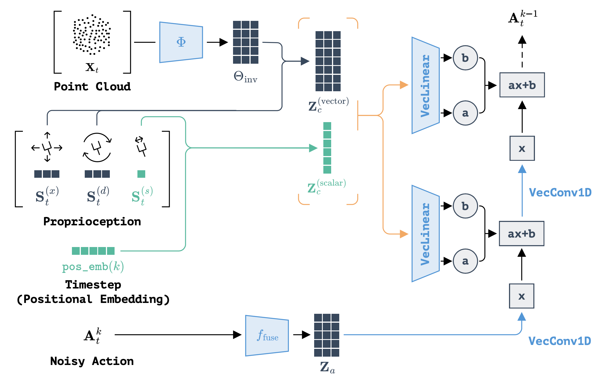

## 第一阶段：源头（初始化）

### 起始状态（$\mathbf{x}_T$）
整个过程始于从标准高斯分布 $\mathcal{N}(0, 1)$ 中采样的一个随机张量。

- **形状**：`[Batch, Action_Dim, 3, Horizon]`  
  - `Action_Dim`：通道数  
  - `3`：几何维度（x, y, z）  
  - `Horizon`：时间步长
- **含义**：纯粹的、无结构的噪声。可以把它们想象成指向随机方向的 3D 箭头。它们具有“球面对称性”（各向同性），意味着它们还分不清哪里是“上”，哪里是“前”。

---

## 第二阶段：瀑布（去噪循环）

系统进入一个运行 $K$ 步（例如 100 步）的循环。在每一步 $k$，网络接收带噪声的动作 $\mathbf{x}_k$，并利用环境信息作为“指南针”来对其进行“雕刻”。

---

### 步骤 2.1：观测处理（指南针）

在触碰噪声之前，网络首先处理环境信息，以明确该“雕刻”什么。

- **输入**：点云（$P$）和机器人本体感知（$S$）

#### 编码（SIM(3) 编码器）
- **质心（$\mu$）& 尺度（$\sigma$）**：根据点云计算得出，用于将世界归一化到一个标准的“单位空间”（Canonical Unit Box）中。
- **向量特征（$Z$）**：通过 VecPointNet 提取的 3D 特征向量。关键点：如果物体旋转，这些特征向量也会自动跟着旋转。

#### 构建条件向量（$C_{obs}$）
- 将机器人的状态进行平移/缩放（使用 $\mu, \sigma$），以匹配点云的坐标系。
- 将其与 $Z$ 堆叠，形成条件向量（$C_{obs}$）。

---

### 步骤 2.2：动作准备（输入流）

现在，带噪声的动作 $\mathbf{x}_k$ 进入流水线。

- **归一化**：动作向量同样使用 $\mu$ 和 $\sigma$ 进行中心化和缩放，这样网络看到的动作就处于与点云相同的“标准坐标系”中。
- **重塑形状（Reshaping）**：张量维度被重新排列为 `[Batch, Channels, 3, Horizon]`，为进入 U-Net 做准备。

---

### 步骤 2.3：网络穿行（“积木”内部）

噪声流经 **条件 U-Net（Conditional U-Net）**。U-Net 由层层堆叠的 **残差块（VecConditionalResidualBlock1D）** 组成。

为了理解调制（Modulation）具体是如何工作的，我们必须剖析单个残差块的内部，看看两条并行的数据流是如何汇合的。

---

#### 支流 A：特征引擎（产生 $F$）

首先，网络观察带噪声的轨迹 $\mathbf{x}$，提取几何模式（如“曲率”或“加速度”），此刻它暂时忽略物体。

- **输入**：带噪声的轨迹 $\mathbf{x}$

##### “Batch 技巧”（折叠）
标准的卷积层不懂 3D 旋转。为了解决这个问题，代码将 3 个空间维度（$x, y, z$）堆叠到了 Batch（批次）维度中：

$$
[Batch, Ch, 3, Time] \rightarrow [Batch \cdot 3, Ch, Time]
$$

##### 卷积（Convolution）
一个标准的 1D 卷积在“时间”维度上滑动。

- **为什么？**  
  因为我们折叠了维度，完全相同的权重被分别应用到了 X、Y 和 Z 上。这确保了网络平等地对待所有空间方向。

##### 展开（Unfolding）
将张量重塑回 3D 结构。

##### 向量激活（Vector Activation）
非线性激活函数（Mish）仅作用于向量的模长（magnitude），而保留其方向不变。

- **结果（$F$）**：这个输出就是 $F$（特征图）。它仅基于当前的轨迹，代表了“动作的形状”。

---

#### 支流 B：指令生成器（产生 $\gamma, \beta$）

与此同时，网络观察来自步骤 2.1 的条件向量 $C_{obs}$，以决定如何修改动作。

- **输入**：环境上下文 $C_{obs}$
- **层**：一个 VecLinear（向量线性层）处理这个上下文。

- **结果（$\gamma, \beta$）**：它预测出两个具体的张量：
  - **缩放（$\gamma$）**：一个标量值。含义：“这个物体很小，所以把动作幅度收一点。”
  - **平移（$\beta$）**：一个 3D 向量。含义：“把手在左边，所以把动作往左推。”

---

#### 支流 C：注入（FiLM 调制）

现在，指令（$\gamma, \beta$）与动作特征（$F$）发生碰撞：

$$
F_{new} = (F \cdot \gamma) + \beta
$$

- **$F \cdot \gamma$（缩放）**：轨迹特征被放大或抑制。
- **$+\beta$（平移）**：轨迹特征在 3D 空间中被物理推移，以对齐物体。

**等变性（Equivariance）**：因为 $\beta$ 来自旋转后的点云，如果物理世界中的杯子旋转了，$\beta$ 也会随之旋转。这迫使整个规划出的轨迹 $F$ 自动跟随旋转。

---

### 步骤 2.4：梯度预测（$\epsilon_\theta$）

- **输出**：经过所有模块后，U-Net 输出一个张量 $\epsilon_\theta$。
- **含义**：这是噪声梯度。它告诉系统：“为了让这个动作看起来像一个有效的机器人动作，请把向量往那个方向移动这么多。”

---

### 步骤 2.5：更新规则（雕刻）

系统使用 DDPM 公式计算下一步 $\mathbf{x}_{k-1}$：

- **减去噪声**：从当前状态中移除预测出的噪声 $\epsilon_\theta$。
- **增加随机性**：加入少量的、新的高斯噪声（按 $\sigma_t$ 缩放），以保持过程的鲁棒性。

---

## 第三阶段：终点（最终输出）

### 最终状态（$\mathbf{x}_0$）
循环 $K$ 次后，噪声被完全移除。结果是一条干净的轨迹。

- **反归一化**：这条轨迹目前还处于“标准单位空间”中。需要乘以 $\sigma$（尺度）并加上 $\mu$（质心），将其放回现实世界的工作空间坐标中。
- **执行**：这条干净的、具有 SIM(3) 等变性 的轨迹被发送给机器人控制器执行。

---

---

## EquiBot 的 SE(3) 等变性机制详解

EquiBot 保证 SE(3) 等变性（即：当物体平移或旋转时，生成的轨迹也会精确地随之平移或旋转）的机制非常巧妙。

它并不是像传统方法那样靠“看过很多旋转的照片”（数据增强）来学会旋转的，而是通过网络架构的设计（数学硬编码），从根本上强制保证了这一点。简单来说：因为数学公式被锁死了，网络想不“等变”都不行。

SE(3) 包含 **平移（Translation）** 和 **旋转（Rotation）**。EquiBot 用两套完全不同的机制来分别搞定它们。

---

### 1. 如何保证平移等变？（Translation Equivariance）

**核心机制：相对坐标系（Relative Coordinates）**

网络永远不知道物体在桌子上的绝对位置（比如 x=100, y=200）。它只看“相对”位置。

#### 步骤 A（进门前 - 归零）
代码（`sim3_encoder.py`）首先计算点云的质心（Centroid，$\mu$）。然后，它把所有的输入数据（点云、机器人当前位置）都减去这个质心。

$$
\text{输入}_{local} = \text{原始坐标}_{world} - \mu
$$

**效果**：不管物体在桌子上怎么移动，在网络眼里，物体永远都在 $(0,0,0)$ 原点。

#### 步骤 B（出门后 - 还原）
网络在原点规划好动作后，系统再把刚才减去的质心 $\mu$ 加回去。

$$
\text{最终动作}_{world} = \text{网络输出}_{local} + \mu
$$

**结论**：如果物体向右移了 1 米，质心 $\mu$ 也向右移 1 米。虽然网络输出的相对动作没变，但最后加上 $\mu$ 后，最终动作自然就向右移了 1 米。

---

### 2. 如何保证旋转等变？（Rotation Equivariance）

**核心机制：向量神经元 + 权重共享（The Batch Trick）**

这是最难的部分。普通神经网络（如 ResNet）把 $(x, y, z)$ 当作三个独立的数字，一旦旋转，数字全变了（x 变成了 y），网络就懵了。

EquiBot 在网络内部制定了三条严格的“戒律”，强制网络对方向保持“色盲”（各向同性）：

#### 戒律 1：数据结构——神圣的“3”
在整个网络里，数据的形状永远是 `[Batch, Channels, 3, Horizon]`。

那个 `3` 代表 $(x, y, z)$ 几何维度。代码严禁把这 3 个维度合并或打乱。网络处理的最小单位是向量，而不是标量。

#### 戒律 2：卷积层——Batch 技巧（The Batch Trick）
这是代码中最精彩的一笔（`conv1d_components.py`）。U-Net 需要在时间轴上做卷积。为了保证卷积核不会偏心（比如“只关注 x 轴的变化”），代码做了一个“欺骗”操作：

- **折叠（Folding）**：把 3 个空间维度，强行塞进 Batch 维度里：
  $$
  [Batch, Channel, 3, Time] \rightarrow [Batch \cdot 3, Channel, Time]
  $$
- **卷积**：进行标准的 1D 卷积。
- **原理**：因为 x, y, z 现在被当成了不同的样本，PyTorch 会被迫对它们使用完全相同的卷积权重。
- **展开**：恢复回 3D 结构。

**结果**：网络对 x 轴、y 轴、z 轴的处理逻辑是完全共享的。它无法区分方向，因此不可能学会“垂直方向特殊处理”这种会破坏旋转等变的逻辑。

#### 戒律 3：线性层与激活——只看模长
- **线性层（VecLinear）**：普通的全连接层矩阵 $W$ 会混合所有输入。EquiBot 的线性层权重 $W$ 只是标量，只混合通道（Channel），绝不混合坐标。  
  公式：$\vec{y} = W \cdot \vec{x}$。如果输入 $\vec{x}$ 转了，输出 $\vec{y}$ 也会跟着转。
- **激活函数（VecActivation）**：普通的 ReLU 会把负数变成 0（破坏方向）。EquiBot 只看向量的长度（Magnitude）。  
  逻辑：“如果这个向量很长，就保留；如果不长，就缩短。”  
  方向本身完全不被修改，所以旋转等变性得以保留。

---

### 3. 旋转是如何“传导”的？（FiLM 调制）

你可能会问：“既然噪声是球形的（没方向），网络又是各向同性的（没偏见），那最终的动作怎么知道往哪里转？”

答案在于 FiLM 调制这一步：

$$
F_{new} = (F \cdot \gamma) + \beta
$$

- **$F$（动作流）**：它是各向同性的，没有方向感（来自噪声）。
- **$\beta$（指令流）**：这是一个向量。它是从点云（Point Cloud）中提取出来的。

因为提取点云特征的编码器（VecPointNet）也是严格遵守上述戒律的，所以如果点云旋转了 $R$，这个 $\beta$ 向量也会精确地旋转 $R$。

最终结局：

$$
\text{旋转后的动作} = (\text{无方向的噪声} \cdot \text{标量}) + \text{旋转后的偏移向量}(\beta)
$$

$\beta$ 就像一个有方向的磁铁。当它注入到无方向的 $F$ 中时，它不仅告诉了动作“去哪里”，也赋予了动作“朝向哪里”。因为 $\beta$ 随物体旋转，所以最终生成的轨迹也就自动随物体旋转了。