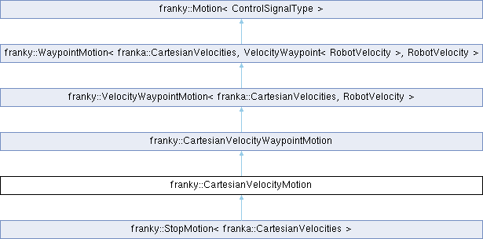

<table>
<colgroup>
<col style="width: 100%" />
</colgroup>
<tbody>
<tr class="odd">
<td>

franky 1.1.3

A High-Level Motion API for Franka

</td>
</tr>
</tbody>
</table>

Loading...

Searching...

No Matches

  - [franky](namespacefranky.md)
  - [CartesianVelocityMotion](classfranky_1_1_cartesian_velocity_motion.md)

[Public Member Functions](classfranky_1_1_cartesian_velocity_motion.md#pub-methods) | [List of all members](classfranky_1_1_cartesian_velocity_motion-members.md)

franky::CartesianVelocityMotion Class Reference

Cartesian velocity motion with a single target velocity. [More...](classfranky_1_1_cartesian_velocity_motion.md#details)

`#include <cartesian_velocity_motion.hpp>`

Inheritance diagram for franky::CartesianVelocityMotion:

##  Public Member Functions

 

[CartesianVelocityMotion](classfranky_1_1_cartesian_velocity_motion.md#a7495a708837dc9198513dcf8a7e780d2) ([const](namespacefranky.md#a0b6bfc825c262ae89d9b0adcccd97ab0) [RobotVelocity](classfranky_1_1_robot_velocity.md) \&target, [const](namespacefranky.md#a0b6bfc825c262ae89d9b0adcccd97ab0) franka::Duration &[duration](namespacefranky.md#a0b6bfc825c262ae89d9b0adcccd97ab0)=franka::Duration(1000), [const](namespacefranky.md#a0b6bfc825c262ae89d9b0adcccd97ab0) [RelativeDynamicsFactor](classfranky_1_1_relative_dynamics_factor.md) \&relative\_dynamics\_factor=1.0, [const](namespacefranky.md#a0b6bfc825c262ae89d9b0adcccd97ab0) [Affine](namespacefranky.md#afab9faf133666ada543b15236a8c4b5f) &[frame](namespacefranky.md#a0b6bfc825c262ae89d9b0adcccd97ab0)=Affine::Identity())

 

Construct a Cartesian motion.  

 

 Public Member Functions inherited from [franky::CartesianVelocityWaypointMotion](classfranky_1_1_cartesian_velocity_waypoint_motion.md)

 

[CartesianVelocityWaypointMotion](classfranky_1_1_cartesian_velocity_waypoint_motion.md#aaa63e51c2a4e35a52ec6c0b99b24603f) ([const](namespacefranky.md#a0b6bfc825c262ae89d9b0adcccd97ab0) std::vector\< [VelocityWaypoint](namespacefranky.md#a7af3aea8bf2e7bc0f366814328c1fb32)\< [RobotVelocity](classfranky_1_1_robot_velocity.md) \> \> &[waypoints](namespacefranky.md#a0b6bfc825c262ae89d9b0adcccd97ab0), [const](namespacefranky.md#a0b6bfc825c262ae89d9b0adcccd97ab0) [RelativeDynamicsFactor](classfranky_1_1_relative_dynamics_factor.md) \&relative\_dynamics\_factor=1.0, [Affine](namespacefranky.md#afab9faf133666ada543b15236a8c4b5f) [ee\_frame](namespacefranky.md#a0b6bfc825c262ae89d9b0adcccd97ab0)=Affine::Identity())

 

 Public Member Functions inherited from [franky::VelocityWaypointMotion\< franka::CartesianVelocities, RobotVelocity \>](classfranky_1_1_velocity_waypoint_motion.md)

 

[VelocityWaypointMotion](classfranky_1_1_velocity_waypoint_motion.md#aa7cb87ffe6b03a25bf14efbb3e547405) (std::vector\< [VelocityWaypoint](namespacefranky.md#a7af3aea8bf2e7bc0f366814328c1fb32)\< [RobotVelocity](classfranky_1_1_robot_velocity.md) \> \> waypoints, const [RelativeDynamicsFactor](classfranky_1_1_relative_dynamics_factor.md) \&relative\_dynamics\_factor=1.0)

 

 Public Member Functions inherited from [franky::WaypointMotion\< ControlSignalType, WaypointType, TargetType \>](classfranky_1_1_waypoint_motion.md)

 

[WaypointMotion](classfranky_1_1_waypoint_motion.md#a53c26db8057d1048efafe5a38a372f77) (std::vector\< [WaypointType](namespacefranky.md#a0b6bfc825c262ae89d9b0adcccd97ab0) \> [waypoints](namespacefranky.md#a0b6bfc825c262ae89d9b0adcccd97ab0), [bool](namespacefranky.md#a0b6bfc825c262ae89d9b0adcccd97ab0) return\_when\_finished=[true](namespacefranky.md#a0b6bfc825c262ae89d9b0adcccd97ab0))

 

 Public Member Functions inherited from [franky::Motion\< ControlSignalType \>](classfranky_1_1_motion.md)

[virtual](namespacefranky.md#a0b6bfc825c262ae89d9b0adcccd97ab0) 

[\~Motion](classfranky_1_1_motion.md#aa6d72b7a606055fc444bf2da0c463d16) ()=[default](namespacefranky.md#a0b6bfc825c262ae89d9b0adcccd97ab0)

 

[void](namespacefranky.md#a0b6bfc825c262ae89d9b0adcccd97ab0) 

[addReaction](classfranky_1_1_motion.md#a52f0efb3e6c876f480eceb75a18d7448) (std::shared\_ptr\< [Reaction](classfranky_1_1_reaction.md)\< [ControlSignalType](namespacefranky.md#a9a12fea9c3341e3437af837efe8ebaac) \> \> [reaction](namespacefranky.md#a0b6bfc825c262ae89d9b0adcccd97ab0))

 

Add a reaction to the motion.  

 

[void](namespacefranky.md#a0b6bfc825c262ae89d9b0adcccd97ab0) 

[addReactionFront](classfranky_1_1_motion.md#a8fdbf32e0808fb2f01514f83ee964347) (std::shared\_ptr\< [Reaction](classfranky_1_1_reaction.md)\< [ControlSignalType](namespacefranky.md#a9a12fea9c3341e3437af837efe8ebaac) \> \> [reaction](namespacefranky.md#a0b6bfc825c262ae89d9b0adcccd97ab0))

 

Add a reaction to the front of the reaction list.  

 

std::vector\< std::shared\_ptr\< [Reaction](classfranky_1_1_reaction.md)\< [ControlSignalType](namespacefranky.md#a9a12fea9c3341e3437af837efe8ebaac) \> \> \> 

[reactions](classfranky_1_1_motion.md#aed40663a195eb68318799d19451c5a0d) ()

 

Currently registered reactions of the motion.  

 

[void](namespacefranky.md#a0b6bfc825c262ae89d9b0adcccd97ab0) 

[registerCallback](classfranky_1_1_motion.md#a05ed2a4f6dbcd406f9298a7c8e4e76c2) ([CallbackType](classfranky_1_1_motion.md#aabc4cfc38ed77466ca94be5b1c38fc6c) [callback](namespacefranky.md#a0b6bfc825c262ae89d9b0adcccd97ab0))

 

Register a callback that is called in every step of the motion.  

 

[void](namespacefranky.md#a0b6bfc825c262ae89d9b0adcccd97ab0) 

[init](classfranky_1_1_motion.md#a3780f86a0c58bdfb959e4d9bb65179d6) ([Robot](classfranky_1_1_robot.md) \*[robot](classfranky_1_1_motion.md#a4a279dafcbb7ae10605f58d27a3a368f), [const](namespacefranky.md#a0b6bfc825c262ae89d9b0adcccd97ab0) [RobotState](structfranky_1_1_robot_state.md) &[robot\_state](namespacefranky.md#a0b6bfc825c262ae89d9b0adcccd97ab0), [const](namespacefranky.md#a0b6bfc825c262ae89d9b0adcccd97ab0) std::optional\< [ControlSignalType](namespacefranky.md#a9a12fea9c3341e3437af837efe8ebaac) \> &[previous\_command](namespacefranky.md#a0b6bfc825c262ae89d9b0adcccd97ab0))

 

Initialize the motion.  

 

[ControlSignalType](namespacefranky.md#a9a12fea9c3341e3437af837efe8ebaac) 

[nextCommand](classfranky_1_1_motion.md#abc04c5fe350635cf36bc1e459736ddb7) ([const](namespacefranky.md#a0b6bfc825c262ae89d9b0adcccd97ab0) [RobotState](structfranky_1_1_robot_state.md) &[robot\_state](namespacefranky.md#a0b6bfc825c262ae89d9b0adcccd97ab0), franka::Duration [time\_step](namespacefranky.md#a0b6bfc825c262ae89d9b0adcccd97ab0), franka::Duration [rel\_time](namespacefranky.md#a0b6bfc825c262ae89d9b0adcccd97ab0), franka::Duration [abs\_time](namespacefranky.md#a0b6bfc825c262ae89d9b0adcccd97ab0), [const](namespacefranky.md#a0b6bfc825c262ae89d9b0adcccd97ab0) std::optional\< [ControlSignalType](namespacefranky.md#a9a12fea9c3341e3437af837efe8ebaac) \> &[previous\_command](namespacefranky.md#a0b6bfc825c262ae89d9b0adcccd97ab0))

 

Get the next command of the motion.  

 

std::shared\_ptr\< [Motion](classfranky_1_1_motion.md)\< [ControlSignalType](namespacefranky.md#a9a12fea9c3341e3437af837efe8ebaac) \> \> 

[checkAndCallReactions](classfranky_1_1_motion.md#a2a0e78863021c3c2116c8500c9386369) ([const](namespacefranky.md#a0b6bfc825c262ae89d9b0adcccd97ab0) [RobotState](structfranky_1_1_robot_state.md) &[robot\_state](namespacefranky.md#a0b6bfc825c262ae89d9b0adcccd97ab0), franka::Duration [rel\_time](namespacefranky.md#a0b6bfc825c262ae89d9b0adcccd97ab0), franka::Duration [abs\_time](namespacefranky.md#a0b6bfc825c262ae89d9b0adcccd97ab0))

 

Check and call reactions.  

 

##  Additional Inherited Members

 Public Types inherited from [franky::Motion\< ControlSignalType \>](classfranky_1_1_motion.md)

[using](namespacefranky.md#a0b6bfc825c262ae89d9b0adcccd97ab0) 

[CallbackType](classfranky_1_1_motion.md#aabc4cfc38ed77466ca94be5b1c38fc6c) = std::function\< [void](namespacefranky.md#a0b6bfc825c262ae89d9b0adcccd97ab0)([const](namespacefranky.md#a0b6bfc825c262ae89d9b0adcccd97ab0) [RobotState](structfranky_1_1_robot_state.md) &, franka::Duration, franka::Duration, franka::Duration, [const](namespacefranky.md#a0b6bfc825c262ae89d9b0adcccd97ab0) [ControlSignalType](namespacefranky.md#a9a12fea9c3341e3437af837efe8ebaac) &)\>

 

 Protected Member Functions inherited from [franky::CartesianVelocityWaypointMotion](classfranky_1_1_cartesian_velocity_waypoint_motion.md)

[void](namespacefranky.md#a0b6bfc825c262ae89d9b0adcccd97ab0) 

[checkWaypoint](classfranky_1_1_cartesian_velocity_waypoint_motion.md#a4483e5bd364018e5d3ec8dff2eaa1302) ([const](namespacefranky.md#a0b6bfc825c262ae89d9b0adcccd97ab0) [VelocityWaypoint](namespacefranky.md#a7af3aea8bf2e7bc0f366814328c1fb32)\< [RobotVelocity](classfranky_1_1_robot_velocity.md) \> &[waypoint](namespacefranky.md#a0b6bfc825c262ae89d9b0adcccd97ab0)) [const](namespacefranky.md#a0b6bfc825c262ae89d9b0adcccd97ab0) [override](namespacefranky.md#a0b6bfc825c262ae89d9b0adcccd97ab0)

 

[void](namespacefranky.md#a0b6bfc825c262ae89d9b0adcccd97ab0) 

[initWaypointMotion](classfranky_1_1_cartesian_velocity_waypoint_motion.md#a4510ec8c4652cffede4dfabbe57b9124) ([const](namespacefranky.md#a0b6bfc825c262ae89d9b0adcccd97ab0) [RobotState](structfranky_1_1_robot_state.md) &[robot\_state](namespacefranky.md#a0b6bfc825c262ae89d9b0adcccd97ab0), [const](namespacefranky.md#a0b6bfc825c262ae89d9b0adcccd97ab0) std::optional\< franka::CartesianVelocities \> &[previous\_command](namespacefranky.md#a0b6bfc825c262ae89d9b0adcccd97ab0), ruckig::InputParameter\< 7 \> &[input\_parameter](namespacefranky.md#a0b6bfc825c262ae89d9b0adcccd97ab0)) [override](namespacefranky.md#a0b6bfc825c262ae89d9b0adcccd97ab0)

 

[void](namespacefranky.md#a0b6bfc825c262ae89d9b0adcccd97ab0) 

[setNewWaypoint](classfranky_1_1_cartesian_velocity_waypoint_motion.md#ac18036425bdc30192fbb9d2b8152dd5a) ([const](namespacefranky.md#a0b6bfc825c262ae89d9b0adcccd97ab0) [RobotState](structfranky_1_1_robot_state.md) &[robot\_state](namespacefranky.md#a0b6bfc825c262ae89d9b0adcccd97ab0), [const](namespacefranky.md#a0b6bfc825c262ae89d9b0adcccd97ab0) std::optional\< franka::CartesianVelocities \> &[previous\_command](namespacefranky.md#a0b6bfc825c262ae89d9b0adcccd97ab0), [const](namespacefranky.md#a0b6bfc825c262ae89d9b0adcccd97ab0) [VelocityWaypoint](namespacefranky.md#a7af3aea8bf2e7bc0f366814328c1fb32)\< [RobotVelocity](classfranky_1_1_robot_velocity.md) \> &[new\_waypoint](namespacefranky.md#a0b6bfc825c262ae89d9b0adcccd97ab0), ruckig::InputParameter\< 7 \> &[input\_parameter](namespacefranky.md#a0b6bfc825c262ae89d9b0adcccd97ab0)) [override](namespacefranky.md#a0b6bfc825c262ae89d9b0adcccd97ab0)

 

std::tuple\< [Vector7d](namespacefranky.md#a4c36e6539a78f808bf759142dec935c4), [Vector7d](namespacefranky.md#a4c36e6539a78f808bf759142dec935c4), [Vector7d](namespacefranky.md#a4c36e6539a78f808bf759142dec935c4) \> 

[getAbsoluteInputLimits](classfranky_1_1_cartesian_velocity_waypoint_motion.md#a8653d525b32035e8b774da7b7fb6051e) () [const](namespacefranky.md#a0b6bfc825c262ae89d9b0adcccd97ab0) [override](namespacefranky.md#a0b6bfc825c262ae89d9b0adcccd97ab0)

 

franka::CartesianVelocities 

[getControlSignal](classfranky_1_1_cartesian_velocity_waypoint_motion.md#a30fda0c7c073a4017dc7606517cec045) ([const](namespacefranky.md#a0b6bfc825c262ae89d9b0adcccd97ab0) [RobotState](structfranky_1_1_robot_state.md) &[robot\_state](namespacefranky.md#a0b6bfc825c262ae89d9b0adcccd97ab0), [const](namespacefranky.md#a0b6bfc825c262ae89d9b0adcccd97ab0) franka::Duration &[time\_step](namespacefranky.md#a0b6bfc825c262ae89d9b0adcccd97ab0), [const](namespacefranky.md#a0b6bfc825c262ae89d9b0adcccd97ab0) std::optional\< franka::CartesianVelocities \> &[previous\_command](namespacefranky.md#a0b6bfc825c262ae89d9b0adcccd97ab0), [const](namespacefranky.md#a0b6bfc825c262ae89d9b0adcccd97ab0) ruckig::InputParameter\< 7 \> &[input\_parameter](namespacefranky.md#a0b6bfc825c262ae89d9b0adcccd97ab0)) [override](namespacefranky.md#a0b6bfc825c262ae89d9b0adcccd97ab0)

 

std::tuple\< [Vector7d](namespacefranky.md#a4c36e6539a78f808bf759142dec935c4), [Vector7d](namespacefranky.md#a4c36e6539a78f808bf759142dec935c4), [Vector7d](namespacefranky.md#a4c36e6539a78f808bf759142dec935c4) \> 

[getDesiredState](classfranky_1_1_cartesian_velocity_waypoint_motion.md#acd98010a20c95678d57f47829073ce3d) ([const](namespacefranky.md#a0b6bfc825c262ae89d9b0adcccd97ab0) [RobotState](structfranky_1_1_robot_state.md) &[robot\_state](namespacefranky.md#a0b6bfc825c262ae89d9b0adcccd97ab0)) [const](namespacefranky.md#a0b6bfc825c262ae89d9b0adcccd97ab0) [override](namespacefranky.md#a0b6bfc825c262ae89d9b0adcccd97ab0)

 

 Protected Member Functions inherited from [franky::VelocityWaypointMotion\< franka::CartesianVelocities, RobotVelocity \>](classfranky_1_1_velocity_waypoint_motion.md)

void 

[setInputLimits](classfranky_1_1_velocity_waypoint_motion.md#a1cfd2cbfa762565d6d95a9db2d911fba) (const [VelocityWaypoint](namespacefranky.md#a7af3aea8bf2e7bc0f366814328c1fb32)\< [RobotVelocity](classfranky_1_1_robot_velocity.md) \> \&waypoint, ruckig::InputParameter\< 7 \> \&input\_parameter) const override

 

void 

[extrapolateMotion](classfranky_1_1_velocity_waypoint_motion.md#aca3cabe4405f7132c4001388d248cc67) (const [RobotState](structfranky_1_1_robot_state.md) \&robot\_state, const franka::Duration \&time\_step, const ruckig::InputParameter\< 7 \> \&input\_parameter, ruckig::OutputParameter\< 7 \> \&output\_parameter) const override

 

 Protected Member Functions inherited from [franky::WaypointMotion\< ControlSignalType, WaypointType, TargetType \>](classfranky_1_1_waypoint_motion.md)

[void](namespacefranky.md#a0b6bfc825c262ae89d9b0adcccd97ab0) 

[initImpl](classfranky_1_1_waypoint_motion.md#ada8edd9d849ee29244b6c2c1cfa30f69) ([const](namespacefranky.md#a0b6bfc825c262ae89d9b0adcccd97ab0) [RobotState](structfranky_1_1_robot_state.md) &[robot\_state](namespacefranky.md#a0b6bfc825c262ae89d9b0adcccd97ab0), [const](namespacefranky.md#a0b6bfc825c262ae89d9b0adcccd97ab0) std::optional\< [ControlSignalType](namespacefranky.md#a9a12fea9c3341e3437af837efe8ebaac) \> &[previous\_command](namespacefranky.md#a0b6bfc825c262ae89d9b0adcccd97ab0)) [override](namespacefranky.md#a0b6bfc825c262ae89d9b0adcccd97ab0)

 

[ControlSignalType](namespacefranky.md#a9a12fea9c3341e3437af837efe8ebaac) 

[nextCommandImpl](classfranky_1_1_waypoint_motion.md#ade5d803c15b7f55e55258092788df21b) ([const](namespacefranky.md#a0b6bfc825c262ae89d9b0adcccd97ab0) [RobotState](structfranky_1_1_robot_state.md) &[robot\_state](namespacefranky.md#a0b6bfc825c262ae89d9b0adcccd97ab0), franka::Duration [time\_step](namespacefranky.md#a0b6bfc825c262ae89d9b0adcccd97ab0), franka::Duration [rel\_time](namespacefranky.md#a0b6bfc825c262ae89d9b0adcccd97ab0), franka::Duration [abs\_time](namespacefranky.md#a0b6bfc825c262ae89d9b0adcccd97ab0), [const](namespacefranky.md#a0b6bfc825c262ae89d9b0adcccd97ab0) std::optional\< [ControlSignalType](namespacefranky.md#a9a12fea9c3341e3437af837efe8ebaac) \> &[previous\_command](namespacefranky.md#a0b6bfc825c262ae89d9b0adcccd97ab0)) [override](namespacefranky.md#a0b6bfc825c262ae89d9b0adcccd97ab0)

 

[virtual](namespacefranky.md#a0b6bfc825c262ae89d9b0adcccd97ab0) [void](namespacefranky.md#a0b6bfc825c262ae89d9b0adcccd97ab0) 

[initWaypointMotion](classfranky_1_1_waypoint_motion.md#a2af18e1bfe76ed4e88f87ba03fe04fd8) ([const](namespacefranky.md#a0b6bfc825c262ae89d9b0adcccd97ab0) [RobotState](structfranky_1_1_robot_state.md) &[robot\_state](namespacefranky.md#a0b6bfc825c262ae89d9b0adcccd97ab0), [const](namespacefranky.md#a0b6bfc825c262ae89d9b0adcccd97ab0) std::optional\< [ControlSignalType](namespacefranky.md#a9a12fea9c3341e3437af837efe8ebaac) \> &[previous\_command](namespacefranky.md#a0b6bfc825c262ae89d9b0adcccd97ab0), ruckig::InputParameter\< 7 \> &[input\_parameter](namespacefranky.md#a0b6bfc825c262ae89d9b0adcccd97ab0))=0

 

[virtual](namespacefranky.md#a0b6bfc825c262ae89d9b0adcccd97ab0) [void](namespacefranky.md#a0b6bfc825c262ae89d9b0adcccd97ab0) 

[setNewWaypoint](classfranky_1_1_waypoint_motion.md#aac84c2b66a185a3c21380a395cc49ae0) ([const](namespacefranky.md#a0b6bfc825c262ae89d9b0adcccd97ab0) [RobotState](structfranky_1_1_robot_state.md) &[robot\_state](namespacefranky.md#a0b6bfc825c262ae89d9b0adcccd97ab0), [const](namespacefranky.md#a0b6bfc825c262ae89d9b0adcccd97ab0) std::optional\< [ControlSignalType](namespacefranky.md#a9a12fea9c3341e3437af837efe8ebaac) \> &[previous\_command](namespacefranky.md#a0b6bfc825c262ae89d9b0adcccd97ab0), [const](namespacefranky.md#a0b6bfc825c262ae89d9b0adcccd97ab0) [WaypointType](namespacefranky.md#a0b6bfc825c262ae89d9b0adcccd97ab0) &[new\_waypoint](namespacefranky.md#a0b6bfc825c262ae89d9b0adcccd97ab0), ruckig::InputParameter\< 7 \> &[input\_parameter](namespacefranky.md#a0b6bfc825c262ae89d9b0adcccd97ab0))=0

 

[virtual](namespacefranky.md#a0b6bfc825c262ae89d9b0adcccd97ab0) [void](namespacefranky.md#a0b6bfc825c262ae89d9b0adcccd97ab0) 

[checkWaypoint](classfranky_1_1_waypoint_motion.md#a9d8d450f3d2748cc32eb6bd2afd6f46c) ([const](namespacefranky.md#a0b6bfc825c262ae89d9b0adcccd97ab0) [WaypointType](namespacefranky.md#a0b6bfc825c262ae89d9b0adcccd97ab0) &[waypoint](namespacefranky.md#a0b6bfc825c262ae89d9b0adcccd97ab0)) [const](namespacefranky.md#a0b6bfc825c262ae89d9b0adcccd97ab0)

 

[virtual](namespacefranky.md#a0b6bfc825c262ae89d9b0adcccd97ab0) [ControlSignalType](namespacefranky.md#a9a12fea9c3341e3437af837efe8ebaac) 

[getControlSignal](classfranky_1_1_waypoint_motion.md#aa019aeb70e7bc53a5a95a8ac2e2b62eb) ([const](namespacefranky.md#a0b6bfc825c262ae89d9b0adcccd97ab0) [RobotState](structfranky_1_1_robot_state.md) &[robot\_state](namespacefranky.md#a0b6bfc825c262ae89d9b0adcccd97ab0), [const](namespacefranky.md#a0b6bfc825c262ae89d9b0adcccd97ab0) franka::Duration &[time\_step](namespacefranky.md#a0b6bfc825c262ae89d9b0adcccd97ab0), [const](namespacefranky.md#a0b6bfc825c262ae89d9b0adcccd97ab0) std::optional\< [ControlSignalType](namespacefranky.md#a9a12fea9c3341e3437af837efe8ebaac) \> &[previous\_command](namespacefranky.md#a0b6bfc825c262ae89d9b0adcccd97ab0), [const](namespacefranky.md#a0b6bfc825c262ae89d9b0adcccd97ab0) ruckig::InputParameter\< 7 \> &[input\_parameter](namespacefranky.md#a0b6bfc825c262ae89d9b0adcccd97ab0))=0

 

[virtual](namespacefranky.md#a0b6bfc825c262ae89d9b0adcccd97ab0) [void](namespacefranky.md#a0b6bfc825c262ae89d9b0adcccd97ab0) 

[setInputLimits](classfranky_1_1_waypoint_motion.md#a4a54f0791590e317159518eb0353a199) ([const](namespacefranky.md#a0b6bfc825c262ae89d9b0adcccd97ab0) [WaypointType](namespacefranky.md#a0b6bfc825c262ae89d9b0adcccd97ab0) &[waypoint](namespacefranky.md#a0b6bfc825c262ae89d9b0adcccd97ab0), ruckig::InputParameter\< 7 \> &[input\_parameter](namespacefranky.md#a0b6bfc825c262ae89d9b0adcccd97ab0)) [const](namespacefranky.md#a0b6bfc825c262ae89d9b0adcccd97ab0) =0

 

 Protected Member Functions inherited from [franky::Motion\< ControlSignalType \>](classfranky_1_1_motion.md)

 

[Motion](classfranky_1_1_motion.md#ab18f33f97f86e9fb838fb6d6d79915b4) ()

 

[Robot](classfranky_1_1_robot.md) \* 

[robot](classfranky_1_1_motion.md#a4a279dafcbb7ae10605f58d27a3a368f) () [const](namespacefranky.md#a0b6bfc825c262ae89d9b0adcccd97ab0)

 

## Detailed Description

Cartesian velocity motion with a single target velocity.

## Constructor & Destructor Documentation

## [◆ ](classfranky_1_1_cartesian_velocity_motion.md#a7495a708837dc9198513dcf8a7e780d2)CartesianVelocityMotion()

<table>
<colgroup>
<col style="width: 50%" />
<col style="width: 50%" />
</colgroup>
<tbody>
<tr class="odd">
<td><table>
<tbody>
<tr class="odd">
<td>franky::CartesianVelocityMotion::CartesianVelocityMotion</td>
<td>(</td>
<td><a href="namespacefranky.md#a0b6bfc825c262ae89d9b0adcccd97ab0" class="el">const</a> <a href="classfranky_1_1_robot_velocity.md" class="el">RobotVelocity</a> &amp; </td>
<td><em>target</em>,</td>
</tr>
<tr class="even">
<td></td>
<td></td>
<td><a href="namespacefranky.md#a0b6bfc825c262ae89d9b0adcccd97ab0" class="el">const</a> franka::Duration &amp; </td>
<td><em>duration</em> = <code>franka::Duration(1000)</code>,</td>
</tr>
<tr class="odd">
<td></td>
<td></td>
<td><a href="namespacefranky.md#a0b6bfc825c262ae89d9b0adcccd97ab0" class="el">const</a> <a href="classfranky_1_1_relative_dynamics_factor.md" class="el">RelativeDynamicsFactor</a> &amp; </td>
<td><em>relative_dynamics_factor</em> = <code>1.0</code>,</td>
</tr>
<tr class="even">
<td></td>
<td></td>
<td><a href="namespacefranky.md#a0b6bfc825c262ae89d9b0adcccd97ab0" class="el">const</a> <a href="namespacefranky.md#afab9faf133666ada543b15236a8c4b5f" class="el">Affine</a> &amp; </td>
<td><em>frame</em> = <code>Affine::Identity()</code> </td>
</tr>
<tr class="odd">
<td></td>
<td>)</td>
<td></td>
<td></td>
</tr>
</tbody>
</table></td>
<td>explicit</td>
</tr>
</tbody>
</table>

Construct a Cartesian motion.

  - Parameters
    
    |                            |                                                                                                                                                                              |
    | -------------------------- | ---------------------------------------------------------------------------------------------------------------------------------------------------------------------------- |
    | target                     | The target Cartesian velocity.                                                                                                                                               |
    | duration                   | Duration this command is active. Default is 1s.                                                                                                                              |
    | relative\_dynamics\_factor | The relative dynamics factor for this motion. The factor will get multiplied with the robot's global dynamics factor to get the actual dynamics factor for this motion.      |
    | frame                      | The end-effector frame for which the target is defined. This is a transformation from the configured end-effector frame to the end-effector frame the target is defined for. |
    

-----

The documentation for this class was generated from the following files:

  - /home/runner/work/franky/franky/include/franky/motion/[cartesian\_velocity\_motion.hpp](cartesian__velocity__motion_8hpp_source.md)
  - /home/runner/work/franky/franky/src/motion/[cartesian\_velocity\_motion.cpp](cartesian__velocity__motion_8cpp.md)

-----

Generated by  1.9.8
