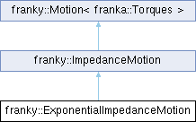

<table>
<colgroup>
<col style="width: 100%" />
</colgroup>
<tbody>
<tr class="odd">
<td>

franky 1.1.3

A High-Level Motion API for Franka

</td>
</tr>
</tbody>
</table>

Loading...

Searching...

No Matches

  - [franky](namespacefranky.md)
  - [ExponentialImpedanceMotion](classfranky_1_1_exponential_impedance_motion.md)

[Classes](classfranky_1_1_exponential_impedance_motion.md#nested-classes) | [Public Member Functions](classfranky_1_1_exponential_impedance_motion.md#pub-methods) | [Protected Member Functions](classfranky_1_1_exponential_impedance_motion.md#pro-methods) | [List of all members](classfranky_1_1_exponential_impedance_motion-members.md)

franky::ExponentialImpedanceMotion Class Reference

Exponential cartesian impedance motion. [More...](classfranky_1_1_exponential_impedance_motion.md#details)

`#include <exponential_impedance_motion.hpp>`

Inheritance diagram for franky::ExponentialImpedanceMotion:

##  Classes

struct  

[Params](structfranky_1_1_exponential_impedance_motion_1_1_params.md)

 

Parameters for the exponential cartesian impedance motion. [More...](structfranky_1_1_exponential_impedance_motion_1_1_params.md#details)  

 

##  Public Member Functions

 

[ExponentialImpedanceMotion](classfranky_1_1_exponential_impedance_motion.md#a4c87760c474f602956c43519724a8e54) ([const](namespacefranky.md#a0b6bfc825c262ae89d9b0adcccd97ab0) [Affine](namespacefranky.md#afab9faf133666ada543b15236a8c4b5f) &[target](classfranky_1_1_impedance_motion.md#a1ce961ddf51cd792482fd5ca2b299d97))

 

 

[ExponentialImpedanceMotion](classfranky_1_1_exponential_impedance_motion.md#a4c8e1c7079e9992457b063f43131e979) ([const](namespacefranky.md#a0b6bfc825c262ae89d9b0adcccd97ab0) [Affine](namespacefranky.md#afab9faf133666ada543b15236a8c4b5f) &[target](classfranky_1_1_impedance_motion.md#a1ce961ddf51cd792482fd5ca2b299d97), [const](namespacefranky.md#a0b6bfc825c262ae89d9b0adcccd97ab0) [Params](structfranky_1_1_exponential_impedance_motion_1_1_params.md) &[params](namespacefranky.md#a0b6bfc825c262ae89d9b0adcccd97ab0))

 

 Public Member Functions inherited from [franky::ImpedanceMotion](classfranky_1_1_impedance_motion.md)

 

[ImpedanceMotion](classfranky_1_1_impedance_motion.md#a60d55400835651bf37a1593f72e1a5cf) ([Affine](namespacefranky.md#afab9faf133666ada543b15236a8c4b5f) [target](classfranky_1_1_impedance_motion.md#a1ce961ddf51cd792482fd5ca2b299d97), [const](namespacefranky.md#a0b6bfc825c262ae89d9b0adcccd97ab0) [Params](structfranky_1_1_impedance_motion_1_1_params.md) &[params](namespacefranky.md#a0b6bfc825c262ae89d9b0adcccd97ab0))

 

 Public Member Functions inherited from [franky::Motion\< franka::Torques \>](classfranky_1_1_motion.md)

virtual 

[\~Motion](classfranky_1_1_motion.md#aa6d72b7a606055fc444bf2da0c463d16) ()=default

 

void 

[addReaction](classfranky_1_1_motion.md#a52f0efb3e6c876f480eceb75a18d7448) (std::shared\_ptr\< [Reaction](classfranky_1_1_reaction.md)\< franka::Torques \> \> reaction)

 

Add a reaction to the motion.  

 

void 

[addReactionFront](classfranky_1_1_motion.md#a8fdbf32e0808fb2f01514f83ee964347) (std::shared\_ptr\< [Reaction](classfranky_1_1_reaction.md)\< franka::Torques \> \> reaction)

 

Add a reaction to the front of the reaction list.  

 

std::vector\< std::shared\_ptr\< [Reaction](classfranky_1_1_reaction.md)\< franka::Torques \> \> \> 

[reactions](classfranky_1_1_motion.md#aed40663a195eb68318799d19451c5a0d) ()

 

Currently registered reactions of the motion.  

 

void 

[registerCallback](classfranky_1_1_motion.md#a05ed2a4f6dbcd406f9298a7c8e4e76c2) ([CallbackType](classfranky_1_1_motion.md#aabc4cfc38ed77466ca94be5b1c38fc6c) callback)

 

Register a callback that is called in every step of the motion.  

 

void 

[init](classfranky_1_1_motion.md#a3780f86a0c58bdfb959e4d9bb65179d6) ([Robot](classfranky_1_1_robot.md) \*robot, const [RobotState](structfranky_1_1_robot_state.md) \&robot\_state, const std::optional\< franka::Torques \> \&previous\_command)

 

Initialize the motion.  

 

franka::Torques 

[nextCommand](classfranky_1_1_motion.md#abc04c5fe350635cf36bc1e459736ddb7) (const [RobotState](structfranky_1_1_robot_state.md) \&robot\_state, franka::Duration time\_step, franka::Duration rel\_time, franka::Duration abs\_time, const std::optional\< franka::Torques \> \&previous\_command)

 

Get the next command of the motion.  

 

std::shared\_ptr\< [Motion](classfranky_1_1_motion.md)\< franka::Torques \> \> 

[checkAndCallReactions](classfranky_1_1_motion.md#a2a0e78863021c3c2116c8500c9386369) (const [RobotState](structfranky_1_1_robot_state.md) \&robot\_state, franka::Duration rel\_time, franka::Duration abs\_time)

 

Check and call reactions.  

 

##  Protected Member Functions

std::tuple\< [Affine](namespacefranky.md#afab9faf133666ada543b15236a8c4b5f), [bool](namespacefranky.md#a0b6bfc825c262ae89d9b0adcccd97ab0) \> 

[update](classfranky_1_1_exponential_impedance_motion.md#a09d2d86cfd46ce2238dacf4d471cf9f8) ([const](namespacefranky.md#a0b6bfc825c262ae89d9b0adcccd97ab0) [RobotState](structfranky_1_1_robot_state.md) &[robot\_state](namespacefranky.md#a0b6bfc825c262ae89d9b0adcccd97ab0), franka::Duration [time\_step](namespacefranky.md#a0b6bfc825c262ae89d9b0adcccd97ab0), franka::Duration time) [override](namespacefranky.md#a0b6bfc825c262ae89d9b0adcccd97ab0)

 

 Protected Member Functions inherited from [franky::ImpedanceMotion](classfranky_1_1_impedance_motion.md)

[void](namespacefranky.md#a0b6bfc825c262ae89d9b0adcccd97ab0) 

[initImpl](classfranky_1_1_impedance_motion.md#a87fe10bf698cbc2b55db0a354fa9d250) ([const](namespacefranky.md#a0b6bfc825c262ae89d9b0adcccd97ab0) [RobotState](structfranky_1_1_robot_state.md) &[robot\_state](namespacefranky.md#a0b6bfc825c262ae89d9b0adcccd97ab0), [const](namespacefranky.md#a0b6bfc825c262ae89d9b0adcccd97ab0) std::optional\< franka::Torques \> &[previous\_command](namespacefranky.md#a0b6bfc825c262ae89d9b0adcccd97ab0)) [override](namespacefranky.md#a0b6bfc825c262ae89d9b0adcccd97ab0)

 

franka::Torques 

[nextCommandImpl](classfranky_1_1_impedance_motion.md#a6594ab5628923b88cce26903ae02077c) ([const](namespacefranky.md#a0b6bfc825c262ae89d9b0adcccd97ab0) [RobotState](structfranky_1_1_robot_state.md) &[robot\_state](namespacefranky.md#a0b6bfc825c262ae89d9b0adcccd97ab0), franka::Duration [time\_step](namespacefranky.md#a0b6bfc825c262ae89d9b0adcccd97ab0), franka::Duration [rel\_time](namespacefranky.md#a0b6bfc825c262ae89d9b0adcccd97ab0), franka::Duration [abs\_time](namespacefranky.md#a0b6bfc825c262ae89d9b0adcccd97ab0), [const](namespacefranky.md#a0b6bfc825c262ae89d9b0adcccd97ab0) std::optional\< franka::Torques \> &[previous\_command](namespacefranky.md#a0b6bfc825c262ae89d9b0adcccd97ab0)) [override](namespacefranky.md#a0b6bfc825c262ae89d9b0adcccd97ab0)

 

[Affine](namespacefranky.md#afab9faf133666ada543b15236a8c4b5f) 

[intermediate\_target](classfranky_1_1_impedance_motion.md#aabd59d6e0609d88130d71426324d12e2) () [const](namespacefranky.md#a0b6bfc825c262ae89d9b0adcccd97ab0)

 

[Affine](namespacefranky.md#afab9faf133666ada543b15236a8c4b5f) 

[target](classfranky_1_1_impedance_motion.md#a1ce961ddf51cd792482fd5ca2b299d97) () [const](namespacefranky.md#a0b6bfc825c262ae89d9b0adcccd97ab0)

 

 Protected Member Functions inherited from [franky::Motion\< franka::Torques \>](classfranky_1_1_motion.md)

 

[Motion](classfranky_1_1_motion.md#ab18f33f97f86e9fb838fb6d6d79915b4) ()

 

[Robot](classfranky_1_1_robot.md) \* 

[robot](classfranky_1_1_motion.md#a4a279dafcbb7ae10605f58d27a3a368f) () const

 

##  Additional Inherited Members

 Public Types inherited from [franky::Motion\< franka::Torques \>](classfranky_1_1_motion.md)

using 

[CallbackType](classfranky_1_1_motion.md#aabc4cfc38ed77466ca94be5b1c38fc6c) = std::function\< void(const [RobotState](structfranky_1_1_robot_state.md) &, franka::Duration, franka::Duration, franka::Duration, const franka::Torques &)\>

 

## Detailed Description

Exponential cartesian impedance motion.

This motion is a implements a exponential cartesian impedance controller on the client side and does not use Franka's internal impedance controller. Instead, it uses Franka's internal torque controller and calculates the torques itself.

## Constructor & Destructor Documentation

## [◆ ](classfranky_1_1_exponential_impedance_motion.md#a4c87760c474f602956c43519724a8e54)ExponentialImpedanceMotion() \[1/2\]

<table>
<colgroup>
<col style="width: 50%" />
<col style="width: 50%" />
</colgroup>
<tbody>
<tr class="odd">
<td><table>
<tbody>
<tr class="odd">
<td>franky::ExponentialImpedanceMotion::ExponentialImpedanceMotion</td>
<td>(</td>
<td><a href="namespacefranky.md#a0b6bfc825c262ae89d9b0adcccd97ab0" class="el">const</a> <a href="namespacefranky.md#afab9faf133666ada543b15236a8c4b5f" class="el">Affine</a> &amp; </td>
<td><em>target</em></td>
<td>)</td>
<td></td>
</tr>
</tbody>
</table></td>
<td>explicit</td>
</tr>
</tbody>
</table>

  - Parameters
    
    |        |                  |
    | ------ | ---------------- |
    | target | The target pose. |
    

## [◆ ](classfranky_1_1_exponential_impedance_motion.md#a4c8e1c7079e9992457b063f43131e979)ExponentialImpedanceMotion() \[2/2\]

<table>
<colgroup>
<col style="width: 50%" />
<col style="width: 50%" />
</colgroup>
<tbody>
<tr class="odd">
<td><table>
<tbody>
<tr class="odd">
<td>franky::ExponentialImpedanceMotion::ExponentialImpedanceMotion</td>
<td>(</td>
<td><a href="namespacefranky.md#a0b6bfc825c262ae89d9b0adcccd97ab0" class="el">const</a> <a href="namespacefranky.md#afab9faf133666ada543b15236a8c4b5f" class="el">Affine</a> &amp; </td>
<td><em>target</em>,</td>
</tr>
<tr class="even">
<td></td>
<td></td>
<td><a href="namespacefranky.md#a0b6bfc825c262ae89d9b0adcccd97ab0" class="el">const</a> <a href="structfranky_1_1_exponential_impedance_motion_1_1_params.md" class="el">Params</a> &amp; </td>
<td><em>params</em> </td>
</tr>
<tr class="odd">
<td></td>
<td>)</td>
<td></td>
<td></td>
</tr>
</tbody>
</table></td>
<td>explicit</td>
</tr>
</tbody>
</table>

  - Parameters
    
    |        |                            |
    | ------ | -------------------------- |
    | target | The target pose.           |
    | params | Parameters for the motion. |
    

## Member Function Documentation

## [◆ ](classfranky_1_1_exponential_impedance_motion.md#a09d2d86cfd46ce2238dacf4d471cf9f8)update()

<table>
<colgroup>
<col style="width: 50%" />
<col style="width: 50%" />
</colgroup>
<tbody>
<tr class="odd">
<td><table>
<tbody>
<tr class="odd">
<td>std::tuple&lt; <a href="namespacefranky.md#afab9faf133666ada543b15236a8c4b5f" class="el">Affine</a>, <a href="namespacefranky.md#a0b6bfc825c262ae89d9b0adcccd97ab0" class="el">bool</a> &gt; franky::ExponentialImpedanceMotion::update</td>
<td>(</td>
<td><a href="namespacefranky.md#a0b6bfc825c262ae89d9b0adcccd97ab0" class="el">const</a> <a href="structfranky_1_1_robot_state.md" class="el">RobotState</a> &amp; </td>
<td><em>robot_state</em>,</td>
</tr>
<tr class="even">
<td></td>
<td></td>
<td>franka::Duration </td>
<td><em>time_step</em>,</td>
</tr>
<tr class="odd">
<td></td>
<td></td>
<td>franka::Duration </td>
<td><em>time</em> </td>
</tr>
<tr class="even">
<td></td>
<td>)</td>
<td></td>
<td></td>
</tr>
</tbody>
</table></td>
<td>overrideprotectedvirtual</td>
</tr>
</tbody>
</table>

Implements [franky::ImpedanceMotion](classfranky_1_1_impedance_motion.md#aee9a6e23b63db2ebc49c6615b461189c).

-----

The documentation for this class was generated from the following files:

  - /home/runner/work/franky/franky/include/franky/motion/[exponential\_impedance\_motion.hpp](exponential__impedance__motion_8hpp_source.md)
  - /home/runner/work/franky/franky/src/motion/[exponential\_impedance\_motion.cpp](exponential__impedance__motion_8cpp.md)

-----

Generated by  1.9.8
