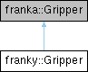

<table>
<colgroup>
<col style="width: 100%" />
</colgroup>
<tbody>
<tr class="odd">
<td>

franky 1.1.3

A High-Level Motion API for Franka

</td>
</tr>
</tbody>
</table>

Loading...

Searching...

No Matches

  - [franky](namespacefranky.md)
  - [Gripper](classfranky_1_1_gripper.md)

[Public Member Functions](classfranky_1_1_gripper.md#pub-methods) | [List of all members](classfranky_1_1_gripper-members.md)

franky::Gripper Class Reference

A wrapper around the franka::Gripper class that adds asynchronous functionality. [More...](classfranky_1_1_gripper.md#details)

`#include <gripper.hpp>`

Inheritance diagram for franky::Gripper:

##  Public Member Functions

 

[Gripper](classfranky_1_1_gripper.md#ad496a52d3a7a01926c8fd6e679901a89) ([const](namespacefranky.md#a0b6bfc825c262ae89d9b0adcccd97ab0) std::string &[franka\_address](namespacefranky.md#a0b6bfc825c262ae89d9b0adcccd97ab0))

 

 

[Gripper](classfranky_1_1_gripper.md#ac6996e448e7a780d67682743cd836da9) ([Gripper](classfranky_1_1_gripper.md) &&[gripper](namespacefranky.md#a0b6bfc825c262ae89d9b0adcccd97ab0)) [noexcept](namespacefranky.md#a0b6bfc825c262ae89d9b0adcccd97ab0)

 

std::shared\_future\< [bool](namespacefranky.md#a0b6bfc825c262ae89d9b0adcccd97ab0) \> 

[graspAsync](classfranky_1_1_gripper.md#a39998a7c1c4ea04403e9dc74e2459d5f) ([double](namespacefranky.md#a0b6bfc825c262ae89d9b0adcccd97ab0) [width](classfranky_1_1_gripper.md#a176c18c2ca98694075eea1085dc65a7e), [double](namespacefranky.md#a0b6bfc825c262ae89d9b0adcccd97ab0) [speed](namespacefranky.md#a0b6bfc825c262ae89d9b0adcccd97ab0), [double](namespacefranky.md#a0b6bfc825c262ae89d9b0adcccd97ab0) [force](namespacefranky.md#a0b6bfc825c262ae89d9b0adcccd97ab0), [double](namespacefranky.md#a0b6bfc825c262ae89d9b0adcccd97ab0) [epsilon\_inner](namespacefranky.md#a0b6bfc825c262ae89d9b0adcccd97ab0)=0.005, [double](namespacefranky.md#a0b6bfc825c262ae89d9b0adcccd97ab0) [epsilon\_outer](namespacefranky.md#a0b6bfc825c262ae89d9b0adcccd97ab0)=0.005)

 

Asynchronous variant of the franka::Gripper::grasp function.  

 

std::shared\_future\< [bool](namespacefranky.md#a0b6bfc825c262ae89d9b0adcccd97ab0) \> 

[moveAsync](classfranky_1_1_gripper.md#a9e8dbe460f5b1cf277ad281906fe8ed7) ([double](namespacefranky.md#a0b6bfc825c262ae89d9b0adcccd97ab0) [width](classfranky_1_1_gripper.md#a176c18c2ca98694075eea1085dc65a7e), [double](namespacefranky.md#a0b6bfc825c262ae89d9b0adcccd97ab0) [speed](namespacefranky.md#a0b6bfc825c262ae89d9b0adcccd97ab0))

 

Asynchronous variant of the franka::Gripper::move function.  

 

[bool](namespacefranky.md#a0b6bfc825c262ae89d9b0adcccd97ab0) 

[open](classfranky_1_1_gripper.md#a6f9b3b3a14eefe618b480a4e932dce24) ([double](namespacefranky.md#a0b6bfc825c262ae89d9b0adcccd97ab0) [speed](namespacefranky.md#a0b6bfc825c262ae89d9b0adcccd97ab0))

 

Opens the gripper fully.  

 

std::shared\_future\< [bool](namespacefranky.md#a0b6bfc825c262ae89d9b0adcccd97ab0) \> 

[openAsync](classfranky_1_1_gripper.md#aa1b54a5041bdc3c8161cd8da895388c6) ([double](namespacefranky.md#a0b6bfc825c262ae89d9b0adcccd97ab0) [speed](namespacefranky.md#a0b6bfc825c262ae89d9b0adcccd97ab0))

 

Asynchronous variant of the open function.  

 

std::shared\_future\< [bool](namespacefranky.md#a0b6bfc825c262ae89d9b0adcccd97ab0) \> 

[homingAsync](classfranky_1_1_gripper.md#af81ac0bf44132f338e43e64d8c10ea7e) ()

 

Asynchronous variant of the franka::Gripper::homing function.  

 

std::shared\_future\< [bool](namespacefranky.md#a0b6bfc825c262ae89d9b0adcccd97ab0) \> 

[stopAsync](classfranky_1_1_gripper.md#aa272b7106a9a5262a0bfc76ed36e002b) ()

 

Asynchronous variant of the franka::Gripper::stop function.  

 

[double](namespacefranky.md#a0b6bfc825c262ae89d9b0adcccd97ab0) 

[width](classfranky_1_1_gripper.md#a176c18c2ca98694075eea1085dc65a7e) () [const](namespacefranky.md#a0b6bfc825c262ae89d9b0adcccd97ab0)

 

Current opening width of the gripper \[m\].  

 

[bool](namespacefranky.md#a0b6bfc825c262ae89d9b0adcccd97ab0) 

[is\_grasped](classfranky_1_1_gripper.md#a792b6d30ee087a4cddba5e3d2320d6e9) () [const](namespacefranky.md#a0b6bfc825c262ae89d9b0adcccd97ab0)

 

Whether the gripper is grasping.  

 

[double](namespacefranky.md#a0b6bfc825c262ae89d9b0adcccd97ab0) 

[max\_width](classfranky_1_1_gripper.md#a5ae2659a6edf6e117fc461f60191c9db) () [const](namespacefranky.md#a0b6bfc825c262ae89d9b0adcccd97ab0)

 

Maximum width of the gripper \[m\].  

 

franka::GripperState 

[state](classfranky_1_1_gripper.md#abb8531bbdefc46cbd15f36a3ad40b1e8) () [const](namespacefranky.md#a0b6bfc825c262ae89d9b0adcccd97ab0)

 

Current gripper state.  

 

## Detailed Description

A wrapper around the franka::Gripper class that adds asynchronous functionality.

## Constructor & Destructor Documentation

## [◆ ](classfranky_1_1_gripper.md#ad496a52d3a7a01926c8fd6e679901a89)Gripper() \[1/2\]

<table>
<colgroup>
<col style="width: 50%" />
<col style="width: 50%" />
</colgroup>
<tbody>
<tr class="odd">
<td><table>
<tbody>
<tr class="odd">
<td>franky::Gripper::Gripper</td>
<td>(</td>
<td><a href="namespacefranky.md#a0b6bfc825c262ae89d9b0adcccd97ab0" class="el">const</a> std::string &amp; </td>
<td><em>franka_address</em></td>
<td>)</td>
<td></td>
</tr>
</tbody>
</table></td>
<td>inlineexplicit</td>
</tr>
</tbody>
</table>

## [◆ ](classfranky_1_1_gripper.md#ac6996e448e7a780d67682743cd836da9)Gripper() \[2/2\]

<table>
<colgroup>
<col style="width: 50%" />
<col style="width: 50%" />
</colgroup>
<tbody>
<tr class="odd">
<td><table>
<tbody>
<tr class="odd">
<td>franky::Gripper::Gripper</td>
<td>(</td>
<td><a href="classfranky_1_1_gripper.md" class="el">Gripper</a> &amp;&amp; </td>
<td><em>gripper</em></td>
<td>)</td>
<td></td>
</tr>
</tbody>
</table></td>
<td>inlinenoexcept</td>
</tr>
</tbody>
</table>

## Member Function Documentation

## [◆ ](classfranky_1_1_gripper.md#a39998a7c1c4ea04403e9dc74e2459d5f)graspAsync()

|                                                                                                                     |   |                                                                  |                             |
| ------------------------------------------------------------------------------------------------------------------- | - | ---------------------------------------------------------------- | --------------------------- |
| std::shared\_future\< [bool](namespacefranky.md#a0b6bfc825c262ae89d9b0adcccd97ab0) \> franky::Gripper::graspAsync | ( | [double](namespacefranky.md#a0b6bfc825c262ae89d9b0adcccd97ab0) | *width*,                    |
|                                                                                                                     |   | [double](namespacefranky.md#a0b6bfc825c262ae89d9b0adcccd97ab0) | *speed*,                    |
|                                                                                                                     |   | [double](namespacefranky.md#a0b6bfc825c262ae89d9b0adcccd97ab0) | *force*,                    |
|                                                                                                                     |   | [double](namespacefranky.md#a0b6bfc825c262ae89d9b0adcccd97ab0) | *epsilon\_inner* = `0.005`, |
|                                                                                                                     |   | [double](namespacefranky.md#a0b6bfc825c262ae89d9b0adcccd97ab0) | *epsilon\_outer* = `0.005`  |
|                                                                                                                     | ) |                                                                  |                             |

Asynchronous variant of the franka::Gripper::grasp function.

  - Parameters
    
    |                |                                                                                                      |
    | -------------- | ---------------------------------------------------------------------------------------------------- |
    | width          | Size of the object to grasp in \[m\].                                                                |
    | speed          | Closing speed in \[m/s\].                                                                            |
    | force          | Grasping force in \[N\].                                                                             |
    | epsilon\_inner | Maximum tolerated deviation when the actual grasped width is smaller than the commanded grasp width. |
    | epsilon\_outer | Maximum tolerated deviation when the actual grasped width is larger than the commanded grasp width.  |
    

<!-- end list -->

  - Returns  
    Future that becomes ready when the grasp is finished. Contains true if an object has been grasped, false otherwise.

## [◆ ](classfranky_1_1_gripper.md#af81ac0bf44132f338e43e64d8c10ea7e)homingAsync()

|                                                                                                                      |   |  |   |  |
| -------------------------------------------------------------------------------------------------------------------- | - |  | - |  |
| std::shared\_future\< [bool](namespacefranky.md#a0b6bfc825c262ae89d9b0adcccd97ab0) \> franky::Gripper::homingAsync | ( |  | ) |  |

Asynchronous variant of the franka::Gripper::homing function.

  - Returns  
    A future that becomes ready when the homing is finished. Contains true if the homing was successful.

## [◆ ](classfranky_1_1_gripper.md#a792b6d30ee087a4cddba5e3d2320d6e9)is\_grasped()

<table>
<colgroup>
<col style="width: 50%" />
<col style="width: 50%" />
</colgroup>
<tbody>
<tr class="odd">
<td><table>
<tbody>
<tr class="odd">
<td><a href="namespacefranky.md#a0b6bfc825c262ae89d9b0adcccd97ab0" class="el">bool</a> franky::Gripper::is_grasped</td>
<td>(</td>
<td></td>
<td>)</td>
<td>const</td>
</tr>
</tbody>
</table></td>
<td>inline</td>
</tr>
</tbody>
</table>

Whether the gripper is grasping.

## [◆ ](classfranky_1_1_gripper.md#a5ae2659a6edf6e117fc461f60191c9db)max\_width()

<table>
<colgroup>
<col style="width: 50%" />
<col style="width: 50%" />
</colgroup>
<tbody>
<tr class="odd">
<td><table>
<tbody>
<tr class="odd">
<td><a href="namespacefranky.md#a0b6bfc825c262ae89d9b0adcccd97ab0" class="el">double</a> franky::Gripper::max_width</td>
<td>(</td>
<td></td>
<td>)</td>
<td>const</td>
</tr>
</tbody>
</table></td>
<td>inline</td>
</tr>
</tbody>
</table>

Maximum width of the gripper \[m\].

## [◆ ](classfranky_1_1_gripper.md#a9e8dbe460f5b1cf277ad281906fe8ed7)moveAsync()

|                                                                                                                    |   |                                                                  |          |
| ------------------------------------------------------------------------------------------------------------------ | - | ---------------------------------------------------------------- | -------- |
| std::shared\_future\< [bool](namespacefranky.md#a0b6bfc825c262ae89d9b0adcccd97ab0) \> franky::Gripper::moveAsync | ( | [double](namespacefranky.md#a0b6bfc825c262ae89d9b0adcccd97ab0) | *width*, |
|                                                                                                                    |   | [double](namespacefranky.md#a0b6bfc825c262ae89d9b0adcccd97ab0) | *speed*  |
|                                                                                                                    | ) |                                                                  |          |

Asynchronous variant of the franka::Gripper::move function.

  - Parameters
    
    |       |                                   |
    | ----- | --------------------------------- |
    | width | Intended opening width in \[m\].  |
    | speed | Speed of the movement in \[m/s\]. |
    

<!-- end list -->

  - Returns  
    Future that becomes ready when the movement is finished. Contains true if the movement was successful,

## [◆ ](classfranky_1_1_gripper.md#a6f9b3b3a14eefe618b480a4e932dce24)open()

|                                                                                      |   |                                                                  |         |   |  |
| ------------------------------------------------------------------------------------ | - | ---------------------------------------------------------------- | ------- | - |  |
| [bool](namespacefranky.md#a0b6bfc825c262ae89d9b0adcccd97ab0) franky::Gripper::open | ( | [double](namespacefranky.md#a0b6bfc825c262ae89d9b0adcccd97ab0) | *speed* | ) |  |

Opens the gripper fully.

  - Parameters
    
    |       |                                   |
    | ----- | --------------------------------- |
    | speed | Speed of the movement in \[m/s\]. |
    

<!-- end list -->

  - Returns  
    True if the gripper was opened successfully.

## [◆ ](classfranky_1_1_gripper.md#aa1b54a5041bdc3c8161cd8da895388c6)openAsync()

|                                                                                                                    |   |                                                                  |         |   |  |
| ------------------------------------------------------------------------------------------------------------------ | - | ---------------------------------------------------------------- | ------- | - |  |
| std::shared\_future\< [bool](namespacefranky.md#a0b6bfc825c262ae89d9b0adcccd97ab0) \> franky::Gripper::openAsync | ( | [double](namespacefranky.md#a0b6bfc825c262ae89d9b0adcccd97ab0) | *speed* | ) |  |

Asynchronous variant of the open function.

  - Parameters
    
    |       |                                   |
    | ----- | --------------------------------- |
    | speed | Speed of the movement in \[m/s\]. |
    

<!-- end list -->

  - Returns  
    Future that becomes ready when the gripper is fully opened. Contains true if the gripper was opened successfully.

## [◆ ](classfranky_1_1_gripper.md#abb8531bbdefc46cbd15f36a3ad40b1e8)state()

<table>
<colgroup>
<col style="width: 50%" />
<col style="width: 50%" />
</colgroup>
<tbody>
<tr class="odd">
<td><table>
<tbody>
<tr class="odd">
<td>franka::GripperState franky::Gripper::state</td>
<td>(</td>
<td></td>
<td>)</td>
<td>const</td>
</tr>
</tbody>
</table></td>
<td>inline</td>
</tr>
</tbody>
</table>

Current gripper state.

## [◆ ](classfranky_1_1_gripper.md#aa272b7106a9a5262a0bfc76ed36e002b)stopAsync()

|                                                                                                                    |   |  |   |  |
| ------------------------------------------------------------------------------------------------------------------ | - |  | - |  |
| std::shared\_future\< [bool](namespacefranky.md#a0b6bfc825c262ae89d9b0adcccd97ab0) \> franky::Gripper::stopAsync | ( |  | ) |  |

Asynchronous variant of the franka::Gripper::stop function.

  - Returns  
    A future that becomes ready when the stop is finished. Contains true if the stop was successful.

## [◆ ](classfranky_1_1_gripper.md#a176c18c2ca98694075eea1085dc65a7e)width()

<table>
<colgroup>
<col style="width: 50%" />
<col style="width: 50%" />
</colgroup>
<tbody>
<tr class="odd">
<td><table>
<tbody>
<tr class="odd">
<td><a href="namespacefranky.md#a0b6bfc825c262ae89d9b0adcccd97ab0" class="el">double</a> franky::Gripper::width</td>
<td>(</td>
<td></td>
<td>)</td>
<td>const</td>
</tr>
</tbody>
</table></td>
<td>inline</td>
</tr>
</tbody>
</table>

Current opening width of the gripper \[m\].

-----

The documentation for this class was generated from the following files:

  - /home/runner/work/franky/franky/include/franky/[gripper.hpp](gripper_8hpp_source.md)
  - /home/runner/work/franky/franky/src/[gripper.cpp](gripper_8cpp.md)

-----

Generated by  1.9.8
