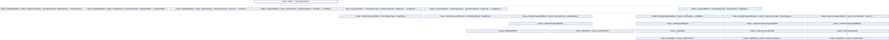

<table>
<colgroup>
<col style="width: 100%" />
</colgroup>
<tbody>
<tr class="odd">
<td>

franky 1.1.3

A High-Level Motion API for Franka

</td>
</tr>
</tbody>
</table>

Loading...

Searching...

No Matches

  - [franky](namespacefranky.md)
  - [Motion](classfranky_1_1_motion.md)

[Public Types](classfranky_1_1_motion.md#pub-types) | [Public Member Functions](classfranky_1_1_motion.md#pub-methods) | [Protected Member Functions](classfranky_1_1_motion.md#pro-methods) | [List of all members](classfranky_1_1_motion-members.md)

franky::Motion\< ControlSignalType \> Class Template Referenceabstract

Base class for motions. [More...](classfranky_1_1_motion.md#details)

`#include <motion.hpp>`

Inheritance diagram for franky::Motion\< ControlSignalType \>:

##  Public Types

[using](namespacefranky.md#a0b6bfc825c262ae89d9b0adcccd97ab0) 

[CallbackType](classfranky_1_1_motion.md#aabc4cfc38ed77466ca94be5b1c38fc6c) = std::function\< [void](namespacefranky.md#a0b6bfc825c262ae89d9b0adcccd97ab0)([const](namespacefranky.md#a0b6bfc825c262ae89d9b0adcccd97ab0) [RobotState](structfranky_1_1_robot_state.md) &, franka::Duration, franka::Duration, franka::Duration, [const](namespacefranky.md#a0b6bfc825c262ae89d9b0adcccd97ab0) [ControlSignalType](namespacefranky.md#a9a12fea9c3341e3437af837efe8ebaac) &)\>

 

##  Public Member Functions

[virtual](namespacefranky.md#a0b6bfc825c262ae89d9b0adcccd97ab0) 

[\~Motion](classfranky_1_1_motion.md#aa6d72b7a606055fc444bf2da0c463d16) ()=[default](namespacefranky.md#a0b6bfc825c262ae89d9b0adcccd97ab0)

 

[void](namespacefranky.md#a0b6bfc825c262ae89d9b0adcccd97ab0) 

[addReaction](classfranky_1_1_motion.md#a52f0efb3e6c876f480eceb75a18d7448) (std::shared\_ptr\< [Reaction](classfranky_1_1_reaction.md)\< [ControlSignalType](namespacefranky.md#a9a12fea9c3341e3437af837efe8ebaac) \> \> [reaction](namespacefranky.md#a0b6bfc825c262ae89d9b0adcccd97ab0))

 

Add a reaction to the motion.  

 

[void](namespacefranky.md#a0b6bfc825c262ae89d9b0adcccd97ab0) 

[addReactionFront](classfranky_1_1_motion.md#a8fdbf32e0808fb2f01514f83ee964347) (std::shared\_ptr\< [Reaction](classfranky_1_1_reaction.md)\< [ControlSignalType](namespacefranky.md#a9a12fea9c3341e3437af837efe8ebaac) \> \> [reaction](namespacefranky.md#a0b6bfc825c262ae89d9b0adcccd97ab0))

 

Add a reaction to the front of the reaction list.  

 

std::vector\< std::shared\_ptr\< [Reaction](classfranky_1_1_reaction.md)\< [ControlSignalType](namespacefranky.md#a9a12fea9c3341e3437af837efe8ebaac) \> \> \> 

[reactions](classfranky_1_1_motion.md#aed40663a195eb68318799d19451c5a0d) ()

 

Currently registered reactions of the motion.  

 

[void](namespacefranky.md#a0b6bfc825c262ae89d9b0adcccd97ab0) 

[registerCallback](classfranky_1_1_motion.md#a05ed2a4f6dbcd406f9298a7c8e4e76c2) ([CallbackType](classfranky_1_1_motion.md#aabc4cfc38ed77466ca94be5b1c38fc6c) [callback](namespacefranky.md#a0b6bfc825c262ae89d9b0adcccd97ab0))

 

Register a callback that is called in every step of the motion.  

 

[void](namespacefranky.md#a0b6bfc825c262ae89d9b0adcccd97ab0) 

[init](classfranky_1_1_motion.md#a3780f86a0c58bdfb959e4d9bb65179d6) ([Robot](classfranky_1_1_robot.md) \*[robot](classfranky_1_1_motion.md#a4a279dafcbb7ae10605f58d27a3a368f), [const](namespacefranky.md#a0b6bfc825c262ae89d9b0adcccd97ab0) [RobotState](structfranky_1_1_robot_state.md) &[robot\_state](namespacefranky.md#a0b6bfc825c262ae89d9b0adcccd97ab0), [const](namespacefranky.md#a0b6bfc825c262ae89d9b0adcccd97ab0) std::optional\< [ControlSignalType](namespacefranky.md#a9a12fea9c3341e3437af837efe8ebaac) \> &[previous\_command](namespacefranky.md#a0b6bfc825c262ae89d9b0adcccd97ab0))

 

Initialize the motion.  

 

[ControlSignalType](namespacefranky.md#a9a12fea9c3341e3437af837efe8ebaac) 

[nextCommand](classfranky_1_1_motion.md#abc04c5fe350635cf36bc1e459736ddb7) ([const](namespacefranky.md#a0b6bfc825c262ae89d9b0adcccd97ab0) [RobotState](structfranky_1_1_robot_state.md) &[robot\_state](namespacefranky.md#a0b6bfc825c262ae89d9b0adcccd97ab0), franka::Duration [time\_step](namespacefranky.md#a0b6bfc825c262ae89d9b0adcccd97ab0), franka::Duration [rel\_time](namespacefranky.md#a0b6bfc825c262ae89d9b0adcccd97ab0), franka::Duration [abs\_time](namespacefranky.md#a0b6bfc825c262ae89d9b0adcccd97ab0), [const](namespacefranky.md#a0b6bfc825c262ae89d9b0adcccd97ab0) std::optional\< [ControlSignalType](namespacefranky.md#a9a12fea9c3341e3437af837efe8ebaac) \> &[previous\_command](namespacefranky.md#a0b6bfc825c262ae89d9b0adcccd97ab0))

 

Get the next command of the motion.  

 

std::shared\_ptr\< [Motion](classfranky_1_1_motion.md)\< [ControlSignalType](namespacefranky.md#a9a12fea9c3341e3437af837efe8ebaac) \> \> 

[checkAndCallReactions](classfranky_1_1_motion.md#a2a0e78863021c3c2116c8500c9386369) ([const](namespacefranky.md#a0b6bfc825c262ae89d9b0adcccd97ab0) [RobotState](structfranky_1_1_robot_state.md) &[robot\_state](namespacefranky.md#a0b6bfc825c262ae89d9b0adcccd97ab0), franka::Duration [rel\_time](namespacefranky.md#a0b6bfc825c262ae89d9b0adcccd97ab0), franka::Duration [abs\_time](namespacefranky.md#a0b6bfc825c262ae89d9b0adcccd97ab0))

 

Check and call reactions.  

 

##  Protected Member Functions

 

[Motion](classfranky_1_1_motion.md#ab18f33f97f86e9fb838fb6d6d79915b4) ()

 

[virtual](namespacefranky.md#a0b6bfc825c262ae89d9b0adcccd97ab0) [void](namespacefranky.md#a0b6bfc825c262ae89d9b0adcccd97ab0) 

[initImpl](classfranky_1_1_motion.md#ad11b300fa7c37e18403af6a17bf663b8) ([const](namespacefranky.md#a0b6bfc825c262ae89d9b0adcccd97ab0) [RobotState](structfranky_1_1_robot_state.md) &[robot\_state](namespacefranky.md#a0b6bfc825c262ae89d9b0adcccd97ab0), [const](namespacefranky.md#a0b6bfc825c262ae89d9b0adcccd97ab0) std::optional\< [ControlSignalType](namespacefranky.md#a9a12fea9c3341e3437af837efe8ebaac) \> &[previous\_command](namespacefranky.md#a0b6bfc825c262ae89d9b0adcccd97ab0))

 

[virtual](namespacefranky.md#a0b6bfc825c262ae89d9b0adcccd97ab0) [ControlSignalType](namespacefranky.md#a9a12fea9c3341e3437af837efe8ebaac) 

[nextCommandImpl](classfranky_1_1_motion.md#ad2e6f47d30089ee335fecb671618a5f6) ([const](namespacefranky.md#a0b6bfc825c262ae89d9b0adcccd97ab0) [RobotState](structfranky_1_1_robot_state.md) &[robot\_state](namespacefranky.md#a0b6bfc825c262ae89d9b0adcccd97ab0), franka::Duration [time\_step](namespacefranky.md#a0b6bfc825c262ae89d9b0adcccd97ab0), franka::Duration [rel\_time](namespacefranky.md#a0b6bfc825c262ae89d9b0adcccd97ab0), franka::Duration [abs\_time](namespacefranky.md#a0b6bfc825c262ae89d9b0adcccd97ab0), [const](namespacefranky.md#a0b6bfc825c262ae89d9b0adcccd97ab0) std::optional\< [ControlSignalType](namespacefranky.md#a9a12fea9c3341e3437af837efe8ebaac) \> &[previous\_command](namespacefranky.md#a0b6bfc825c262ae89d9b0adcccd97ab0))=0

 

[Robot](classfranky_1_1_robot.md) \* 

[robot](classfranky_1_1_motion.md#a4a279dafcbb7ae10605f58d27a3a368f) () [const](namespacefranky.md#a0b6bfc825c262ae89d9b0adcccd97ab0)

 

## Detailed Description

template\<[typename](namespacefranky.md#a0b6bfc825c262ae89d9b0adcccd97ab0) [ControlSignalType](namespacefranky.md#a9a12fea9c3341e3437af837efe8ebaac)\>  
class franky::Motion\< ControlSignalType \>

Base class for motions.

  - Template Parameters
    
    |                   |                                                                                                                                                                   |
    | ----------------- | ----------------------------------------------------------------------------------------------------------------------------------------------------------------- |
    | ControlSignalType | Control signal type of the motion. Either franka::Torques, franka::JointVelocities, franka::CartesianVelocities, franka::JointPositions or franka::CartesianPose. |
    

## Member Typedef Documentation

## [◆ ](classfranky_1_1_motion.md#aabc4cfc38ed77466ca94be5b1c38fc6c)CallbackType

template\<[typename](namespacefranky.md#a0b6bfc825c262ae89d9b0adcccd97ab0) [ControlSignalType](namespacefranky.md#a9a12fea9c3341e3437af837efe8ebaac) \>

|                                                                                                                                                                                                                                                                                                                                                                                                                                                                                                                                                                                                                         |
| ----------------------------------------------------------------------------------------------------------------------------------------------------------------------------------------------------------------------------------------------------------------------------------------------------------------------------------------------------------------------------------------------------------------------------------------------------------------------------------------------------------------------------------------------------------------------------------------------------------------------- |
| [using](namespacefranky.md#a0b6bfc825c262ae89d9b0adcccd97ab0) [franky::Motion](classfranky_1_1_motion.md)\< [ControlSignalType](namespacefranky.md#a9a12fea9c3341e3437af837efe8ebaac) \>::CallbackType = std::function\<[void](namespacefranky.md#a0b6bfc825c262ae89d9b0adcccd97ab0)( [const](namespacefranky.md#a0b6bfc825c262ae89d9b0adcccd97ab0) [RobotState](structfranky_1_1_robot_state.md) &, franka::Duration, franka::Duration, franka::Duration, [const](namespacefranky.md#a0b6bfc825c262ae89d9b0adcccd97ab0) [ControlSignalType](namespacefranky.md#a9a12fea9c3341e3437af837efe8ebaac) &)\> |

## Constructor & Destructor Documentation

## [◆ ](classfranky_1_1_motion.md#aa6d72b7a606055fc444bf2da0c463d16)\~Motion()

template\<[typename](namespacefranky.md#a0b6bfc825c262ae89d9b0adcccd97ab0) [ControlSignalType](namespacefranky.md#a9a12fea9c3341e3437af837efe8ebaac) \>

<table>
<colgroup>
<col style="width: 50%" />
<col style="width: 50%" />
</colgroup>
<tbody>
<tr class="odd">
<td><table>
<tbody>
<tr class="odd">
<td><a href="namespacefranky.md#a0b6bfc825c262ae89d9b0adcccd97ab0" class="el">virtual</a> <a href="classfranky_1_1_motion.md" class="el">franky::Motion</a>&lt; <a href="namespacefranky.md#a9a12fea9c3341e3437af837efe8ebaac" class="el">ControlSignalType</a> &gt;::~<a href="classfranky_1_1_motion.md" class="el">Motion</a></td>
<td>(</td>
<td></td>
<td>)</td>
<td></td>
</tr>
</tbody>
</table></td>
<td>virtualdefault</td>
</tr>
</tbody>
</table>

## [◆ ](classfranky_1_1_motion.md#ab18f33f97f86e9fb838fb6d6d79915b4)Motion()

template\<[typename](namespacefranky.md#a0b6bfc825c262ae89d9b0adcccd97ab0) [ControlSignalType](namespacefranky.md#a9a12fea9c3341e3437af837efe8ebaac) \>

<table>
<colgroup>
<col style="width: 50%" />
<col style="width: 50%" />
</colgroup>
<tbody>
<tr class="odd">
<td><table>
<tbody>
<tr class="odd">
<td><a href="classfranky_1_1_motion.md" class="el">franky::Motion</a>&lt; <a href="namespacefranky.md#a9a12fea9c3341e3437af837efe8ebaac" class="el">ControlSignalType</a> &gt;::Motion</td>
<td>(</td>
<td></td>
<td>)</td>
<td></td>
</tr>
</tbody>
</table></td>
<td>explicitprotected</td>
</tr>
</tbody>
</table>

## Member Function Documentation

## [◆ ](classfranky_1_1_motion.md#a52f0efb3e6c876f480eceb75a18d7448)addReaction()

template\<[typename](namespacefranky.md#a0b6bfc825c262ae89d9b0adcccd97ab0) [ControlSignalType](namespacefranky.md#a9a12fea9c3341e3437af837efe8ebaac) \>

|                                                                                                                                                                                                            |   |                                                                                                                                                  |            |   |  |
| ---------------------------------------------------------------------------------------------------------------------------------------------------------------------------------------------------------- | - | ------------------------------------------------------------------------------------------------------------------------------------------------ | ---------- | - |  |
| [void](namespacefranky.md#a0b6bfc825c262ae89d9b0adcccd97ab0) [franky::Motion](classfranky_1_1_motion.md)\< [ControlSignalType](namespacefranky.md#a9a12fea9c3341e3437af837efe8ebaac) \>::addReaction | ( | std::shared\_ptr\< [Reaction](classfranky_1_1_reaction.md)\< [ControlSignalType](namespacefranky.md#a9a12fea9c3341e3437af837efe8ebaac) \> \> | *reaction* | ) |  |

Add a reaction to the motion.

Reactions are evaluated in every step of the motion and can replace the current motion with a new motion.

  - Parameters
    
    |          |                      |
    | -------- | -------------------- |
    | reaction | The reaction to add. |
    

## [◆ ](classfranky_1_1_motion.md#a8fdbf32e0808fb2f01514f83ee964347)addReactionFront()

template\<[typename](namespacefranky.md#a0b6bfc825c262ae89d9b0adcccd97ab0) [ControlSignalType](namespacefranky.md#a9a12fea9c3341e3437af837efe8ebaac) \>

|                                                                                                                                                                                                                 |   |                                                                                                                                                  |            |   |  |
| --------------------------------------------------------------------------------------------------------------------------------------------------------------------------------------------------------------- | - | ------------------------------------------------------------------------------------------------------------------------------------------------ | ---------- | - |  |
| [void](namespacefranky.md#a0b6bfc825c262ae89d9b0adcccd97ab0) [franky::Motion](classfranky_1_1_motion.md)\< [ControlSignalType](namespacefranky.md#a9a12fea9c3341e3437af837efe8ebaac) \>::addReactionFront | ( | std::shared\_ptr\< [Reaction](classfranky_1_1_reaction.md)\< [ControlSignalType](namespacefranky.md#a9a12fea9c3341e3437af837efe8ebaac) \> \> | *reaction* | ) |  |

Add a reaction to the front of the reaction list.

Reactions are evaluated in every step of the motion and can replace the current motion with a new motion.

  - Parameters
    
    |          |                      |
    | -------- | -------------------- |
    | reaction | The reaction to add. |
    

## [◆ ](classfranky_1_1_motion.md#a2a0e78863021c3c2116c8500c9386369)checkAndCallReactions()

template\<[typename](namespacefranky.md#a0b6bfc825c262ae89d9b0adcccd97ab0) [ControlSignalType](namespacefranky.md#a9a12fea9c3341e3437af837efe8ebaac) \>

|                                                                                                                                                                                                                                                                                                    |   |                                                                                                                   |                 |
| -------------------------------------------------------------------------------------------------------------------------------------------------------------------------------------------------------------------------------------------------------------------------------------------------- | - | ----------------------------------------------------------------------------------------------------------------- | --------------- |
| std::shared\_ptr\< [Motion](classfranky_1_1_motion.md)\< [ControlSignalType](namespacefranky.md#a9a12fea9c3341e3437af837efe8ebaac) \> \> [franky::Motion](classfranky_1_1_motion.md)\< [ControlSignalType](namespacefranky.md#a9a12fea9c3341e3437af837efe8ebaac) \>::checkAndCallReactions | ( | [const](namespacefranky.md#a0b6bfc825c262ae89d9b0adcccd97ab0) [RobotState](structfranky_1_1_robot_state.md) & | *robot\_state*, |
|                                                                                                                                                                                                                                                                                                    |   | franka::Duration                                                                                                  | *rel\_time*,    |
|                                                                                                                                                                                                                                                                                                    |   | franka::Duration                                                                                                  | *abs\_time*     |
|                                                                                                                                                                                                                                                                                                    | ) |                                                                                                                   |                 |

Check and call reactions.

  - Parameters
    
    |              |                          |
    | ------------ | ------------------------ |
    | robot\_state | The current robot state. |
    | rel\_time    | The relative time.       |
    | abs\_time    | The absolute time \[s\]. |
    

<!-- end list -->

  - Returns  
    The new motion if a reaction was triggered, nullptr otherwise.

## [◆ ](classfranky_1_1_motion.md#a3780f86a0c58bdfb959e4d9bb65179d6)init()

template\<[typename](namespacefranky.md#a0b6bfc825c262ae89d9b0adcccd97ab0) [ControlSignalType](namespacefranky.md#a9a12fea9c3341e3437af837efe8ebaac) \>

|                                                                                                                                                                                                     |   |                                                                                                                                                                  |                     |
| --------------------------------------------------------------------------------------------------------------------------------------------------------------------------------------------------- | - | ---------------------------------------------------------------------------------------------------------------------------------------------------------------- | ------------------- |
| [void](namespacefranky.md#a0b6bfc825c262ae89d9b0adcccd97ab0) [franky::Motion](classfranky_1_1_motion.md)\< [ControlSignalType](namespacefranky.md#a9a12fea9c3341e3437af837efe8ebaac) \>::init | ( | [Robot](classfranky_1_1_robot.md) \*                                                                                                                           | *robot*,            |
|                                                                                                                                                                                                     |   | [const](namespacefranky.md#a0b6bfc825c262ae89d9b0adcccd97ab0) [RobotState](structfranky_1_1_robot_state.md) &                                                | *robot\_state*,     |
|                                                                                                                                                                                                     |   | [const](namespacefranky.md#a0b6bfc825c262ae89d9b0adcccd97ab0) std::optional\< [ControlSignalType](namespacefranky.md#a9a12fea9c3341e3437af837efe8ebaac) \> & | *previous\_command* |
|                                                                                                                                                                                                     | ) |                                                                                                                                                                  |                     |

Initialize the motion.

  - Parameters
    
    |                   |                          |
    | ----------------- | ------------------------ |
    | robot             | The robot instance.      |
    | robot\_state      | The current robot state. |
    | previous\_command | The previous command.    |
    

## [◆ ](classfranky_1_1_motion.md#ad11b300fa7c37e18403af6a17bf663b8)initImpl()

template\<[typename](namespacefranky.md#a0b6bfc825c262ae89d9b0adcccd97ab0) [ControlSignalType](namespacefranky.md#a9a12fea9c3341e3437af837efe8ebaac) \>

<table>
<colgroup>
<col style="width: 50%" />
<col style="width: 50%" />
</colgroup>
<tbody>
<tr class="odd">
<td><table>
<tbody>
<tr class="odd">
<td><a href="namespacefranky.md#a0b6bfc825c262ae89d9b0adcccd97ab0" class="el">virtual</a> <a href="namespacefranky.md#a0b6bfc825c262ae89d9b0adcccd97ab0" class="el">void</a> <a href="classfranky_1_1_motion.md" class="el">franky::Motion</a>&lt; <a href="namespacefranky.md#a9a12fea9c3341e3437af837efe8ebaac" class="el">ControlSignalType</a> &gt;::initImpl</td>
<td>(</td>
<td><a href="namespacefranky.md#a0b6bfc825c262ae89d9b0adcccd97ab0" class="el">const</a> <a href="structfranky_1_1_robot_state.md" class="el">RobotState</a> &amp; </td>
<td><em>robot_state</em>,</td>
</tr>
<tr class="even">
<td></td>
<td></td>
<td><a href="namespacefranky.md#a0b6bfc825c262ae89d9b0adcccd97ab0" class="el">const</a> std::optional&lt; <a href="namespacefranky.md#a9a12fea9c3341e3437af837efe8ebaac" class="el">ControlSignalType</a> &gt; &amp; </td>
<td><em>previous_command</em> </td>
</tr>
<tr class="odd">
<td></td>
<td>)</td>
<td></td>
<td></td>
</tr>
</tbody>
</table></td>
<td>inlineprotectedvirtual</td>
</tr>
</tbody>
</table>

Reimplemented in [franky::WaypointMotion\< ControlSignalType, WaypointType, TargetType \>](classfranky_1_1_waypoint_motion.md#ada8edd9d849ee29244b6c2c1cfa30f69), [franky::WaypointMotion\< ControlSignalType, PositionWaypoint\< TargetType \>, TargetType \>](classfranky_1_1_waypoint_motion.md#ada8edd9d849ee29244b6c2c1cfa30f69), [franky::WaypointMotion\< ControlSignalType, VelocityWaypoint\< TargetType \>, TargetType \>](classfranky_1_1_waypoint_motion.md#ada8edd9d849ee29244b6c2c1cfa30f69), [franky::CartesianImpedanceMotion](classfranky_1_1_cartesian_impedance_motion.md#a224f09b1b32ab145ff9db2c10220c51d), and [franky::ImpedanceMotion](classfranky_1_1_impedance_motion.md#a87fe10bf698cbc2b55db0a354fa9d250).

## [◆ ](classfranky_1_1_motion.md#abc04c5fe350635cf36bc1e459736ddb7)nextCommand()

template\<[typename](namespacefranky.md#a0b6bfc825c262ae89d9b0adcccd97ab0) [ControlSignalType](namespacefranky.md#a9a12fea9c3341e3437af837efe8ebaac) \>

|                                                                                                                                                                                                                         |   |                                                                                                                                                                  |                     |
| ----------------------------------------------------------------------------------------------------------------------------------------------------------------------------------------------------------------------- | - | ---------------------------------------------------------------------------------------------------------------------------------------------------------------- | ------------------- |
| [ControlSignalType](namespacefranky.md#a9a12fea9c3341e3437af837efe8ebaac) [franky::Motion](classfranky_1_1_motion.md)\< [ControlSignalType](namespacefranky.md#a9a12fea9c3341e3437af837efe8ebaac) \>::nextCommand | ( | [const](namespacefranky.md#a0b6bfc825c262ae89d9b0adcccd97ab0) [RobotState](structfranky_1_1_robot_state.md) &                                                | *robot\_state*,     |
|                                                                                                                                                                                                                         |   | franka::Duration                                                                                                                                                 | *time\_step*,       |
|                                                                                                                                                                                                                         |   | franka::Duration                                                                                                                                                 | *rel\_time*,        |
|                                                                                                                                                                                                                         |   | franka::Duration                                                                                                                                                 | *abs\_time*,        |
|                                                                                                                                                                                                                         |   | [const](namespacefranky.md#a0b6bfc825c262ae89d9b0adcccd97ab0) std::optional\< [ControlSignalType](namespacefranky.md#a9a12fea9c3341e3437af837efe8ebaac) \> & | *previous\_command* |
|                                                                                                                                                                                                                         | ) |                                                                                                                                                                  |                     |

Get the next command of the motion.

  - Parameters
    
    |                   |                          |
    | ----------------- | ------------------------ |
    | robot\_state      | The current robot state. |
    | time\_step        | The time step \[s\].     |
    | rel\_time         | The relative time.       |
    | abs\_time         | The absolute time \[s\]. |
    | previous\_command | The previous command.    |
    

<!-- end list -->

  - Returns  
    The next control signal for libfranka.

## [◆ ](classfranky_1_1_motion.md#ad2e6f47d30089ee335fecb671618a5f6)nextCommandImpl()

template\<[typename](namespacefranky.md#a0b6bfc825c262ae89d9b0adcccd97ab0) [ControlSignalType](namespacefranky.md#a9a12fea9c3341e3437af837efe8ebaac) \>

<table>
<colgroup>
<col style="width: 50%" />
<col style="width: 50%" />
</colgroup>
<tbody>
<tr class="odd">
<td><table>
<tbody>
<tr class="odd">
<td><a href="namespacefranky.md#a0b6bfc825c262ae89d9b0adcccd97ab0" class="el">virtual</a> <a href="namespacefranky.md#a9a12fea9c3341e3437af837efe8ebaac" class="el">ControlSignalType</a> <a href="classfranky_1_1_motion.md" class="el">franky::Motion</a>&lt; <a href="namespacefranky.md#a9a12fea9c3341e3437af837efe8ebaac" class="el">ControlSignalType</a> &gt;::nextCommandImpl</td>
<td>(</td>
<td><a href="namespacefranky.md#a0b6bfc825c262ae89d9b0adcccd97ab0" class="el">const</a> <a href="structfranky_1_1_robot_state.md" class="el">RobotState</a> &amp; </td>
<td><em>robot_state</em>,</td>
</tr>
<tr class="even">
<td></td>
<td></td>
<td>franka::Duration </td>
<td><em>time_step</em>,</td>
</tr>
<tr class="odd">
<td></td>
<td></td>
<td>franka::Duration </td>
<td><em>rel_time</em>,</td>
</tr>
<tr class="even">
<td></td>
<td></td>
<td>franka::Duration </td>
<td><em>abs_time</em>,</td>
</tr>
<tr class="odd">
<td></td>
<td></td>
<td><a href="namespacefranky.md#a0b6bfc825c262ae89d9b0adcccd97ab0" class="el">const</a> std::optional&lt; <a href="namespacefranky.md#a9a12fea9c3341e3437af837efe8ebaac" class="el">ControlSignalType</a> &gt; &amp; </td>
<td><em>previous_command</em> </td>
</tr>
<tr class="even">
<td></td>
<td>)</td>
<td></td>
<td></td>
</tr>
</tbody>
</table></td>
<td>protectedpure virtual</td>
</tr>
</tbody>
</table>

Implemented in [franky::WaypointMotion\< ControlSignalType, WaypointType, TargetType \>](classfranky_1_1_waypoint_motion.md#ade5d803c15b7f55e55258092788df21b), [franky::WaypointMotion\< ControlSignalType, PositionWaypoint\< TargetType \>, TargetType \>](classfranky_1_1_waypoint_motion.md#ade5d803c15b7f55e55258092788df21b), [franky::WaypointMotion\< ControlSignalType, VelocityWaypoint\< TargetType \>, TargetType \>](classfranky_1_1_waypoint_motion.md#ade5d803c15b7f55e55258092788df21b), and [franky::ImpedanceMotion](classfranky_1_1_impedance_motion.md#a6594ab5628923b88cce26903ae02077c).

## [◆ ](classfranky_1_1_motion.md#aed40663a195eb68318799d19451c5a0d)reactions()

template\<[typename](namespacefranky.md#a0b6bfc825c262ae89d9b0adcccd97ab0) [ControlSignalType](namespacefranky.md#a9a12fea9c3341e3437af837efe8ebaac) \>

|                                                                                                                                                                                                                                                                                                             |   |  |   |  |
| ----------------------------------------------------------------------------------------------------------------------------------------------------------------------------------------------------------------------------------------------------------------------------------------------------------- | - |  | - |  |
| std::vector\< std::shared\_ptr\< [Reaction](classfranky_1_1_reaction.md)\< [ControlSignalType](namespacefranky.md#a9a12fea9c3341e3437af837efe8ebaac) \> \> \> [franky::Motion](classfranky_1_1_motion.md)\< [ControlSignalType](namespacefranky.md#a9a12fea9c3341e3437af837efe8ebaac) \>::reactions | ( |  | ) |  |

Currently registered reactions of the motion.

## [◆ ](classfranky_1_1_motion.md#a05ed2a4f6dbcd406f9298a7c8e4e76c2)registerCallback()

template\<[typename](namespacefranky.md#a0b6bfc825c262ae89d9b0adcccd97ab0) [ControlSignalType](namespacefranky.md#a9a12fea9c3341e3437af837efe8ebaac) \>

|                                                                                                                                                                                                                 |   |                                                                               |            |   |  |
| --------------------------------------------------------------------------------------------------------------------------------------------------------------------------------------------------------------- | - | ----------------------------------------------------------------------------- | ---------- | - |  |
| [void](namespacefranky.md#a0b6bfc825c262ae89d9b0adcccd97ab0) [franky::Motion](classfranky_1_1_motion.md)\< [ControlSignalType](namespacefranky.md#a9a12fea9c3341e3437af837efe8ebaac) \>::registerCallback | ( | [CallbackType](classfranky_1_1_motion.md#aabc4cfc38ed77466ca94be5b1c38fc6c) | *callback* | ) |  |

Register a callback that is called in every step of the motion.

  - Parameters
    
    |          |                                                                                                                                                                                          |
    | -------- | ---------------------------------------------------------------------------------------------------------------------------------------------------------------------------------------- |
    | callback | The callback to register. Callbacks are called with the robot state, the time step \[s\], the relative time \[s\], the absolute time \[s\] and the control signal computed in this step. |
    

## [◆ ](classfranky_1_1_motion.md#a4a279dafcbb7ae10605f58d27a3a368f)robot()

template\<[typename](namespacefranky.md#a0b6bfc825c262ae89d9b0adcccd97ab0) [ControlSignalType](namespacefranky.md#a9a12fea9c3341e3437af837efe8ebaac) \>

<table>
<colgroup>
<col style="width: 50%" />
<col style="width: 50%" />
</colgroup>
<tbody>
<tr class="odd">
<td><table>
<tbody>
<tr class="odd">
<td><a href="classfranky_1_1_robot.md" class="el">Robot</a> * <a href="classfranky_1_1_motion.md" class="el">franky::Motion</a>&lt; <a href="namespacefranky.md#a9a12fea9c3341e3437af837efe8ebaac" class="el">ControlSignalType</a> &gt;::robot</td>
<td>(</td>
<td></td>
<td>)</td>
<td>const</td>
</tr>
</tbody>
</table></td>
<td>inlineprotected</td>
</tr>
</tbody>
</table>

-----

The documentation for this class was generated from the following files:

  - /home/runner/work/franky/franky/include/franky/motion/[motion.hpp](motion_8hpp_source.md)
  - /home/runner/work/franky/franky/src/motion/[motion.cpp](motion_8cpp.md)

-----

Generated by  1.9.8
