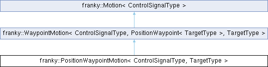

<table>
<colgroup>
<col style="width: 100%" />
</colgroup>
<tbody>
<tr class="odd">
<td>

franky 1.1.3

A High-Level Motion API for Franka

</td>
</tr>
</tbody>
</table>

Loading...

Searching...

No Matches

  - [franky](namespacefranky.md)
  - [PositionWaypointMotion](classfranky_1_1_position_waypoint_motion.md)

[Public Member Functions](classfranky_1_1_position_waypoint_motion.md#pub-methods) | [Protected Member Functions](classfranky_1_1_position_waypoint_motion.md#pro-methods) | [List of all members](classfranky_1_1_position_waypoint_motion-members.md)

franky::PositionWaypointMotion\< ControlSignalType, TargetType \> Class Template Referenceabstract

A motion following multiple positional waypoints in a time-optimal way. Works with arbitrary initial conditions. [More...](classfranky_1_1_position_waypoint_motion.md#details)

`#include <position_waypoint_motion.hpp>`

Inheritance diagram for franky::PositionWaypointMotion\< ControlSignalType, TargetType \>:

##  Public Member Functions

 

[PositionWaypointMotion](classfranky_1_1_position_waypoint_motion.md#ad5d16a0e7416918355c6110df27a93e4) (std::vector\< [PositionWaypoint](structfranky_1_1_position_waypoint.md)\< [TargetType](namespacefranky.md#a0b6bfc825c262ae89d9b0adcccd97ab0) \> \> [waypoints](namespacefranky.md#a0b6bfc825c262ae89d9b0adcccd97ab0), [const](namespacefranky.md#a0b6bfc825c262ae89d9b0adcccd97ab0) [RelativeDynamicsFactor](classfranky_1_1_relative_dynamics_factor.md) \&relative\_dynamics\_factor=1.0, [bool](namespacefranky.md#a0b6bfc825c262ae89d9b0adcccd97ab0) return\_when\_finished=[true](namespacefranky.md#a0b6bfc825c262ae89d9b0adcccd97ab0))

 

 Public Member Functions inherited from [franky::WaypointMotion\< ControlSignalType, PositionWaypoint\< TargetType \>, TargetType \>](classfranky_1_1_waypoint_motion.md)

 

[WaypointMotion](classfranky_1_1_waypoint_motion.md#a53c26db8057d1048efafe5a38a372f77) (std::vector\< [PositionWaypoint](structfranky_1_1_position_waypoint.md)\< TargetType \> \> waypoints, bool return\_when\_finished=true)

 

 Public Member Functions inherited from [franky::Motion\< ControlSignalType \>](classfranky_1_1_motion.md)

[virtual](namespacefranky.md#a0b6bfc825c262ae89d9b0adcccd97ab0) 

[\~Motion](classfranky_1_1_motion.md#aa6d72b7a606055fc444bf2da0c463d16) ()=[default](namespacefranky.md#a0b6bfc825c262ae89d9b0adcccd97ab0)

 

[void](namespacefranky.md#a0b6bfc825c262ae89d9b0adcccd97ab0) 

[addReaction](classfranky_1_1_motion.md#a52f0efb3e6c876f480eceb75a18d7448) (std::shared\_ptr\< [Reaction](classfranky_1_1_reaction.md)\< [ControlSignalType](namespacefranky.md#a9a12fea9c3341e3437af837efe8ebaac) \> \> [reaction](namespacefranky.md#a0b6bfc825c262ae89d9b0adcccd97ab0))

 

Add a reaction to the motion.  

 

[void](namespacefranky.md#a0b6bfc825c262ae89d9b0adcccd97ab0) 

[addReactionFront](classfranky_1_1_motion.md#a8fdbf32e0808fb2f01514f83ee964347) (std::shared\_ptr\< [Reaction](classfranky_1_1_reaction.md)\< [ControlSignalType](namespacefranky.md#a9a12fea9c3341e3437af837efe8ebaac) \> \> [reaction](namespacefranky.md#a0b6bfc825c262ae89d9b0adcccd97ab0))

 

Add a reaction to the front of the reaction list.  

 

std::vector\< std::shared\_ptr\< [Reaction](classfranky_1_1_reaction.md)\< [ControlSignalType](namespacefranky.md#a9a12fea9c3341e3437af837efe8ebaac) \> \> \> 

[reactions](classfranky_1_1_motion.md#aed40663a195eb68318799d19451c5a0d) ()

 

Currently registered reactions of the motion.  

 

[void](namespacefranky.md#a0b6bfc825c262ae89d9b0adcccd97ab0) 

[registerCallback](classfranky_1_1_motion.md#a05ed2a4f6dbcd406f9298a7c8e4e76c2) ([CallbackType](classfranky_1_1_motion.md#aabc4cfc38ed77466ca94be5b1c38fc6c) [callback](namespacefranky.md#a0b6bfc825c262ae89d9b0adcccd97ab0))

 

Register a callback that is called in every step of the motion.  

 

[void](namespacefranky.md#a0b6bfc825c262ae89d9b0adcccd97ab0) 

[init](classfranky_1_1_motion.md#a3780f86a0c58bdfb959e4d9bb65179d6) ([Robot](classfranky_1_1_robot.md) \*[robot](classfranky_1_1_motion.md#a4a279dafcbb7ae10605f58d27a3a368f), [const](namespacefranky.md#a0b6bfc825c262ae89d9b0adcccd97ab0) [RobotState](structfranky_1_1_robot_state.md) &[robot\_state](namespacefranky.md#a0b6bfc825c262ae89d9b0adcccd97ab0), [const](namespacefranky.md#a0b6bfc825c262ae89d9b0adcccd97ab0) std::optional\< [ControlSignalType](namespacefranky.md#a9a12fea9c3341e3437af837efe8ebaac) \> &[previous\_command](namespacefranky.md#a0b6bfc825c262ae89d9b0adcccd97ab0))

 

Initialize the motion.  

 

[ControlSignalType](namespacefranky.md#a9a12fea9c3341e3437af837efe8ebaac) 

[nextCommand](classfranky_1_1_motion.md#abc04c5fe350635cf36bc1e459736ddb7) ([const](namespacefranky.md#a0b6bfc825c262ae89d9b0adcccd97ab0) [RobotState](structfranky_1_1_robot_state.md) &[robot\_state](namespacefranky.md#a0b6bfc825c262ae89d9b0adcccd97ab0), franka::Duration [time\_step](namespacefranky.md#a0b6bfc825c262ae89d9b0adcccd97ab0), franka::Duration [rel\_time](namespacefranky.md#a0b6bfc825c262ae89d9b0adcccd97ab0), franka::Duration [abs\_time](namespacefranky.md#a0b6bfc825c262ae89d9b0adcccd97ab0), [const](namespacefranky.md#a0b6bfc825c262ae89d9b0adcccd97ab0) std::optional\< [ControlSignalType](namespacefranky.md#a9a12fea9c3341e3437af837efe8ebaac) \> &[previous\_command](namespacefranky.md#a0b6bfc825c262ae89d9b0adcccd97ab0))

 

Get the next command of the motion.  

 

std::shared\_ptr\< [Motion](classfranky_1_1_motion.md)\< [ControlSignalType](namespacefranky.md#a9a12fea9c3341e3437af837efe8ebaac) \> \> 

[checkAndCallReactions](classfranky_1_1_motion.md#a2a0e78863021c3c2116c8500c9386369) ([const](namespacefranky.md#a0b6bfc825c262ae89d9b0adcccd97ab0) [RobotState](structfranky_1_1_robot_state.md) &[robot\_state](namespacefranky.md#a0b6bfc825c262ae89d9b0adcccd97ab0), franka::Duration [rel\_time](namespacefranky.md#a0b6bfc825c262ae89d9b0adcccd97ab0), franka::Duration [abs\_time](namespacefranky.md#a0b6bfc825c262ae89d9b0adcccd97ab0))

 

Check and call reactions.  

 

##  Protected Member Functions

[void](namespacefranky.md#a0b6bfc825c262ae89d9b0adcccd97ab0) 

[setInputLimits](classfranky_1_1_position_waypoint_motion.md#a8ebb35ebb3363acfec93c9228418804a) ([const](namespacefranky.md#a0b6bfc825c262ae89d9b0adcccd97ab0) [PositionWaypoint](structfranky_1_1_position_waypoint.md)\< [TargetType](namespacefranky.md#a0b6bfc825c262ae89d9b0adcccd97ab0) \> &[waypoint](namespacefranky.md#a0b6bfc825c262ae89d9b0adcccd97ab0), ruckig::InputParameter\< 7 \> &[input\_parameter](namespacefranky.md#a0b6bfc825c262ae89d9b0adcccd97ab0)) [const](namespacefranky.md#a0b6bfc825c262ae89d9b0adcccd97ab0) [override](namespacefranky.md#a0b6bfc825c262ae89d9b0adcccd97ab0)

 

[void](namespacefranky.md#a0b6bfc825c262ae89d9b0adcccd97ab0) 

[extrapolateMotion](classfranky_1_1_position_waypoint_motion.md#a345e479ffc4f38dba2a1128805108e19) ([const](namespacefranky.md#a0b6bfc825c262ae89d9b0adcccd97ab0) [RobotState](structfranky_1_1_robot_state.md) &[robot\_state](namespacefranky.md#a0b6bfc825c262ae89d9b0adcccd97ab0), [const](namespacefranky.md#a0b6bfc825c262ae89d9b0adcccd97ab0) franka::Duration &[time\_step](namespacefranky.md#a0b6bfc825c262ae89d9b0adcccd97ab0), [const](namespacefranky.md#a0b6bfc825c262ae89d9b0adcccd97ab0) ruckig::InputParameter\< 7 \> &[input\_parameter](namespacefranky.md#a0b6bfc825c262ae89d9b0adcccd97ab0), ruckig::OutputParameter\< 7 \> &[output\_parameter](namespacefranky.md#a0b6bfc825c262ae89d9b0adcccd97ab0)) [const](namespacefranky.md#a0b6bfc825c262ae89d9b0adcccd97ab0) [override](namespacefranky.md#a0b6bfc825c262ae89d9b0adcccd97ab0)

 

std::tuple\< [Vector7d](namespacefranky.md#a4c36e6539a78f808bf759142dec935c4), [Vector7d](namespacefranky.md#a4c36e6539a78f808bf759142dec935c4), [Vector7d](namespacefranky.md#a4c36e6539a78f808bf759142dec935c4) \> 

[getAbsoluteInputLimits](classfranky_1_1_position_waypoint_motion.md#a98d70e2d1e3113b5e5f86da03a21f714) () [const](namespacefranky.md#a0b6bfc825c262ae89d9b0adcccd97ab0) [override](namespacefranky.md#a0b6bfc825c262ae89d9b0adcccd97ab0)=0

 

[virtual](namespacefranky.md#a0b6bfc825c262ae89d9b0adcccd97ab0) std::tuple\< [Vector7d](namespacefranky.md#a4c36e6539a78f808bf759142dec935c4), [Vector7d](namespacefranky.md#a4c36e6539a78f808bf759142dec935c4), [Vector7d](namespacefranky.md#a4c36e6539a78f808bf759142dec935c4) \> 

[getDesiredState](classfranky_1_1_position_waypoint_motion.md#a144c55eb67315d3e260690f2633e9942) ([const](namespacefranky.md#a0b6bfc825c262ae89d9b0adcccd97ab0) [RobotState](structfranky_1_1_robot_state.md) &[robot\_state](namespacefranky.md#a0b6bfc825c262ae89d9b0adcccd97ab0)) [const](namespacefranky.md#a0b6bfc825c262ae89d9b0adcccd97ab0) =0

 

 Protected Member Functions inherited from [franky::WaypointMotion\< ControlSignalType, PositionWaypoint\< TargetType \>, TargetType \>](classfranky_1_1_waypoint_motion.md)

void 

[initImpl](classfranky_1_1_waypoint_motion.md#ada8edd9d849ee29244b6c2c1cfa30f69) (const [RobotState](structfranky_1_1_robot_state.md) \&robot\_state, const std::optional\< [ControlSignalType](namespacefranky.md#a9a12fea9c3341e3437af837efe8ebaac) \> \&previous\_command) override

 

[ControlSignalType](namespacefranky.md#a9a12fea9c3341e3437af837efe8ebaac) 

[nextCommandImpl](classfranky_1_1_waypoint_motion.md#ade5d803c15b7f55e55258092788df21b) (const [RobotState](structfranky_1_1_robot_state.md) \&robot\_state, franka::Duration time\_step, franka::Duration rel\_time, franka::Duration abs\_time, const std::optional\< [ControlSignalType](namespacefranky.md#a9a12fea9c3341e3437af837efe8ebaac) \> \&previous\_command) override

 

virtual void 

[initWaypointMotion](classfranky_1_1_waypoint_motion.md#a2af18e1bfe76ed4e88f87ba03fe04fd8) (const [RobotState](structfranky_1_1_robot_state.md) \&robot\_state, const std::optional\< [ControlSignalType](namespacefranky.md#a9a12fea9c3341e3437af837efe8ebaac) \> \&previous\_command, ruckig::InputParameter\< 7 \> \&input\_parameter)=0

 

virtual void 

[setNewWaypoint](classfranky_1_1_waypoint_motion.md#aac84c2b66a185a3c21380a395cc49ae0) (const [RobotState](structfranky_1_1_robot_state.md) \&robot\_state, const std::optional\< [ControlSignalType](namespacefranky.md#a9a12fea9c3341e3437af837efe8ebaac) \> \&previous\_command, const [PositionWaypoint](structfranky_1_1_position_waypoint.md)\< TargetType \> \&new\_waypoint, ruckig::InputParameter\< 7 \> \&input\_parameter)=0

 

virtual void 

[checkWaypoint](classfranky_1_1_waypoint_motion.md#a9d8d450f3d2748cc32eb6bd2afd6f46c) (const [PositionWaypoint](structfranky_1_1_position_waypoint.md)\< TargetType \> \&waypoint) const

 

virtual [ControlSignalType](namespacefranky.md#a9a12fea9c3341e3437af837efe8ebaac) 

[getControlSignal](classfranky_1_1_waypoint_motion.md#aa019aeb70e7bc53a5a95a8ac2e2b62eb) (const [RobotState](structfranky_1_1_robot_state.md) \&robot\_state, const franka::Duration \&time\_step, const std::optional\< [ControlSignalType](namespacefranky.md#a9a12fea9c3341e3437af837efe8ebaac) \> \&previous\_command, const ruckig::InputParameter\< 7 \> \&input\_parameter)=0

 

 Protected Member Functions inherited from [franky::Motion\< ControlSignalType \>](classfranky_1_1_motion.md)

 

[Motion](classfranky_1_1_motion.md#ab18f33f97f86e9fb838fb6d6d79915b4) ()

 

[Robot](classfranky_1_1_robot.md) \* 

[robot](classfranky_1_1_motion.md#a4a279dafcbb7ae10605f58d27a3a368f) () [const](namespacefranky.md#a0b6bfc825c262ae89d9b0adcccd97ab0)

 

##  Additional Inherited Members

 Public Types inherited from [franky::Motion\< ControlSignalType \>](classfranky_1_1_motion.md)

[using](namespacefranky.md#a0b6bfc825c262ae89d9b0adcccd97ab0) 

[CallbackType](classfranky_1_1_motion.md#aabc4cfc38ed77466ca94be5b1c38fc6c) = std::function\< [void](namespacefranky.md#a0b6bfc825c262ae89d9b0adcccd97ab0)([const](namespacefranky.md#a0b6bfc825c262ae89d9b0adcccd97ab0) [RobotState](structfranky_1_1_robot_state.md) &, franka::Duration, franka::Duration, franka::Duration, [const](namespacefranky.md#a0b6bfc825c262ae89d9b0adcccd97ab0) [ControlSignalType](namespacefranky.md#a9a12fea9c3341e3437af837efe8ebaac) &)\>

 

## Detailed Description

template\<[typename](namespacefranky.md#a0b6bfc825c262ae89d9b0adcccd97ab0) [ControlSignalType](namespacefranky.md#a9a12fea9c3341e3437af837efe8ebaac), [typename](namespacefranky.md#a0b6bfc825c262ae89d9b0adcccd97ab0) [TargetType](namespacefranky.md#a0b6bfc825c262ae89d9b0adcccd97ab0)\>  
class franky::PositionWaypointMotion\< ControlSignalType, TargetType \>

A motion following multiple positional waypoints in a time-optimal way. Works with arbitrary initial conditions.

  - Template Parameters
    
    |                   |                                                                                                                                                                |
    | ----------------- | -------------------------------------------------------------------------------------------------------------------------------------------------------------- |
    | ControlSignalType | The type of the control signal. Either franka::Torques, franka::JointVelocities, franka::CartesianVelocities, franka::JointPositions or franka::CartesianPose. |
    | TargetType        | The type of the target of the waypoints.                                                                                                                       |
    

## Constructor & Destructor Documentation

## [◆ ](classfranky_1_1_position_waypoint_motion.md#ad5d16a0e7416918355c6110df27a93e4)PositionWaypointMotion()

template\<[typename](namespacefranky.md#a0b6bfc825c262ae89d9b0adcccd97ab0) [ControlSignalType](namespacefranky.md#a9a12fea9c3341e3437af837efe8ebaac) , [typename](namespacefranky.md#a0b6bfc825c262ae89d9b0adcccd97ab0) [TargetType](namespacefranky.md#a0b6bfc825c262ae89d9b0adcccd97ab0) \>

<table>
<colgroup>
<col style="width: 50%" />
<col style="width: 50%" />
</colgroup>
<tbody>
<tr class="odd">
<td><table>
<tbody>
<tr class="odd">
<td><a href="classfranky_1_1_position_waypoint_motion.md" class="el">franky::PositionWaypointMotion</a>&lt; <a href="namespacefranky.md#a9a12fea9c3341e3437af837efe8ebaac" class="el">ControlSignalType</a>, <a href="namespacefranky.md#a0b6bfc825c262ae89d9b0adcccd97ab0" class="el">TargetType</a> &gt;::PositionWaypointMotion</td>
<td>(</td>
<td>std::vector&lt; <a href="structfranky_1_1_position_waypoint.md" class="el">PositionWaypoint</a>&lt; <a href="namespacefranky.md#a0b6bfc825c262ae89d9b0adcccd97ab0" class="el">TargetType</a> &gt; &gt; </td>
<td><em>waypoints</em>,</td>
</tr>
<tr class="even">
<td></td>
<td></td>
<td><a href="namespacefranky.md#a0b6bfc825c262ae89d9b0adcccd97ab0" class="el">const</a> <a href="classfranky_1_1_relative_dynamics_factor.md" class="el">RelativeDynamicsFactor</a> &amp; </td>
<td><em>relative_dynamics_factor</em> = <code>1.0</code>,</td>
</tr>
<tr class="odd">
<td></td>
<td></td>
<td><a href="namespacefranky.md#a0b6bfc825c262ae89d9b0adcccd97ab0" class="el">bool</a> </td>
<td><em>return_when_finished</em> = <code>true</code> </td>
</tr>
<tr class="even">
<td></td>
<td>)</td>
<td></td>
<td></td>
</tr>
</tbody>
</table></td>
<td>inlineexplicit</td>
</tr>
</tbody>
</table>

  - Parameters
    
    |                            |                                                                                                                                                                          |
    | -------------------------- | ------------------------------------------------------------------------------------------------------------------------------------------------------------------------ |
    | waypoints                  | The waypoints to follow.                                                                                                                                                 |
    | relative\_dynamics\_factor | The relative dynamics factor for this motion. This factor will get multiplied with the robot's global dynamics factor to get the actual dynamics factor for this motion. |
    | return\_when\_finished     | Whether to end the motion when the last waypoint is reached or keep holding the last target.                                                                             |
    

## Member Function Documentation

## [◆ ](classfranky_1_1_position_waypoint_motion.md#a345e479ffc4f38dba2a1128805108e19)extrapolateMotion()

template\<[typename](namespacefranky.md#a0b6bfc825c262ae89d9b0adcccd97ab0) [ControlSignalType](namespacefranky.md#a9a12fea9c3341e3437af837efe8ebaac) , [typename](namespacefranky.md#a0b6bfc825c262ae89d9b0adcccd97ab0) [TargetType](namespacefranky.md#a0b6bfc825c262ae89d9b0adcccd97ab0) \>

<table>
<colgroup>
<col style="width: 50%" />
<col style="width: 50%" />
</colgroup>
<tbody>
<tr class="odd">
<td><table>
<tbody>
<tr class="odd">
<td><a href="namespacefranky.md#a0b6bfc825c262ae89d9b0adcccd97ab0" class="el">void</a> <a href="classfranky_1_1_position_waypoint_motion.md" class="el">franky::PositionWaypointMotion</a>&lt; <a href="namespacefranky.md#a9a12fea9c3341e3437af837efe8ebaac" class="el">ControlSignalType</a>, <a href="namespacefranky.md#a0b6bfc825c262ae89d9b0adcccd97ab0" class="el">TargetType</a> &gt;::extrapolateMotion</td>
<td>(</td>
<td><a href="namespacefranky.md#a0b6bfc825c262ae89d9b0adcccd97ab0" class="el">const</a> <a href="structfranky_1_1_robot_state.md" class="el">RobotState</a> &amp; </td>
<td><em>robot_state</em>,</td>
</tr>
<tr class="even">
<td></td>
<td></td>
<td><a href="namespacefranky.md#a0b6bfc825c262ae89d9b0adcccd97ab0" class="el">const</a> franka::Duration &amp; </td>
<td><em>time_step</em>,</td>
</tr>
<tr class="odd">
<td></td>
<td></td>
<td><a href="namespacefranky.md#a0b6bfc825c262ae89d9b0adcccd97ab0" class="el">const</a> ruckig::InputParameter&lt; 7 &gt; &amp; </td>
<td><em>input_parameter</em>,</td>
</tr>
<tr class="even">
<td></td>
<td></td>
<td>ruckig::OutputParameter&lt; 7 &gt; &amp; </td>
<td><em>output_parameter</em> </td>
</tr>
<tr class="odd">
<td></td>
<td>)</td>
<td></td>
<td>const</td>
</tr>
</tbody>
</table></td>
<td>inlineoverrideprotectedvirtual</td>
</tr>
</tbody>
</table>

Implements [franky::WaypointMotion\< ControlSignalType, PositionWaypoint\< TargetType \>, TargetType \>](classfranky_1_1_waypoint_motion.md#a24a6f06d1ca935764c37aa044d191750).

## [◆ ](classfranky_1_1_position_waypoint_motion.md#a98d70e2d1e3113b5e5f86da03a21f714)getAbsoluteInputLimits()

template\<[typename](namespacefranky.md#a0b6bfc825c262ae89d9b0adcccd97ab0) [ControlSignalType](namespacefranky.md#a9a12fea9c3341e3437af837efe8ebaac) , [typename](namespacefranky.md#a0b6bfc825c262ae89d9b0adcccd97ab0) [TargetType](namespacefranky.md#a0b6bfc825c262ae89d9b0adcccd97ab0) \>

<table>
<colgroup>
<col style="width: 50%" />
<col style="width: 50%" />
</colgroup>
<tbody>
<tr class="odd">
<td><table>
<tbody>
<tr class="odd">
<td>std::tuple&lt; <a href="namespacefranky.md#a4c36e6539a78f808bf759142dec935c4" class="el">Vector7d</a>, <a href="namespacefranky.md#a4c36e6539a78f808bf759142dec935c4" class="el">Vector7d</a>, <a href="namespacefranky.md#a4c36e6539a78f808bf759142dec935c4" class="el">Vector7d</a> &gt; <a href="classfranky_1_1_position_waypoint_motion.md" class="el">franky::PositionWaypointMotion</a>&lt; <a href="namespacefranky.md#a9a12fea9c3341e3437af837efe8ebaac" class="el">ControlSignalType</a>, <a href="namespacefranky.md#a0b6bfc825c262ae89d9b0adcccd97ab0" class="el">TargetType</a> &gt;::getAbsoluteInputLimits</td>
<td>(</td>
<td></td>
<td>)</td>
<td>const</td>
</tr>
</tbody>
</table></td>
<td>overrideprotectedpure virtual</td>
</tr>
</tbody>
</table>

Implements [franky::WaypointMotion\< ControlSignalType, PositionWaypoint\< TargetType \>, TargetType \>](classfranky_1_1_waypoint_motion.md#ae3c92f31c20dcb7f48107c1991d8be33).

Implemented in [franky::CartesianWaypointMotion](classfranky_1_1_cartesian_waypoint_motion.md#a493676502c53be9f6f0acf8a82cb8192), and [franky::JointWaypointMotion](classfranky_1_1_joint_waypoint_motion.md#a861df703835e15f447a9f40affe3625a).

## [◆ ](classfranky_1_1_position_waypoint_motion.md#a144c55eb67315d3e260690f2633e9942)getDesiredState()

template\<[typename](namespacefranky.md#a0b6bfc825c262ae89d9b0adcccd97ab0) [ControlSignalType](namespacefranky.md#a9a12fea9c3341e3437af837efe8ebaac) , [typename](namespacefranky.md#a0b6bfc825c262ae89d9b0adcccd97ab0) [TargetType](namespacefranky.md#a0b6bfc825c262ae89d9b0adcccd97ab0) \>

<table>
<colgroup>
<col style="width: 50%" />
<col style="width: 50%" />
</colgroup>
<tbody>
<tr class="odd">
<td><table>
<tbody>
<tr class="odd">
<td><a href="namespacefranky.md#a0b6bfc825c262ae89d9b0adcccd97ab0" class="el">virtual</a> std::tuple&lt; <a href="namespacefranky.md#a4c36e6539a78f808bf759142dec935c4" class="el">Vector7d</a>, <a href="namespacefranky.md#a4c36e6539a78f808bf759142dec935c4" class="el">Vector7d</a>, <a href="namespacefranky.md#a4c36e6539a78f808bf759142dec935c4" class="el">Vector7d</a> &gt; <a href="classfranky_1_1_position_waypoint_motion.md" class="el">franky::PositionWaypointMotion</a>&lt; <a href="namespacefranky.md#a9a12fea9c3341e3437af837efe8ebaac" class="el">ControlSignalType</a>, <a href="namespacefranky.md#a0b6bfc825c262ae89d9b0adcccd97ab0" class="el">TargetType</a> &gt;::getDesiredState</td>
<td>(</td>
<td><a href="namespacefranky.md#a0b6bfc825c262ae89d9b0adcccd97ab0" class="el">const</a> <a href="structfranky_1_1_robot_state.md" class="el">RobotState</a> &amp; </td>
<td><em>robot_state</em></td>
<td>)</td>
<td>const</td>
</tr>
</tbody>
</table></td>
<td>protectedpure virtual</td>
</tr>
</tbody>
</table>

Implemented in [franky::CartesianWaypointMotion](classfranky_1_1_cartesian_waypoint_motion.md#ac112a00b871d27d4dc45deb6eb0ea917), and [franky::JointWaypointMotion](classfranky_1_1_joint_waypoint_motion.md#a6389b5993ad5d5fd416b5f116aad3ec2).

## [◆ ](classfranky_1_1_position_waypoint_motion.md#a8ebb35ebb3363acfec93c9228418804a)setInputLimits()

template\<[typename](namespacefranky.md#a0b6bfc825c262ae89d9b0adcccd97ab0) [ControlSignalType](namespacefranky.md#a9a12fea9c3341e3437af837efe8ebaac) , [typename](namespacefranky.md#a0b6bfc825c262ae89d9b0adcccd97ab0) [TargetType](namespacefranky.md#a0b6bfc825c262ae89d9b0adcccd97ab0) \>

<table>
<colgroup>
<col style="width: 50%" />
<col style="width: 50%" />
</colgroup>
<tbody>
<tr class="odd">
<td><table>
<tbody>
<tr class="odd">
<td><a href="namespacefranky.md#a0b6bfc825c262ae89d9b0adcccd97ab0" class="el">void</a> <a href="classfranky_1_1_position_waypoint_motion.md" class="el">franky::PositionWaypointMotion</a>&lt; <a href="namespacefranky.md#a9a12fea9c3341e3437af837efe8ebaac" class="el">ControlSignalType</a>, <a href="namespacefranky.md#a0b6bfc825c262ae89d9b0adcccd97ab0" class="el">TargetType</a> &gt;::setInputLimits</td>
<td>(</td>
<td><a href="namespacefranky.md#a0b6bfc825c262ae89d9b0adcccd97ab0" class="el">const</a> <a href="structfranky_1_1_position_waypoint.md" class="el">PositionWaypoint</a>&lt; <a href="namespacefranky.md#a0b6bfc825c262ae89d9b0adcccd97ab0" class="el">TargetType</a> &gt; &amp; </td>
<td><em>waypoint</em>,</td>
</tr>
<tr class="even">
<td></td>
<td></td>
<td>ruckig::InputParameter&lt; 7 &gt; &amp; </td>
<td><em>input_parameter</em> </td>
</tr>
<tr class="odd">
<td></td>
<td>)</td>
<td></td>
<td>const</td>
</tr>
</tbody>
</table></td>
<td>inlineoverrideprotectedvirtual</td>
</tr>
</tbody>
</table>

Implements [franky::WaypointMotion\< ControlSignalType, PositionWaypoint\< TargetType \>, TargetType \>](classfranky_1_1_waypoint_motion.md#a4a54f0791590e317159518eb0353a199).

-----

The documentation for this class was generated from the following file:

  - /home/runner/work/franky/franky/include/franky/motion/[position\_waypoint\_motion.hpp](position__waypoint__motion_8hpp_source.md)

-----

Generated by  1.9.8
