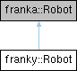

<table>
<colgroup>
<col style="width: 100%" />
</colgroup>
<tbody>
<tr class="odd">
<td>

franky 1.1.3

A High-Level Motion API for Franka

</td>
</tr>
</tbody>
</table>

Loading...

Searching...

No Matches

  - [franky](namespacefranky.md)
  - [Robot](classfranky_1_1_robot.md)

[Classes](classfranky_1_1_robot.md#nested-classes) | [Public Member Functions](classfranky_1_1_robot.md#pub-methods) | [Public Attributes](classfranky_1_1_robot.md#pub-attribs) | [Static Public Attributes](classfranky_1_1_robot.md#pub-static-attribs) | [List of all members](classfranky_1_1_robot-members.md)

franky::Robot Class Reference

A class representing a Franka robot. [More...](classfranky_1_1_robot.md#details)

`#include <robot.hpp>`

Inheritance diagram for franky::Robot:

##  Classes

struct  

[Params](structfranky_1_1_robot_1_1_params.md)

 

Global parameters for the robot. [More...](structfranky_1_1_robot_1_1_params.md#details)  

 

##  Public Member Functions

 

[Robot](classfranky_1_1_robot.md#ab017d5bb8451915dbc0fde436782c771) ([const](namespacefranky.md#a0b6bfc825c262ae89d9b0adcccd97ab0) std::string &[fci\_hostname](classfranky_1_1_robot.md#a25ca7e90c8a10848921fb35a378a7d33))

 

Connects to a robot at the given FCI IP address.  

 

 

[Robot](classfranky_1_1_robot.md#a242b157f9b7fa39617a84680b92ee477) ([const](namespacefranky.md#a0b6bfc825c262ae89d9b0adcccd97ab0) std::string &[fci\_hostname](classfranky_1_1_robot.md#a25ca7e90c8a10848921fb35a378a7d33), [const](namespacefranky.md#a0b6bfc825c262ae89d9b0adcccd97ab0) [Params](structfranky_1_1_robot_1_1_params.md) &[params](namespacefranky.md#a0b6bfc825c262ae89d9b0adcccd97ab0))

 

[void](namespacefranky.md#a0b6bfc825c262ae89d9b0adcccd97ab0) 

[setCollisionBehavior](classfranky_1_1_robot.md#aad586cb00aa450d5c51bc8260b9ad373) ([const](namespacefranky.md#a0b6bfc825c262ae89d9b0adcccd97ab0) [ScalarOrArray](namespacefranky.md#ae77a95d5f13271457b8c8fb645da3bd9)\< 7 \> &[torque\_threshold](namespacefranky.md#a0b6bfc825c262ae89d9b0adcccd97ab0), [const](namespacefranky.md#a0b6bfc825c262ae89d9b0adcccd97ab0) [ScalarOrArray](namespacefranky.md#ae77a95d5f13271457b8c8fb645da3bd9)\< 6 \> &[force\_threshold](namespacefranky.md#a0b6bfc825c262ae89d9b0adcccd97ab0))

 

Set the collision behavior of the robot.  

 

[void](namespacefranky.md#a0b6bfc825c262ae89d9b0adcccd97ab0) 

[setCollisionBehavior](classfranky_1_1_robot.md#a56b550916fb5b9df587e24a6b2353b68) ([const](namespacefranky.md#a0b6bfc825c262ae89d9b0adcccd97ab0) [ScalarOrArray](namespacefranky.md#ae77a95d5f13271457b8c8fb645da3bd9)\< 7 \> &[lower\_torque\_threshold](namespacefranky.md#a0b6bfc825c262ae89d9b0adcccd97ab0), [const](namespacefranky.md#a0b6bfc825c262ae89d9b0adcccd97ab0) [ScalarOrArray](namespacefranky.md#ae77a95d5f13271457b8c8fb645da3bd9)\< 7 \> &[upper\_torque\_threshold](namespacefranky.md#a0b6bfc825c262ae89d9b0adcccd97ab0), [const](namespacefranky.md#a0b6bfc825c262ae89d9b0adcccd97ab0) [ScalarOrArray](namespacefranky.md#ae77a95d5f13271457b8c8fb645da3bd9)\< 6 \> &[lower\_force\_threshold](namespacefranky.md#a0b6bfc825c262ae89d9b0adcccd97ab0), [const](namespacefranky.md#a0b6bfc825c262ae89d9b0adcccd97ab0) [ScalarOrArray](namespacefranky.md#ae77a95d5f13271457b8c8fb645da3bd9)\< 6 \> &[upper\_force\_threshold](namespacefranky.md#a0b6bfc825c262ae89d9b0adcccd97ab0))

 

Set the collision behavior of the robot.  

 

[void](namespacefranky.md#a0b6bfc825c262ae89d9b0adcccd97ab0) 

[setCollisionBehavior](classfranky_1_1_robot.md#a8b1476422439a82844e934873c88888a) ([const](namespacefranky.md#a0b6bfc825c262ae89d9b0adcccd97ab0) [ScalarOrArray](namespacefranky.md#ae77a95d5f13271457b8c8fb645da3bd9)\< 7 \> &[lower\_torque\_threshold\_acceleration](namespacefranky.md#a0b6bfc825c262ae89d9b0adcccd97ab0), [const](namespacefranky.md#a0b6bfc825c262ae89d9b0adcccd97ab0) [ScalarOrArray](namespacefranky.md#ae77a95d5f13271457b8c8fb645da3bd9)\< 7 \> &[upper\_torque\_threshold\_acceleration](namespacefranky.md#a0b6bfc825c262ae89d9b0adcccd97ab0), [const](namespacefranky.md#a0b6bfc825c262ae89d9b0adcccd97ab0) [ScalarOrArray](namespacefranky.md#ae77a95d5f13271457b8c8fb645da3bd9)\< 7 \> &[lower\_torque\_threshold\_nominal](namespacefranky.md#a0b6bfc825c262ae89d9b0adcccd97ab0), [const](namespacefranky.md#a0b6bfc825c262ae89d9b0adcccd97ab0) [ScalarOrArray](namespacefranky.md#ae77a95d5f13271457b8c8fb645da3bd9)\< 7 \> &[upper\_torque\_threshold\_nominal](namespacefranky.md#a0b6bfc825c262ae89d9b0adcccd97ab0), [const](namespacefranky.md#a0b6bfc825c262ae89d9b0adcccd97ab0) [ScalarOrArray](namespacefranky.md#ae77a95d5f13271457b8c8fb645da3bd9)\< 6 \> &[lower\_force\_threshold\_acceleration](namespacefranky.md#a0b6bfc825c262ae89d9b0adcccd97ab0), [const](namespacefranky.md#a0b6bfc825c262ae89d9b0adcccd97ab0) [ScalarOrArray](namespacefranky.md#ae77a95d5f13271457b8c8fb645da3bd9)\< 6 \> &[upper\_force\_threshold\_acceleration](namespacefranky.md#a0b6bfc825c262ae89d9b0adcccd97ab0), [const](namespacefranky.md#a0b6bfc825c262ae89d9b0adcccd97ab0) [ScalarOrArray](namespacefranky.md#ae77a95d5f13271457b8c8fb645da3bd9)\< 6 \> &[lower\_force\_threshold\_nominal](namespacefranky.md#a0b6bfc825c262ae89d9b0adcccd97ab0), [const](namespacefranky.md#a0b6bfc825c262ae89d9b0adcccd97ab0) [ScalarOrArray](namespacefranky.md#ae77a95d5f13271457b8c8fb645da3bd9)\< 6 \> &[upper\_force\_threshold\_nominal](namespacefranky.md#a0b6bfc825c262ae89d9b0adcccd97ab0))

 

Set the collision behavior of the robot.  

 

[bool](namespacefranky.md#a0b6bfc825c262ae89d9b0adcccd97ab0) 

[recoverFromErrors](classfranky_1_1_robot.md#a7389f6e088ba456dd689c093ee6640e0) ()

 

Calls the automatic error recovery of the robot and returns whether the recovery was successful.  

 

[bool](namespacefranky.md#a0b6bfc825c262ae89d9b0adcccd97ab0) 

[hasErrors](classfranky_1_1_robot.md#ad3d89c3fd930ea6590d0abd10fbdb755) ()

 

Returns whether the robot has errors.  

 

[RobotPose](classfranky_1_1_robot_pose.md) 

[currentPose](classfranky_1_1_robot.md#adf04b2531a0ac4a16a759cc048d82e15) ()

 

Returns the current pose of the robot.  

 

[RobotVelocity](classfranky_1_1_robot_velocity.md) 

[currentCartesianVelocity](classfranky_1_1_robot.md#acb900ba5048aa792f4c16150703d8a6b) ()

 

Returns the current cartesian velocity of the robot.  

 

[CartesianState](classfranky_1_1_cartesian_state.md) 

[currentCartesianState](classfranky_1_1_robot.md#a4d2595f5969257dd18dce4997d59f7cd) ()

 

Returns the current cartesian state of the robot.  

 

[JointState](classfranky_1_1_joint_state.md) 

[currentJointState](classfranky_1_1_robot.md#aab5abbad176d18599f25a4204e354cfb) ()

 

Returns the current joint state of the robot.  

 

[Vector7d](namespacefranky.md#a4c36e6539a78f808bf759142dec935c4) 

[currentJointPositions](classfranky_1_1_robot.md#a4aae0b9dbfe4d88615810d1743c43646) ()

 

Returns the current joint positions of the robot.  

 

[Vector7d](namespacefranky.md#a4c36e6539a78f808bf759142dec935c4) 

[currentJointVelocities](classfranky_1_1_robot.md#a2d118e16b5789a8442c486cca80ed3c6) ()

 

Returns the current joint velocities of the robot.  

 

[RobotState](structfranky_1_1_robot_state.md) 

[state](classfranky_1_1_robot.md#a5ee4537b589a74f8df79be730967bab7) ()

 

Returns the current state of the robot.  

 

[RelativeDynamicsFactor](classfranky_1_1_relative_dynamics_factor.md) 

[relative\_dynamics\_factor](classfranky_1_1_robot.md#a43f2f6dde0cca1f8c21fa6c1fb1b28c0) ()

 

Returns the current global relative dynamics factor of the robot.  

 

[void](namespacefranky.md#a0b6bfc825c262ae89d9b0adcccd97ab0) 

[setRelativeDynamicsFactor](classfranky_1_1_robot.md#ad19caa63f0237d39463e5a3dd0b3e793) ([const](namespacefranky.md#a0b6bfc825c262ae89d9b0adcccd97ab0) [RelativeDynamicsFactor](classfranky_1_1_relative_dynamics_factor.md) &[relative\_dynamics\_factor](classfranky_1_1_robot.md#a43f2f6dde0cca1f8c21fa6c1fb1b28c0))

 

Sets the global relative dynamics factor of the robot.  

 

[bool](namespacefranky.md#a0b6bfc825c262ae89d9b0adcccd97ab0) 

[is\_in\_control](classfranky_1_1_robot.md#a971c769d2725f11c3437d28f9ad6de61) ()

 

Whether the robot is currently in control, i.e. a motion is being executed.  

 

std::string 

[fci\_hostname](classfranky_1_1_robot.md#a25ca7e90c8a10848921fb35a378a7d33) () [const](namespacefranky.md#a0b6bfc825c262ae89d9b0adcccd97ab0)

 

The hostname of the robot.  

 

std::optional\< [ControlSignalType](namespacefranky.md#a9a12fea9c3341e3437af837efe8ebaac) \> 

[current\_control\_signal\_type](classfranky_1_1_robot.md#a15b55042954d0bec0f2190abf2c8bb59) ()

 

The type of the current control signal.  

 

std::shared\_ptr\< [const](namespacefranky.md#a0b6bfc825c262ae89d9b0adcccd97ab0) [Model](classfranky_1_1_model.md) \> 

[model](classfranky_1_1_robot.md#ad22fb0483ab2b3402b28b6f35dccaf9f) () [const](namespacefranky.md#a0b6bfc825c262ae89d9b0adcccd97ab0)

 

The model of the robot.  

 

[bool](namespacefranky.md#a0b6bfc825c262ae89d9b0adcccd97ab0) 

[joinMotion](classfranky_1_1_robot.md#a2f48445583c522dd798e312bdbacf864) ()

 

Wait for the current motion to finish. Throw any exceptions that occurred during the motion.  

 

template\<[class](namespacefranky.md#a0b6bfc825c262ae89d9b0adcccd97ab0) [Rep](namespacefranky.md#a0b6bfc825c262ae89d9b0adcccd97ab0) , [class](namespacefranky.md#a0b6bfc825c262ae89d9b0adcccd97ab0) [Period](namespacefranky.md#a0b6bfc825c262ae89d9b0adcccd97ab0) \>

[bool](namespacefranky.md#a0b6bfc825c262ae89d9b0adcccd97ab0) 

[joinMotion](classfranky_1_1_robot.md#a114a614ee78f9b554dd9aaef8fe2a1d8) ([const](namespacefranky.md#a0b6bfc825c262ae89d9b0adcccd97ab0) std::chrono::duration\< [Rep](namespacefranky.md#a0b6bfc825c262ae89d9b0adcccd97ab0), [Period](namespacefranky.md#a0b6bfc825c262ae89d9b0adcccd97ab0) \> &[timeout](namespacefranky.md#a0b6bfc825c262ae89d9b0adcccd97ab0))

 

Wait for the current motion to finish with a timeout. Throw any exceptions that occurred during the motion.  

 

[bool](namespacefranky.md#a0b6bfc825c262ae89d9b0adcccd97ab0) 

[pollMotion](classfranky_1_1_robot.md#afb00fbee84e00d09f3c8dedbfe5708f4) ()

 

Check whether the robot is still in motion. This function is non-blocking and returns immediately. Throw any exceptions that occurred during the motion.  

 

[void](namespacefranky.md#a0b6bfc825c262ae89d9b0adcccd97ab0) 

[move](classfranky_1_1_robot.md#a2142a3e3b425407d33d4c472f5094dba) ([const](namespacefranky.md#a0b6bfc825c262ae89d9b0adcccd97ab0) std::shared\_ptr\< [Motion](classfranky_1_1_motion.md)\< franka::CartesianPose \> \> &[motion](namespacefranky.md#a0b6bfc825c262ae89d9b0adcccd97ab0), [bool](namespacefranky.md#a0b6bfc825c262ae89d9b0adcccd97ab0) [async](namespacefranky.md#a0b6bfc825c262ae89d9b0adcccd97ab0)=[false](namespacefranky.md#a0b6bfc825c262ae89d9b0adcccd97ab0))

 

Execute the given motion.  

 

[void](namespacefranky.md#a0b6bfc825c262ae89d9b0adcccd97ab0) 

[move](classfranky_1_1_robot.md#ad014400edfd5bb1cf837fd09765ac5ce) ([const](namespacefranky.md#a0b6bfc825c262ae89d9b0adcccd97ab0) std::shared\_ptr\< [Motion](classfranky_1_1_motion.md)\< franka::CartesianVelocities \> \> &[motion](namespacefranky.md#a0b6bfc825c262ae89d9b0adcccd97ab0), [bool](namespacefranky.md#a0b6bfc825c262ae89d9b0adcccd97ab0) [async](namespacefranky.md#a0b6bfc825c262ae89d9b0adcccd97ab0)=[false](namespacefranky.md#a0b6bfc825c262ae89d9b0adcccd97ab0))

 

Execute the given motion.  

 

[void](namespacefranky.md#a0b6bfc825c262ae89d9b0adcccd97ab0) 

[move](classfranky_1_1_robot.md#a0e44e9689e22525b286633a43c7eb443) ([const](namespacefranky.md#a0b6bfc825c262ae89d9b0adcccd97ab0) std::shared\_ptr\< [Motion](classfranky_1_1_motion.md)\< franka::JointPositions \> \> &[motion](namespacefranky.md#a0b6bfc825c262ae89d9b0adcccd97ab0), [bool](namespacefranky.md#a0b6bfc825c262ae89d9b0adcccd97ab0) [async](namespacefranky.md#a0b6bfc825c262ae89d9b0adcccd97ab0)=[false](namespacefranky.md#a0b6bfc825c262ae89d9b0adcccd97ab0))

 

Execute the given motion.  

 

[void](namespacefranky.md#a0b6bfc825c262ae89d9b0adcccd97ab0) 

[move](classfranky_1_1_robot.md#aa031b868eacc474676306c3d581f43e7) ([const](namespacefranky.md#a0b6bfc825c262ae89d9b0adcccd97ab0) std::shared\_ptr\< [Motion](classfranky_1_1_motion.md)\< franka::JointVelocities \> \> &[motion](namespacefranky.md#a0b6bfc825c262ae89d9b0adcccd97ab0), [bool](namespacefranky.md#a0b6bfc825c262ae89d9b0adcccd97ab0) [async](namespacefranky.md#a0b6bfc825c262ae89d9b0adcccd97ab0)=[false](namespacefranky.md#a0b6bfc825c262ae89d9b0adcccd97ab0))

 

Execute the given motion.  

 

[void](namespacefranky.md#a0b6bfc825c262ae89d9b0adcccd97ab0) 

[move](classfranky_1_1_robot.md#a4c1066ea03a41b71998d6560a97e7fb1) ([const](namespacefranky.md#a0b6bfc825c262ae89d9b0adcccd97ab0) std::shared\_ptr\< [Motion](classfranky_1_1_motion.md)\< franka::Torques \> \> &[motion](namespacefranky.md#a0b6bfc825c262ae89d9b0adcccd97ab0), [bool](namespacefranky.md#a0b6bfc825c262ae89d9b0adcccd97ab0) [async](namespacefranky.md#a0b6bfc825c262ae89d9b0adcccd97ab0)=[false](namespacefranky.md#a0b6bfc825c262ae89d9b0adcccd97ab0))

 

Execute the given motion.  

 

##  Public Attributes

[DynamicsLimit](classfranky_1_1_dynamics_limit.md)\< [double](namespacefranky.md#a0b6bfc825c262ae89d9b0adcccd97ab0) \> 

[translation\_velocity\_limit](classfranky_1_1_robot.md#a7165eb847d474a244c6fba5b595cd84b)

 

Translational velocity limit \[m/s\].  

 

[DynamicsLimit](classfranky_1_1_dynamics_limit.md)\< [double](namespacefranky.md#a0b6bfc825c262ae89d9b0adcccd97ab0) \> 

[rotation\_velocity\_limit](classfranky_1_1_robot.md#a83a0166687db4309de4f9cd7b76eb723)

 

Rotational velocity limit \[rad/s\].  

 

[DynamicsLimit](classfranky_1_1_dynamics_limit.md)\< [double](namespacefranky.md#a0b6bfc825c262ae89d9b0adcccd97ab0) \> 

[elbow\_velocity\_limit](classfranky_1_1_robot.md#a823551f59caa0f025f1d6af381e38471)

 

Elbow velocity limit \[rad/s\].  

 

[DynamicsLimit](classfranky_1_1_dynamics_limit.md)\< [double](namespacefranky.md#a0b6bfc825c262ae89d9b0adcccd97ab0) \> 

[translation\_acceleration\_limit](classfranky_1_1_robot.md#ad31901ce61f3fce2adf885c776b7bb8a)

 

Translational acceleration limit \[m/s²\].  

 

[DynamicsLimit](classfranky_1_1_dynamics_limit.md)\< [double](namespacefranky.md#a0b6bfc825c262ae89d9b0adcccd97ab0) \> 

[rotation\_acceleration\_limit](classfranky_1_1_robot.md#ae7725e4fffdc28b8db727068a105707a)

 

Rotational acceleration limit \[rad/s²\].  

 

[DynamicsLimit](classfranky_1_1_dynamics_limit.md)\< [double](namespacefranky.md#a0b6bfc825c262ae89d9b0adcccd97ab0) \> 

[elbow\_acceleration\_limit](classfranky_1_1_robot.md#a3790d2dd31a3b2e2ccc32f39b11816fb)

 

Elbow acceleration limit \[rad/s²\].  

 

[DynamicsLimit](classfranky_1_1_dynamics_limit.md)\< [double](namespacefranky.md#a0b6bfc825c262ae89d9b0adcccd97ab0) \> 

[translation\_jerk\_limit](classfranky_1_1_robot.md#a676d0b273cc01dd02fa536ce07992a73)

 

Translational jerk limit \[m/s³\].  

 

[DynamicsLimit](classfranky_1_1_dynamics_limit.md)\< [double](namespacefranky.md#a0b6bfc825c262ae89d9b0adcccd97ab0) \> 

[rotation\_jerk\_limit](classfranky_1_1_robot.md#ace7d9414a2e80b4a6c760578ebd382d3)

 

Rotational jerk limit \[rad/s³\].  

 

[DynamicsLimit](classfranky_1_1_dynamics_limit.md)\< [double](namespacefranky.md#a0b6bfc825c262ae89d9b0adcccd97ab0) \> 

[elbow\_jerk\_limit](classfranky_1_1_robot.md#a87e2193710fe1cc287a21729bba88106)

 

Elbow jerk limit \[rad/s³\].  

 

[DynamicsLimit](classfranky_1_1_dynamics_limit.md)\< [Vector7d](namespacefranky.md#a4c36e6539a78f808bf759142dec935c4) \> 

[joint\_velocity\_limit](classfranky_1_1_robot.md#a4d5a68c15c97aba59872e6795ed1500f)

 

Joint velocity limit \[rad/s\].  

 

[DynamicsLimit](classfranky_1_1_dynamics_limit.md)\< [Vector7d](namespacefranky.md#a4c36e6539a78f808bf759142dec935c4) \> 

[joint\_acceleration\_limit](classfranky_1_1_robot.md#a0348db847ba5ddaae49c0dcb48f4a710)

 

Joint acceleration limit \[rad/s²\].  

 

[DynamicsLimit](classfranky_1_1_dynamics_limit.md)\< [Vector7d](namespacefranky.md#a4c36e6539a78f808bf759142dec935c4) \> 

[joint\_jerk\_limit](classfranky_1_1_robot.md#aa3bd3f0843a7c2c4aeae3d5c21d506b9)

 

Joint jerk limit \[rad/s³\].  

 

##  Static Public Attributes

[static](namespacefranky.md#a0b6bfc825c262ae89d9b0adcccd97ab0) [constexpr](namespacefranky.md#a0b6bfc825c262ae89d9b0adcccd97ab0) [size\_t](namespacefranky.md#a0b6bfc825c262ae89d9b0adcccd97ab0) 

[degrees\_of\_freedoms](classfranky_1_1_robot.md#aba9f9254a1af4fea2af758c450399c4c) {7}

 

[static](namespacefranky.md#a0b6bfc825c262ae89d9b0adcccd97ab0) [constexpr](namespacefranky.md#a0b6bfc825c262ae89d9b0adcccd97ab0) [double](namespacefranky.md#a0b6bfc825c262ae89d9b0adcccd97ab0) 

[control\_rate](classfranky_1_1_robot.md#a3155de462f5590cc67b2874acf846f53) {0.001}

 

## Detailed Description

A class representing a Franka robot.

This class extends the franka::Robot class and adds additional functionality to it.

## Constructor & Destructor Documentation

## [◆ ](classfranky_1_1_robot.md#ab017d5bb8451915dbc0fde436782c771)Robot() \[1/2\]

<table>
<colgroup>
<col style="width: 50%" />
<col style="width: 50%" />
</colgroup>
<tbody>
<tr class="odd">
<td><table>
<tbody>
<tr class="odd">
<td>franky::Robot::Robot</td>
<td>(</td>
<td><a href="namespacefranky.md#a0b6bfc825c262ae89d9b0adcccd97ab0" class="el">const</a> std::string &amp; </td>
<td><em>fci_hostname</em></td>
<td>)</td>
<td></td>
</tr>
</tbody>
</table></td>
<td>explicit</td>
</tr>
</tbody>
</table>

Connects to a robot at the given FCI IP address.

  - Parameters
    
    |               |                                          |
    | ------------- | ---------------------------------------- |
    | fci\_hostname | The hostname or IP address of the robot. |
    

## [◆ ](classfranky_1_1_robot.md#a242b157f9b7fa39617a84680b92ee477)Robot() \[2/2\]

<table>
<colgroup>
<col style="width: 50%" />
<col style="width: 50%" />
</colgroup>
<tbody>
<tr class="odd">
<td><table>
<tbody>
<tr class="odd">
<td>franky::Robot::Robot</td>
<td>(</td>
<td><a href="namespacefranky.md#a0b6bfc825c262ae89d9b0adcccd97ab0" class="el">const</a> std::string &amp; </td>
<td><em>fci_hostname</em>,</td>
</tr>
<tr class="even">
<td></td>
<td></td>
<td><a href="namespacefranky.md#a0b6bfc825c262ae89d9b0adcccd97ab0" class="el">const</a> <a href="structfranky_1_1_robot_1_1_params.md" class="el">Params</a> &amp; </td>
<td><em>params</em> </td>
</tr>
<tr class="odd">
<td></td>
<td>)</td>
<td></td>
<td></td>
</tr>
</tbody>
</table></td>
<td>explicit</td>
</tr>
</tbody>
</table>

  - Parameters
    
    |               |                                          |
    | ------------- | ---------------------------------------- |
    | fci\_hostname | The hostname or IP address of the robot. |
    | params        | The parameters for the robot.            |
    

## Member Function Documentation

## [◆ ](classfranky_1_1_robot.md#a15b55042954d0bec0f2190abf2c8bb59)current\_control\_signal\_type()

|                                                                                                                                              |   |  |   |  |
| -------------------------------------------------------------------------------------------------------------------------------------------- | - |  | - |  |
| std::optional\< [ControlSignalType](namespacefranky.md#a9a12fea9c3341e3437af837efe8ebaac) \> franky::Robot::current\_control\_signal\_type | ( |  | ) |  |

The type of the current control signal.

## [◆ ](classfranky_1_1_robot.md#a4d2595f5969257dd18dce4997d59f7cd)currentCartesianState()

<table>
<colgroup>
<col style="width: 50%" />
<col style="width: 50%" />
</colgroup>
<tbody>
<tr class="odd">
<td><table>
<tbody>
<tr class="odd">
<td><a href="classfranky_1_1_cartesian_state.md" class="el">CartesianState</a> franky::Robot::currentCartesianState</td>
<td>(</td>
<td></td>
<td>)</td>
<td></td>
</tr>
</tbody>
</table></td>
<td>inline</td>
</tr>
</tbody>
</table>

Returns the current cartesian state of the robot.

  - Returns  
    The current cartesian state of the robot.

## [◆ ](classfranky_1_1_robot.md#acb900ba5048aa792f4c16150703d8a6b)currentCartesianVelocity()

<table>
<colgroup>
<col style="width: 50%" />
<col style="width: 50%" />
</colgroup>
<tbody>
<tr class="odd">
<td><table>
<tbody>
<tr class="odd">
<td><a href="classfranky_1_1_robot_velocity.md" class="el">RobotVelocity</a> franky::Robot::currentCartesianVelocity</td>
<td>(</td>
<td></td>
<td>)</td>
<td></td>
</tr>
</tbody>
</table></td>
<td>inline</td>
</tr>
</tbody>
</table>

Returns the current cartesian velocity of the robot.

  - Returns  
    The current cartesian velocity of the robot.

## [◆ ](classfranky_1_1_robot.md#a4aae0b9dbfe4d88615810d1743c43646)currentJointPositions()

<table>
<colgroup>
<col style="width: 50%" />
<col style="width: 50%" />
</colgroup>
<tbody>
<tr class="odd">
<td><table>
<tbody>
<tr class="odd">
<td><a href="namespacefranky.md#a4c36e6539a78f808bf759142dec935c4" class="el">Vector7d</a> franky::Robot::currentJointPositions</td>
<td>(</td>
<td></td>
<td>)</td>
<td></td>
</tr>
</tbody>
</table></td>
<td>inline</td>
</tr>
</tbody>
</table>

Returns the current joint positions of the robot.

  - Returns  
    The current joint positions of the robot.

## [◆ ](classfranky_1_1_robot.md#aab5abbad176d18599f25a4204e354cfb)currentJointState()

<table>
<colgroup>
<col style="width: 50%" />
<col style="width: 50%" />
</colgroup>
<tbody>
<tr class="odd">
<td><table>
<tbody>
<tr class="odd">
<td><a href="classfranky_1_1_joint_state.md" class="el">JointState</a> franky::Robot::currentJointState</td>
<td>(</td>
<td></td>
<td>)</td>
<td></td>
</tr>
</tbody>
</table></td>
<td>inline</td>
</tr>
</tbody>
</table>

Returns the current joint state of the robot.

  - Returns  
    The current joint state of the robot.

## [◆ ](classfranky_1_1_robot.md#a2d118e16b5789a8442c486cca80ed3c6)currentJointVelocities()

<table>
<colgroup>
<col style="width: 50%" />
<col style="width: 50%" />
</colgroup>
<tbody>
<tr class="odd">
<td><table>
<tbody>
<tr class="odd">
<td><a href="namespacefranky.md#a4c36e6539a78f808bf759142dec935c4" class="el">Vector7d</a> franky::Robot::currentJointVelocities</td>
<td>(</td>
<td></td>
<td>)</td>
<td></td>
</tr>
</tbody>
</table></td>
<td>inline</td>
</tr>
</tbody>
</table>

Returns the current joint velocities of the robot.

  - Returns  
    The current joint velocities of the robot.

## [◆ ](classfranky_1_1_robot.md#adf04b2531a0ac4a16a759cc048d82e15)currentPose()

<table>
<colgroup>
<col style="width: 50%" />
<col style="width: 50%" />
</colgroup>
<tbody>
<tr class="odd">
<td><table>
<tbody>
<tr class="odd">
<td><a href="classfranky_1_1_robot_pose.md" class="el">RobotPose</a> franky::Robot::currentPose</td>
<td>(</td>
<td></td>
<td>)</td>
<td></td>
</tr>
</tbody>
</table></td>
<td>inline</td>
</tr>
</tbody>
</table>

Returns the current pose of the robot.

  - Returns  
    The current pose of the robot.

## [◆ ](classfranky_1_1_robot.md#a25ca7e90c8a10848921fb35a378a7d33)fci\_hostname()

|                                          |   |  |   |       |
| ---------------------------------------- | - |  | - | ----- |
| std::string franky::Robot::fci\_hostname | ( |  | ) | const |

The hostname of the robot.

## [◆ ](classfranky_1_1_robot.md#ad3d89c3fd930ea6590d0abd10fbdb755)hasErrors()

|                                                                                         |   |  |   |  |
| --------------------------------------------------------------------------------------- | - |  | - |  |
| [bool](namespacefranky.md#a0b6bfc825c262ae89d9b0adcccd97ab0) franky::Robot::hasErrors | ( |  | ) |  |

Returns whether the robot has errors.

  - Returns  
    Whether the robot has errors.

## [◆ ](classfranky_1_1_robot.md#a971c769d2725f11c3437d28f9ad6de61)is\_in\_control()

|                                                                                               |   |  |   |  |
| --------------------------------------------------------------------------------------------- | - |  | - |  |
| [bool](namespacefranky.md#a0b6bfc825c262ae89d9b0adcccd97ab0) franky::Robot::is\_in\_control | ( |  | ) |  |

Whether the robot is currently in control, i.e. a motion is being executed.

## [◆ ](classfranky_1_1_robot.md#a2f48445583c522dd798e312bdbacf864)joinMotion() \[1/2\]

<table>
<colgroup>
<col style="width: 50%" />
<col style="width: 50%" />
</colgroup>
<tbody>
<tr class="odd">
<td><table>
<tbody>
<tr class="odd">
<td><a href="namespacefranky.md#a0b6bfc825c262ae89d9b0adcccd97ab0" class="el">bool</a> franky::Robot::joinMotion</td>
<td>(</td>
<td></td>
<td>)</td>
<td></td>
</tr>
</tbody>
</table></td>
<td>inline</td>
</tr>
</tbody>
</table>

Wait for the current motion to finish. Throw any exceptions that occurred during the motion.

## [◆ ](classfranky_1_1_robot.md#a114a614ee78f9b554dd9aaef8fe2a1d8)joinMotion() \[2/2\]

template\<[class](namespacefranky.md#a0b6bfc825c262ae89d9b0adcccd97ab0) [Rep](namespacefranky.md#a0b6bfc825c262ae89d9b0adcccd97ab0) , [class](namespacefranky.md#a0b6bfc825c262ae89d9b0adcccd97ab0) [Period](namespacefranky.md#a0b6bfc825c262ae89d9b0adcccd97ab0) \>

<table>
<colgroup>
<col style="width: 50%" />
<col style="width: 50%" />
</colgroup>
<tbody>
<tr class="odd">
<td><table>
<tbody>
<tr class="odd">
<td><a href="namespacefranky.md#a0b6bfc825c262ae89d9b0adcccd97ab0" class="el">bool</a> franky::Robot::joinMotion</td>
<td>(</td>
<td><a href="namespacefranky.md#a0b6bfc825c262ae89d9b0adcccd97ab0" class="el">const</a> std::chrono::duration&lt; <a href="namespacefranky.md#a0b6bfc825c262ae89d9b0adcccd97ab0" class="el">Rep</a>, <a href="namespacefranky.md#a0b6bfc825c262ae89d9b0adcccd97ab0" class="el">Period</a> &gt; &amp; </td>
<td><em>timeout</em></td>
<td>)</td>
<td></td>
</tr>
</tbody>
</table></td>
<td>inline</td>
</tr>
</tbody>
</table>

Wait for the current motion to finish with a timeout. Throw any exceptions that occurred during the motion.

After the timeout has expired, the function will return false.

  - Parameters
    
    |         |                                               |
    | ------- | --------------------------------------------- |
    | timeout | The timeout to wait for the motion to finish. |
    

<!-- end list -->

  - Returns  
    Whether the motion finished before the timeout expired.

## [◆ ](classfranky_1_1_robot.md#ad22fb0483ab2b3402b28b6f35dccaf9f)model()

<table>
<colgroup>
<col style="width: 50%" />
<col style="width: 50%" />
</colgroup>
<tbody>
<tr class="odd">
<td><table>
<tbody>
<tr class="odd">
<td>std::shared_ptr&lt; <a href="namespacefranky.md#a0b6bfc825c262ae89d9b0adcccd97ab0" class="el">const</a> <a href="classfranky_1_1_model.md" class="el">Model</a> &gt; franky::Robot::model</td>
<td>(</td>
<td></td>
<td>)</td>
<td>const</td>
</tr>
</tbody>
</table></td>
<td>inline</td>
</tr>
</tbody>
</table>

The model of the robot.

The model is loaded in the constructor, so calling this function does not incur any overhead.

## [◆ ](classfranky_1_1_robot.md#a2142a3e3b425407d33d4c472f5094dba)move() \[1/5\]

<table>
<colgroup>
<col style="width: 50%" />
<col style="width: 50%" />
</colgroup>
<tbody>
<tr class="odd">
<td><table>
<tbody>
<tr class="odd">
<td><a href="namespacefranky.md#a0b6bfc825c262ae89d9b0adcccd97ab0" class="el">void</a> franky::Robot::move</td>
<td>(</td>
<td><a href="namespacefranky.md#a0b6bfc825c262ae89d9b0adcccd97ab0" class="el">const</a> std::shared_ptr&lt; <a href="classfranky_1_1_motion.md" class="el">Motion</a>&lt; franka::CartesianPose &gt; &gt; &amp; </td>
<td><em>motion</em>,</td>
</tr>
<tr class="even">
<td></td>
<td></td>
<td><a href="namespacefranky.md#a0b6bfc825c262ae89d9b0adcccd97ab0" class="el">bool</a> </td>
<td><em>async</em> = <code>false</code> </td>
</tr>
<tr class="odd">
<td></td>
<td>)</td>
<td></td>
<td></td>
</tr>
</tbody>
</table></td>
<td>inline</td>
</tr>
</tbody>
</table>

Execute the given motion.

  - Parameters
    
    |        |                                               |
    | ------ | --------------------------------------------- |
    | motion | The motion to execute.                        |
    | async  | Whether to execute the motion asynchronously. |
    

## [◆ ](classfranky_1_1_robot.md#ad014400edfd5bb1cf837fd09765ac5ce)move() \[2/5\]

<table>
<colgroup>
<col style="width: 50%" />
<col style="width: 50%" />
</colgroup>
<tbody>
<tr class="odd">
<td><table>
<tbody>
<tr class="odd">
<td><a href="namespacefranky.md#a0b6bfc825c262ae89d9b0adcccd97ab0" class="el">void</a> franky::Robot::move</td>
<td>(</td>
<td><a href="namespacefranky.md#a0b6bfc825c262ae89d9b0adcccd97ab0" class="el">const</a> std::shared_ptr&lt; <a href="classfranky_1_1_motion.md" class="el">Motion</a>&lt; franka::CartesianVelocities &gt; &gt; &amp; </td>
<td><em>motion</em>,</td>
</tr>
<tr class="even">
<td></td>
<td></td>
<td><a href="namespacefranky.md#a0b6bfc825c262ae89d9b0adcccd97ab0" class="el">bool</a> </td>
<td><em>async</em> = <code>false</code> </td>
</tr>
<tr class="odd">
<td></td>
<td>)</td>
<td></td>
<td></td>
</tr>
</tbody>
</table></td>
<td>inline</td>
</tr>
</tbody>
</table>

Execute the given motion.

  - Parameters
    
    |        |                                               |
    | ------ | --------------------------------------------- |
    | motion | The motion to execute.                        |
    | async  | Whether to execute the motion asynchronously. |
    

## [◆ ](classfranky_1_1_robot.md#a0e44e9689e22525b286633a43c7eb443)move() \[3/5\]

<table>
<colgroup>
<col style="width: 50%" />
<col style="width: 50%" />
</colgroup>
<tbody>
<tr class="odd">
<td><table>
<tbody>
<tr class="odd">
<td><a href="namespacefranky.md#a0b6bfc825c262ae89d9b0adcccd97ab0" class="el">void</a> franky::Robot::move</td>
<td>(</td>
<td><a href="namespacefranky.md#a0b6bfc825c262ae89d9b0adcccd97ab0" class="el">const</a> std::shared_ptr&lt; <a href="classfranky_1_1_motion.md" class="el">Motion</a>&lt; franka::JointPositions &gt; &gt; &amp; </td>
<td><em>motion</em>,</td>
</tr>
<tr class="even">
<td></td>
<td></td>
<td><a href="namespacefranky.md#a0b6bfc825c262ae89d9b0adcccd97ab0" class="el">bool</a> </td>
<td><em>async</em> = <code>false</code> </td>
</tr>
<tr class="odd">
<td></td>
<td>)</td>
<td></td>
<td></td>
</tr>
</tbody>
</table></td>
<td>inline</td>
</tr>
</tbody>
</table>

Execute the given motion.

  - Parameters
    
    |        |                                               |
    | ------ | --------------------------------------------- |
    | motion | The motion to execute.                        |
    | async  | Whether to execute the motion asynchronously. |
    

## [◆ ](classfranky_1_1_robot.md#aa031b868eacc474676306c3d581f43e7)move() \[4/5\]

<table>
<colgroup>
<col style="width: 50%" />
<col style="width: 50%" />
</colgroup>
<tbody>
<tr class="odd">
<td><table>
<tbody>
<tr class="odd">
<td><a href="namespacefranky.md#a0b6bfc825c262ae89d9b0adcccd97ab0" class="el">void</a> franky::Robot::move</td>
<td>(</td>
<td><a href="namespacefranky.md#a0b6bfc825c262ae89d9b0adcccd97ab0" class="el">const</a> std::shared_ptr&lt; <a href="classfranky_1_1_motion.md" class="el">Motion</a>&lt; franka::JointVelocities &gt; &gt; &amp; </td>
<td><em>motion</em>,</td>
</tr>
<tr class="even">
<td></td>
<td></td>
<td><a href="namespacefranky.md#a0b6bfc825c262ae89d9b0adcccd97ab0" class="el">bool</a> </td>
<td><em>async</em> = <code>false</code> </td>
</tr>
<tr class="odd">
<td></td>
<td>)</td>
<td></td>
<td></td>
</tr>
</tbody>
</table></td>
<td>inline</td>
</tr>
</tbody>
</table>

Execute the given motion.

  - Parameters
    
    |        |                                               |
    | ------ | --------------------------------------------- |
    | motion | The motion to execute.                        |
    | async  | Whether to execute the motion asynchronously. |
    

## [◆ ](classfranky_1_1_robot.md#a4c1066ea03a41b71998d6560a97e7fb1)move() \[5/5\]

<table>
<colgroup>
<col style="width: 50%" />
<col style="width: 50%" />
</colgroup>
<tbody>
<tr class="odd">
<td><table>
<tbody>
<tr class="odd">
<td><a href="namespacefranky.md#a0b6bfc825c262ae89d9b0adcccd97ab0" class="el">void</a> franky::Robot::move</td>
<td>(</td>
<td><a href="namespacefranky.md#a0b6bfc825c262ae89d9b0adcccd97ab0" class="el">const</a> std::shared_ptr&lt; <a href="classfranky_1_1_motion.md" class="el">Motion</a>&lt; franka::Torques &gt; &gt; &amp; </td>
<td><em>motion</em>,</td>
</tr>
<tr class="even">
<td></td>
<td></td>
<td><a href="namespacefranky.md#a0b6bfc825c262ae89d9b0adcccd97ab0" class="el">bool</a> </td>
<td><em>async</em> = <code>false</code> </td>
</tr>
<tr class="odd">
<td></td>
<td>)</td>
<td></td>
<td></td>
</tr>
</tbody>
</table></td>
<td>inline</td>
</tr>
</tbody>
</table>

Execute the given motion.

  - Parameters
    
    |        |                                               |
    | ------ | --------------------------------------------- |
    | motion | The motion to execute.                        |
    | async  | Whether to execute the motion asynchronously. |
    

## [◆ ](classfranky_1_1_robot.md#afb00fbee84e00d09f3c8dedbfe5708f4)pollMotion()

<table>
<colgroup>
<col style="width: 50%" />
<col style="width: 50%" />
</colgroup>
<tbody>
<tr class="odd">
<td><table>
<tbody>
<tr class="odd">
<td><a href="namespacefranky.md#a0b6bfc825c262ae89d9b0adcccd97ab0" class="el">bool</a> franky::Robot::pollMotion</td>
<td>(</td>
<td></td>
<td>)</td>
<td></td>
</tr>
</tbody>
</table></td>
<td>inline</td>
</tr>
</tbody>
</table>

Check whether the robot is still in motion. This function is non-blocking and returns immediately. Throw any exceptions that occurred during the motion.

  - Returns  
    Whether the robot is still in motion.

## [◆ ](classfranky_1_1_robot.md#a7389f6e088ba456dd689c093ee6640e0)recoverFromErrors()

|                                                                                                 |   |  |   |  |
| ----------------------------------------------------------------------------------------------- | - |  | - |  |
| [bool](namespacefranky.md#a0b6bfc825c262ae89d9b0adcccd97ab0) franky::Robot::recoverFromErrors | ( |  | ) |  |

Calls the automatic error recovery of the robot and returns whether the recovery was successful.

  - Returns  
    Whether the recovery was successful.

## [◆ ](classfranky_1_1_robot.md#a43f2f6dde0cca1f8c21fa6c1fb1b28c0)relative\_dynamics\_factor()

|                                                                                                                   |   |  |   |  |
| ----------------------------------------------------------------------------------------------------------------- | - |  | - |  |
| [RelativeDynamicsFactor](classfranky_1_1_relative_dynamics_factor.md) franky::Robot::relative\_dynamics\_factor | ( |  | ) |  |

Returns the current global relative dynamics factor of the robot.

  - Returns  
    The current relative dynamics factor of the robot.

## [◆ ](classfranky_1_1_robot.md#a56b550916fb5b9df587e24a6b2353b68)setCollisionBehavior() \[1/3\]

|                                                                                                    |   |                                                                                                                                                  |                             |
| -------------------------------------------------------------------------------------------------- | - | ------------------------------------------------------------------------------------------------------------------------------------------------ | --------------------------- |
| [void](namespacefranky.md#a0b6bfc825c262ae89d9b0adcccd97ab0) franky::Robot::setCollisionBehavior | ( | [const](namespacefranky.md#a0b6bfc825c262ae89d9b0adcccd97ab0) [ScalarOrArray](namespacefranky.md#ae77a95d5f13271457b8c8fb645da3bd9)\< 7 \> & | *lower\_torque\_threshold*, |
|                                                                                                    |   | [const](namespacefranky.md#a0b6bfc825c262ae89d9b0adcccd97ab0) [ScalarOrArray](namespacefranky.md#ae77a95d5f13271457b8c8fb645da3bd9)\< 7 \> & | *upper\_torque\_threshold*, |
|                                                                                                    |   | [const](namespacefranky.md#a0b6bfc825c262ae89d9b0adcccd97ab0) [ScalarOrArray](namespacefranky.md#ae77a95d5f13271457b8c8fb645da3bd9)\< 6 \> & | *lower\_force\_threshold*,  |
|                                                                                                    |   | [const](namespacefranky.md#a0b6bfc825c262ae89d9b0adcccd97ab0) [ScalarOrArray](namespacefranky.md#ae77a95d5f13271457b8c8fb645da3bd9)\< 6 \> & | *upper\_force\_threshold*   |
|                                                                                                    | ) |                                                                                                                                                  |                             |

Set the collision behavior of the robot.

  - Parameters
    
    |                          |                                                              |
    | ------------------------ | ------------------------------------------------------------ |
    | lower\_torque\_threshold | The lower torque threshold for the collision behavior in Nm. |
    | upper\_torque\_threshold | The upper torque threshold for the collision behavior in Nm. |
    | lower\_force\_threshold  | The lower force threshold for the collision behavior in N.   |
    | upper\_force\_threshold  | The upper force threshold for the collision behavior in N.   |
    

## [◆ ](classfranky_1_1_robot.md#a8b1476422439a82844e934873c88888a)setCollisionBehavior() \[2/3\]

|                                                                                                    |   |                                                                                                                                                  |                                           |
| -------------------------------------------------------------------------------------------------- | - | ------------------------------------------------------------------------------------------------------------------------------------------------ | ----------------------------------------- |
| [void](namespacefranky.md#a0b6bfc825c262ae89d9b0adcccd97ab0) franky::Robot::setCollisionBehavior | ( | [const](namespacefranky.md#a0b6bfc825c262ae89d9b0adcccd97ab0) [ScalarOrArray](namespacefranky.md#ae77a95d5f13271457b8c8fb645da3bd9)\< 7 \> & | *lower\_torque\_threshold\_acceleration*, |
|                                                                                                    |   | [const](namespacefranky.md#a0b6bfc825c262ae89d9b0adcccd97ab0) [ScalarOrArray](namespacefranky.md#ae77a95d5f13271457b8c8fb645da3bd9)\< 7 \> & | *upper\_torque\_threshold\_acceleration*, |
|                                                                                                    |   | [const](namespacefranky.md#a0b6bfc825c262ae89d9b0adcccd97ab0) [ScalarOrArray](namespacefranky.md#ae77a95d5f13271457b8c8fb645da3bd9)\< 7 \> & | *lower\_torque\_threshold\_nominal*,      |
|                                                                                                    |   | [const](namespacefranky.md#a0b6bfc825c262ae89d9b0adcccd97ab0) [ScalarOrArray](namespacefranky.md#ae77a95d5f13271457b8c8fb645da3bd9)\< 7 \> & | *upper\_torque\_threshold\_nominal*,      |
|                                                                                                    |   | [const](namespacefranky.md#a0b6bfc825c262ae89d9b0adcccd97ab0) [ScalarOrArray](namespacefranky.md#ae77a95d5f13271457b8c8fb645da3bd9)\< 6 \> & | *lower\_force\_threshold\_acceleration*,  |
|                                                                                                    |   | [const](namespacefranky.md#a0b6bfc825c262ae89d9b0adcccd97ab0) [ScalarOrArray](namespacefranky.md#ae77a95d5f13271457b8c8fb645da3bd9)\< 6 \> & | *upper\_force\_threshold\_acceleration*,  |
|                                                                                                    |   | [const](namespacefranky.md#a0b6bfc825c262ae89d9b0adcccd97ab0) [ScalarOrArray](namespacefranky.md#ae77a95d5f13271457b8c8fb645da3bd9)\< 6 \> & | *lower\_force\_threshold\_nominal*,       |
|                                                                                                    |   | [const](namespacefranky.md#a0b6bfc825c262ae89d9b0adcccd97ab0) [ScalarOrArray](namespacefranky.md#ae77a95d5f13271457b8c8fb645da3bd9)\< 6 \> & | *upper\_force\_threshold\_nominal*        |
|                                                                                                    | ) |                                                                                                                                                  |                                           |

Set the collision behavior of the robot.

  - Parameters
    
    |                                        |                                                                                       |
    | -------------------------------------- | ------------------------------------------------------------------------------------- |
    | lower\_torque\_threshold\_acceleration | The lower torque threshold for the collision behavior in Nm during acceleration.      |
    | upper\_torque\_threshold\_acceleration | The upper torque threshold for the collision behavior in Nm during acceleration.      |
    | lower\_torque\_threshold\_nominal      | The lower torque threshold for the collision behavior in Nm during nominal operation. |
    | upper\_torque\_threshold\_nominal      | The upper torque threshold for the collision behavior in Nm during nominal operation. |
    | lower\_force\_threshold\_acceleration  | The lower force threshold for the collision behavior in N during acceleration.        |
    | upper\_force\_threshold\_acceleration  | The upper force threshold for the collision behavior in N during acceleration.        |
    | lower\_force\_threshold\_nominal       | The lower force threshold for the collision behavior in N during nominal operation.   |
    | upper\_force\_threshold\_nominal       | The upper force threshold for the collision behavior in N during nominal operation.   |
    

## [◆ ](classfranky_1_1_robot.md#aad586cb00aa450d5c51bc8260b9ad373)setCollisionBehavior() \[3/3\]

|                                                                                                    |   |                                                                                                                                                  |                      |
| -------------------------------------------------------------------------------------------------- | - | ------------------------------------------------------------------------------------------------------------------------------------------------ | -------------------- |
| [void](namespacefranky.md#a0b6bfc825c262ae89d9b0adcccd97ab0) franky::Robot::setCollisionBehavior | ( | [const](namespacefranky.md#a0b6bfc825c262ae89d9b0adcccd97ab0) [ScalarOrArray](namespacefranky.md#ae77a95d5f13271457b8c8fb645da3bd9)\< 7 \> & | *torque\_threshold*, |
|                                                                                                    |   | [const](namespacefranky.md#a0b6bfc825c262ae89d9b0adcccd97ab0) [ScalarOrArray](namespacefranky.md#ae77a95d5f13271457b8c8fb645da3bd9)\< 6 \> & | *force\_threshold*   |
|                                                                                                    | ) |                                                                                                                                                  |                      |

Set the collision behavior of the robot.

  - Parameters
    
    |                   |                                                        |
    | ----------------- | ------------------------------------------------------ |
    | torque\_threshold | The torque threshold for the collision behavior in Nm. |
    | force\_threshold  | The force threshold for the collision behavior in N.   |
    

## [◆ ](classfranky_1_1_robot.md#ad19caa63f0237d39463e5a3dd0b3e793)setRelativeDynamicsFactor()

|                                                                                                         |   |                                                                                                                                           |                              |   |  |
| ------------------------------------------------------------------------------------------------------- | - | ----------------------------------------------------------------------------------------------------------------------------------------- | ---------------------------- | - |  |
| [void](namespacefranky.md#a0b6bfc825c262ae89d9b0adcccd97ab0) franky::Robot::setRelativeDynamicsFactor | ( | [const](namespacefranky.md#a0b6bfc825c262ae89d9b0adcccd97ab0) [RelativeDynamicsFactor](classfranky_1_1_relative_dynamics_factor.md) & | *relative\_dynamics\_factor* | ) |  |

Sets the global relative dynamics factor of the robot.

  - Parameters
    
    |                            |                                      |
    | -------------------------- | ------------------------------------ |
    | relative\_dynamics\_factor | The relative dynamics factor to set. |
    

## [◆ ](classfranky_1_1_robot.md#a5ee4537b589a74f8df79be730967bab7)state()

|                                                                      |   |  |   |  |
| -------------------------------------------------------------------- | - |  | - |  |
| [RobotState](structfranky_1_1_robot_state.md) franky::Robot::state | ( |  | ) |  |

Returns the current state of the robot.

  - Returns  
    The current state of the robot.

## Member Data Documentation

## [◆ ](classfranky_1_1_robot.md#a3155de462f5590cc67b2874acf846f53)control\_rate

<table>
<colgroup>
<col style="width: 50%" />
<col style="width: 50%" />
</colgroup>
<tbody>
<tr class="odd">
<td><table>
<tbody>
<tr class="odd">
<td><a href="namespacefranky.md#a0b6bfc825c262ae89d9b0adcccd97ab0" class="el">constexpr</a> <a href="namespacefranky.md#a0b6bfc825c262ae89d9b0adcccd97ab0" class="el">double</a> franky::Robot::control_rate {0.001}</td>
</tr>
</tbody>
</table></td>
<td>staticconstexpr</td>
</tr>
</tbody>
</table>

Control rate of the robot \[s\]

## [◆ ](classfranky_1_1_robot.md#aba9f9254a1af4fea2af758c450399c4c)degrees\_of\_freedoms

<table>
<colgroup>
<col style="width: 50%" />
<col style="width: 50%" />
</colgroup>
<tbody>
<tr class="odd">
<td><table>
<tbody>
<tr class="odd">
<td><a href="namespacefranky.md#a0b6bfc825c262ae89d9b0adcccd97ab0" class="el">constexpr</a> <a href="namespacefranky.md#a0b6bfc825c262ae89d9b0adcccd97ab0" class="el">size_t</a> franky::Robot::degrees_of_freedoms {7}</td>
</tr>
</tbody>
</table></td>
<td>staticconstexpr</td>
</tr>
</tbody>
</table>

Number of degrees of freedom of the robot

## [◆ ](classfranky_1_1_robot.md#a3790d2dd31a3b2e2ccc32f39b11816fb)elbow\_acceleration\_limit

|                                                                                                                                                                    |
| ------------------------------------------------------------------------------------------------------------------------------------------------------------------ |
| [DynamicsLimit](classfranky_1_1_dynamics_limit.md)\<[double](namespacefranky.md#a0b6bfc825c262ae89d9b0adcccd97ab0)\> franky::Robot::elbow\_acceleration\_limit |

Elbow acceleration limit \[rad/s²\].

## [◆ ](classfranky_1_1_robot.md#a87e2193710fe1cc287a21729bba88106)elbow\_jerk\_limit

|                                                                                                                                                            |
| ---------------------------------------------------------------------------------------------------------------------------------------------------------- |
| [DynamicsLimit](classfranky_1_1_dynamics_limit.md)\<[double](namespacefranky.md#a0b6bfc825c262ae89d9b0adcccd97ab0)\> franky::Robot::elbow\_jerk\_limit |

Elbow jerk limit \[rad/s³\].

## [◆ ](classfranky_1_1_robot.md#a823551f59caa0f025f1d6af381e38471)elbow\_velocity\_limit

|                                                                                                                                                                |
| -------------------------------------------------------------------------------------------------------------------------------------------------------------- |
| [DynamicsLimit](classfranky_1_1_dynamics_limit.md)\<[double](namespacefranky.md#a0b6bfc825c262ae89d9b0adcccd97ab0)\> franky::Robot::elbow\_velocity\_limit |

Elbow velocity limit \[rad/s\].

## [◆ ](classfranky_1_1_robot.md#a0348db847ba5ddaae49c0dcb48f4a710)joint\_acceleration\_limit

|                                                                                                                                                                      |
| -------------------------------------------------------------------------------------------------------------------------------------------------------------------- |
| [DynamicsLimit](classfranky_1_1_dynamics_limit.md)\<[Vector7d](namespacefranky.md#a4c36e6539a78f808bf759142dec935c4)\> franky::Robot::joint\_acceleration\_limit |

Joint acceleration limit \[rad/s²\].

## [◆ ](classfranky_1_1_robot.md#aa3bd3f0843a7c2c4aeae3d5c21d506b9)joint\_jerk\_limit

|                                                                                                                                                              |
| ------------------------------------------------------------------------------------------------------------------------------------------------------------ |
| [DynamicsLimit](classfranky_1_1_dynamics_limit.md)\<[Vector7d](namespacefranky.md#a4c36e6539a78f808bf759142dec935c4)\> franky::Robot::joint\_jerk\_limit |

Joint jerk limit \[rad/s³\].

## [◆ ](classfranky_1_1_robot.md#a4d5a68c15c97aba59872e6795ed1500f)joint\_velocity\_limit

|                                                                                                                                                                  |
| ---------------------------------------------------------------------------------------------------------------------------------------------------------------- |
| [DynamicsLimit](classfranky_1_1_dynamics_limit.md)\<[Vector7d](namespacefranky.md#a4c36e6539a78f808bf759142dec935c4)\> franky::Robot::joint\_velocity\_limit |

Joint velocity limit \[rad/s\].

## [◆ ](classfranky_1_1_robot.md#ae7725e4fffdc28b8db727068a105707a)rotation\_acceleration\_limit

|                                                                                                                                                                       |
| --------------------------------------------------------------------------------------------------------------------------------------------------------------------- |
| [DynamicsLimit](classfranky_1_1_dynamics_limit.md)\<[double](namespacefranky.md#a0b6bfc825c262ae89d9b0adcccd97ab0)\> franky::Robot::rotation\_acceleration\_limit |

Rotational acceleration limit \[rad/s²\].

## [◆ ](classfranky_1_1_robot.md#ace7d9414a2e80b4a6c760578ebd382d3)rotation\_jerk\_limit

|                                                                                                                                                               |
| ------------------------------------------------------------------------------------------------------------------------------------------------------------- |
| [DynamicsLimit](classfranky_1_1_dynamics_limit.md)\<[double](namespacefranky.md#a0b6bfc825c262ae89d9b0adcccd97ab0)\> franky::Robot::rotation\_jerk\_limit |

Rotational jerk limit \[rad/s³\].

## [◆ ](classfranky_1_1_robot.md#a83a0166687db4309de4f9cd7b76eb723)rotation\_velocity\_limit

|                                                                                                                                                                   |
| ----------------------------------------------------------------------------------------------------------------------------------------------------------------- |
| [DynamicsLimit](classfranky_1_1_dynamics_limit.md)\<[double](namespacefranky.md#a0b6bfc825c262ae89d9b0adcccd97ab0)\> franky::Robot::rotation\_velocity\_limit |

Rotational velocity limit \[rad/s\].

## [◆ ](classfranky_1_1_robot.md#ad31901ce61f3fce2adf885c776b7bb8a)translation\_acceleration\_limit

|                                                                                                                                                                          |
| ------------------------------------------------------------------------------------------------------------------------------------------------------------------------ |
| [DynamicsLimit](classfranky_1_1_dynamics_limit.md)\<[double](namespacefranky.md#a0b6bfc825c262ae89d9b0adcccd97ab0)\> franky::Robot::translation\_acceleration\_limit |

Translational acceleration limit \[m/s²\].

## [◆ ](classfranky_1_1_robot.md#a676d0b273cc01dd02fa536ce07992a73)translation\_jerk\_limit

|                                                                                                                                                                  |
| ---------------------------------------------------------------------------------------------------------------------------------------------------------------- |
| [DynamicsLimit](classfranky_1_1_dynamics_limit.md)\<[double](namespacefranky.md#a0b6bfc825c262ae89d9b0adcccd97ab0)\> franky::Robot::translation\_jerk\_limit |

Translational jerk limit \[m/s³\].

## [◆ ](classfranky_1_1_robot.md#a7165eb847d474a244c6fba5b595cd84b)translation\_velocity\_limit

|                                                                                                                                                                      |
| -------------------------------------------------------------------------------------------------------------------------------------------------------------------- |
| [DynamicsLimit](classfranky_1_1_dynamics_limit.md)\<[double](namespacefranky.md#a0b6bfc825c262ae89d9b0adcccd97ab0)\> franky::Robot::translation\_velocity\_limit |

Translational velocity limit \[m/s\].

-----

The documentation for this class was generated from the following files:

  - /home/runner/work/franky/franky/include/franky/[robot.hpp](robot_8hpp_source.md)
  - /home/runner/work/franky/franky/src/[robot.cpp](robot_8cpp.md)

-----

Generated by  1.9.8
