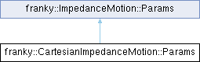

<table>
<colgroup>
<col style="width: 100%" />
</colgroup>
<tbody>
<tr class="odd">
<td>

franky 1.1.3

A High-Level Motion API for Franka

</td>
</tr>
</tbody>
</table>

Loading...

Searching...

No Matches

  - [franky](namespacefranky.md)
  - [CartesianImpedanceMotion](classfranky_1_1_cartesian_impedance_motion.md)
  - [Params](structfranky_1_1_cartesian_impedance_motion_1_1_params.md)

[Public Attributes](structfranky_1_1_cartesian_impedance_motion_1_1_params.md#pub-attribs) | [List of all members](structfranky_1_1_cartesian_impedance_motion_1_1_params-members.md)

franky::CartesianImpedanceMotion::Params Struct Reference

Parameters for the Cartesian impedance motion. [More...](structfranky_1_1_cartesian_impedance_motion_1_1_params.md#details)

`#include <cartesian_impedance_motion.hpp>`

Inheritance diagram for franky::CartesianImpedanceMotion::Params:

##  Public Attributes

[bool](namespacefranky.md#a0b6bfc825c262ae89d9b0adcccd97ab0) 

[return\_when\_finished](structfranky_1_1_cartesian_impedance_motion_1_1_params.md#a55fe8148f737b8ab7856d39cb5e1733d) {[true](namespacefranky.md#a0b6bfc825c262ae89d9b0adcccd97ab0)}

 

[double](namespacefranky.md#a0b6bfc825c262ae89d9b0adcccd97ab0) 

[finish\_wait\_factor](structfranky_1_1_cartesian_impedance_motion_1_1_params.md#acc7d37d06d998daec4c4a7c8dcfcf3cb) {1.2}

 

 Public Attributes inherited from [franky::ImpedanceMotion::Params](structfranky_1_1_impedance_motion_1_1_params.md)

[ReferenceType](namespacefranky.md#a2354a27cfe3100f07e0ad71513ded80e) 

[target\_type](structfranky_1_1_impedance_motion_1_1_params.md#a38a921916482fa544b8f6583c8f6850f) {[ReferenceType::kAbsolute](namespacefranky.md#a2354a27cfe3100f07e0ad71513ded80eabab0767e88027de9944aa55c24c8387a)}

 

[double](namespacefranky.md#a0b6bfc825c262ae89d9b0adcccd97ab0) 

[translational\_stiffness](structfranky_1_1_impedance_motion_1_1_params.md#a122b129596499ae590225f7b1fe3bfd0) {2000}

 

[double](namespacefranky.md#a0b6bfc825c262ae89d9b0adcccd97ab0) 

[rotational\_stiffness](structfranky_1_1_impedance_motion_1_1_params.md#afddc6620238e8713fe4e9c3ad507a4cc) {200}

 

Eigen::Vector\< [double](namespacefranky.md#a0b6bfc825c262ae89d9b0adcccd97ab0), 6 \> 

[force\_constraints](structfranky_1_1_impedance_motion_1_1_params.md#aa83f8133fcb021ce23b1e0bc998d4499)

 

Eigen::Vector\< [bool](namespacefranky.md#a0b6bfc825c262ae89d9b0adcccd97ab0), 6 \> 

[force\_constraints\_active](structfranky_1_1_impedance_motion_1_1_params.md#aaa14fc3684c6a91038cf13a86dd865f9) {Eigen::Vector\<[bool](namespacefranky.md#a0b6bfc825c262ae89d9b0adcccd97ab0), 6\>[::Zero](namespacefranky.md#a0b6bfc825c262ae89d9b0adcccd97ab0)()}

 

## Detailed Description

Parameters for the Cartesian impedance motion.

  - See also  
    [ImpedanceMotion::Params](structfranky_1_1_impedance_motion_1_1_params.md "Parameters for the impedance motion.")

## Member Data Documentation

## [◆ ](structfranky_1_1_cartesian_impedance_motion_1_1_params.md#acc7d37d06d998daec4c4a7c8dcfcf3cb)finish\_wait\_factor

|                                                                                                                                       |
| ------------------------------------------------------------------------------------------------------------------------------------- |
| [double](namespacefranky.md#a0b6bfc825c262ae89d9b0adcccd97ab0) franky::CartesianImpedanceMotion::Params::finish\_wait\_factor {1.2} |

How long to wait after the motion has finished. This factor gets multiplied with the duration of the motion to obtain the total motion duration. After the motion duration has expired, the motion will hold the target until the total motion duration is reached. E.g. a factor of 1.2 will hold the target for 20% longer than the motion duration.

## [◆ ](structfranky_1_1_cartesian_impedance_motion_1_1_params.md#a55fe8148f737b8ab7856d39cb5e1733d)return\_when\_finished

|                                                                                                                                                                                                  |
| ------------------------------------------------------------------------------------------------------------------------------------------------------------------------------------------------ |
| [bool](namespacefranky.md#a0b6bfc825c262ae89d9b0adcccd97ab0) franky::CartesianImpedanceMotion::Params::return\_when\_finished {[true](namespacefranky.md#a0b6bfc825c262ae89d9b0adcccd97ab0)} |

Whether to end the motion when the target is reached or keep holding the last target.

-----

The documentation for this struct was generated from the following file:

  - /home/runner/work/franky/franky/include/franky/motion/[cartesian\_impedance\_motion.hpp](cartesian__impedance__motion_8hpp_source.md)

-----

Generated by  1.9.8
