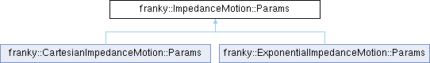

<table>
<colgroup>
<col style="width: 100%" />
</colgroup>
<tbody>
<tr class="odd">
<td>

franky 1.1.3

A High-Level Motion API for Franka

</td>
</tr>
</tbody>
</table>

Loading...

Searching...

No Matches

  - [franky](namespacefranky.md)
  - [ImpedanceMotion](classfranky_1_1_impedance_motion.md)
  - [Params](structfranky_1_1_impedance_motion_1_1_params.md)

[Public Attributes](structfranky_1_1_impedance_motion_1_1_params.md#pub-attribs) | [List of all members](structfranky_1_1_impedance_motion_1_1_params-members.md)

franky::ImpedanceMotion::Params Struct Reference

Parameters for the impedance motion. [More...](structfranky_1_1_impedance_motion_1_1_params.md#details)

`#include <impedance_motion.hpp>`

Inheritance diagram for franky::ImpedanceMotion::Params:

##  Public Attributes

[ReferenceType](namespacefranky.md#a2354a27cfe3100f07e0ad71513ded80e) 

[target\_type](structfranky_1_1_impedance_motion_1_1_params.md#a38a921916482fa544b8f6583c8f6850f) {[ReferenceType::kAbsolute](namespacefranky.md#a2354a27cfe3100f07e0ad71513ded80eabab0767e88027de9944aa55c24c8387a)}

 

[double](namespacefranky.md#a0b6bfc825c262ae89d9b0adcccd97ab0) 

[translational\_stiffness](structfranky_1_1_impedance_motion_1_1_params.md#a122b129596499ae590225f7b1fe3bfd0) {2000}

 

[double](namespacefranky.md#a0b6bfc825c262ae89d9b0adcccd97ab0) 

[rotational\_stiffness](structfranky_1_1_impedance_motion_1_1_params.md#afddc6620238e8713fe4e9c3ad507a4cc) {200}

 

Eigen::Vector\< [double](namespacefranky.md#a0b6bfc825c262ae89d9b0adcccd97ab0), 6 \> 

[force\_constraints](structfranky_1_1_impedance_motion_1_1_params.md#aa83f8133fcb021ce23b1e0bc998d4499)

 

Eigen::Vector\< [bool](namespacefranky.md#a0b6bfc825c262ae89d9b0adcccd97ab0), 6 \> 

[force\_constraints\_active](structfranky_1_1_impedance_motion_1_1_params.md#aaa14fc3684c6a91038cf13a86dd865f9) {Eigen::Vector\<[bool](namespacefranky.md#a0b6bfc825c262ae89d9b0adcccd97ab0), 6\>[::Zero](namespacefranky.md#a0b6bfc825c262ae89d9b0adcccd97ab0)()}

 

## Detailed Description

Parameters for the impedance motion.

## Member Data Documentation

## [◆ ](structfranky_1_1_impedance_motion_1_1_params.md#aa83f8133fcb021ce23b1e0bc998d4499)force\_constraints

|                                                                                                                                          |
| ---------------------------------------------------------------------------------------------------------------------------------------- |
| Eigen::Vector\<[double](namespacefranky.md#a0b6bfc825c262ae89d9b0adcccd97ab0), 6\> franky::ImpedanceMotion::Params::force\_constraints |

The force constraints in \[N, Nm\] for each joint.

## [◆ ](structfranky_1_1_impedance_motion_1_1_params.md#aaa14fc3684c6a91038cf13a86dd865f9)force\_constraints\_active

|                                                                                                                                                                                                                                                                                                       |
| ----------------------------------------------------------------------------------------------------------------------------------------------------------------------------------------------------------------------------------------------------------------------------------------------------- |
| Eigen::Vector\<[bool](namespacefranky.md#a0b6bfc825c262ae89d9b0adcccd97ab0), 6\> franky::ImpedanceMotion::Params::force\_constraints\_active {Eigen::Vector\<[bool](namespacefranky.md#a0b6bfc825c262ae89d9b0adcccd97ab0), 6\>[::Zero](namespacefranky.md#a0b6bfc825c262ae89d9b0adcccd97ab0)()} |

Allows to enable or disable individual force constraints.

## [◆ ](structfranky_1_1_impedance_motion_1_1_params.md#afddc6620238e8713fe4e9c3ad507a4cc)rotational\_stiffness

|                                                                                                                               |
| ----------------------------------------------------------------------------------------------------------------------------- |
| [double](namespacefranky.md#a0b6bfc825c262ae89d9b0adcccd97ab0) franky::ImpedanceMotion::Params::rotational\_stiffness {200} |

The rotational stiffness in \[1, 300\] Nm/rad.

## [◆ ](structfranky_1_1_impedance_motion_1_1_params.md#a38a921916482fa544b8f6583c8f6850f)target\_type

|                                                                                                                                                                                                                                             |
| ------------------------------------------------------------------------------------------------------------------------------------------------------------------------------------------------------------------------------------------- |
| [ReferenceType](namespacefranky.md#a2354a27cfe3100f07e0ad71513ded80e) franky::ImpedanceMotion::Params::target\_type {[ReferenceType::kAbsolute](namespacefranky.md#a2354a27cfe3100f07e0ad71513ded80eabab0767e88027de9944aa55c24c8387a)} |

The type of the target reference (relative or absolute).

## [◆ ](structfranky_1_1_impedance_motion_1_1_params.md#a122b129596499ae590225f7b1fe3bfd0)translational\_stiffness

|                                                                                                                                   |
| --------------------------------------------------------------------------------------------------------------------------------- |
| [double](namespacefranky.md#a0b6bfc825c262ae89d9b0adcccd97ab0) franky::ImpedanceMotion::Params::translational\_stiffness {2000} |

The translational stiffness in \[10, 3000\] N/m.

-----

The documentation for this struct was generated from the following file:

  - /home/runner/work/franky/franky/include/franky/motion/[impedance\_motion.hpp](impedance__motion_8hpp_source.md)

-----

Generated by  1.9.8
