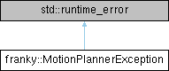

<table>
<colgroup>
<col style="width: 100%" />
</colgroup>
<tbody>
<tr class="odd">
<td>

franky 1.1.3

A High-Level Motion API for Franka

</td>
</tr>
</tbody>
</table>

Loading...

Searching...

No Matches

  - [franky](namespacefranky.md)
  - [MotionPlannerException](structfranky_1_1_motion_planner_exception.md)

franky::MotionPlannerException Struct Reference

Exception thrown if the motion planner fails. [More...](structfranky_1_1_motion_planner_exception.md#details)

`#include <waypoint_motion.hpp>`

Inheritance diagram for franky::MotionPlannerException:

## Detailed Description

Exception thrown if the motion planner fails.

-----

The documentation for this struct was generated from the following file:

  - /home/runner/work/franky/franky/include/franky/motion/[waypoint\_motion.hpp](waypoint__motion_8hpp_source.md)

-----

Generated by  1.9.8
