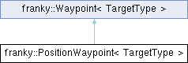

<table>
<colgroup>
<col style="width: 100%" />
</colgroup>
<tbody>
<tr class="odd">
<td>

franky 1.1.3

A High-Level Motion API for Franka

</td>
</tr>
</tbody>
</table>

Loading...

Searching...

No Matches

  - [franky](namespacefranky.md)
  - [PositionWaypoint](structfranky_1_1_position_waypoint.md)

[Public Attributes](structfranky_1_1_position_waypoint.md#pub-attribs) | [List of all members](structfranky_1_1_position_waypoint-members.md)

franky::PositionWaypoint\< TargetType \> Struct Template Reference

A position waypoint with a target and optional parameters. [More...](structfranky_1_1_position_waypoint.md#details)

`#include <position_waypoint_motion.hpp>`

Inheritance diagram for franky::PositionWaypoint\< TargetType \>:

##  Public Attributes

[ReferenceType](namespacefranky.md#a2354a27cfe3100f07e0ad71513ded80e) 

[reference\_type](structfranky_1_1_position_waypoint.md#ac5dee69cb4ee3ab71a80cd54244ad220) {[ReferenceType::kAbsolute](namespacefranky.md#a2354a27cfe3100f07e0ad71513ded80eabab0767e88027de9944aa55c24c8387a)}

 

 Public Attributes inherited from [franky::Waypoint\< TargetType \>](structfranky_1_1_waypoint.md)

[TargetType](namespacefranky.md#a0b6bfc825c262ae89d9b0adcccd97ab0) 

[target](structfranky_1_1_waypoint.md#a857fb8417fc17ff5e171494b1d398355)

 

[RelativeDynamicsFactor](classfranky_1_1_relative_dynamics_factor.md) 

[relative\_dynamics\_factor](structfranky_1_1_waypoint.md#a88afd539ed0caff485c32cf830e9e121) {1.0}

 

std::optional\< franka::Duration \> 

[minimum\_time](structfranky_1_1_waypoint.md#ae1532c5f277153a041d626ce4666d382) {std::nullopt}

 

franka::Duration 

[hold\_target\_duration](structfranky_1_1_waypoint.md#a2c1e5c63e3a7447b4699a546e49ed009) {0}

 

std::optional\< franka::Duration \> 

[max\_total\_duration](structfranky_1_1_waypoint.md#a2a1eae68a4e9d3b9c54a0ff1fd6c9bb2) {std::nullopt}

 

## Detailed Description

template\<[typename](namespacefranky.md#a0b6bfc825c262ae89d9b0adcccd97ab0) [TargetType](namespacefranky.md#a0b6bfc825c262ae89d9b0adcccd97ab0)\>  
struct franky::PositionWaypoint\< TargetType \>

A position waypoint with a target and optional parameters.

  - Template Parameters
    
    |            |                         |
    | ---------- | ----------------------- |
    | TargetType | The type of the target. |
    

<!-- end list -->

  - Parameters
    
    |                 |                                            |
    | --------------- | ------------------------------------------ |
    | reference\_type | The reference type (absolute or relative). |
    

## Member Data Documentation

## [◆ ](structfranky_1_1_position_waypoint.md#ac5dee69cb4ee3ab71a80cd54244ad220)reference\_type

template\<[typename](namespacefranky.md#a0b6bfc825c262ae89d9b0adcccd97ab0) [TargetType](namespacefranky.md#a0b6bfc825c262ae89d9b0adcccd97ab0) \>

|                                                                                                                                                                                                                                                                                                                                                              |
| ------------------------------------------------------------------------------------------------------------------------------------------------------------------------------------------------------------------------------------------------------------------------------------------------------------------------------------------------------------ |
| [ReferenceType](namespacefranky.md#a2354a27cfe3100f07e0ad71513ded80e) [franky::PositionWaypoint](structfranky_1_1_position_waypoint.md)\< [TargetType](namespacefranky.md#a0b6bfc825c262ae89d9b0adcccd97ab0) \>::reference\_type {[ReferenceType::kAbsolute](namespacefranky.md#a2354a27cfe3100f07e0ad71513ded80eabab0767e88027de9944aa55c24c8387a)} |

-----

The documentation for this struct was generated from the following file:

  - /home/runner/work/franky/franky/include/franky/motion/[position\_waypoint\_motion.hpp](position__waypoint__motion_8hpp_source.md)

-----

Generated by  1.9.8
