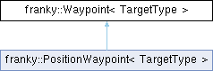

<table>
<colgroup>
<col style="width: 100%" />
</colgroup>
<tbody>
<tr class="odd">
<td>

franky 1.1.3

A High-Level Motion API for Franka

</td>
</tr>
</tbody>
</table>

Loading...

Searching...

No Matches

  - [franky](namespacefranky.md)
  - [Waypoint](structfranky_1_1_waypoint.md)

[Public Attributes](structfranky_1_1_waypoint.md#pub-attribs) | [List of all members](structfranky_1_1_waypoint-members.md)

franky::Waypoint\< TargetType \> Struct Template Reference

A waypoint with a target and optional parameters. [More...](structfranky_1_1_waypoint.md#details)

`#include <waypoint_motion.hpp>`

Inheritance diagram for franky::Waypoint\< TargetType \>:

##  Public Attributes

[TargetType](namespacefranky.md#a0b6bfc825c262ae89d9b0adcccd97ab0) 

[target](structfranky_1_1_waypoint.md#a857fb8417fc17ff5e171494b1d398355)

 

[RelativeDynamicsFactor](classfranky_1_1_relative_dynamics_factor.md) 

[relative\_dynamics\_factor](structfranky_1_1_waypoint.md#a88afd539ed0caff485c32cf830e9e121) {1.0}

 

std::optional\< franka::Duration \> 

[minimum\_time](structfranky_1_1_waypoint.md#ae1532c5f277153a041d626ce4666d382) {std::nullopt}

 

franka::Duration 

[hold\_target\_duration](structfranky_1_1_waypoint.md#a2c1e5c63e3a7447b4699a546e49ed009) {0}

 

std::optional\< franka::Duration \> 

[max\_total\_duration](structfranky_1_1_waypoint.md#a2a1eae68a4e9d3b9c54a0ff1fd6c9bb2) {std::nullopt}

 

## Detailed Description

template\<[typename](namespacefranky.md#a0b6bfc825c262ae89d9b0adcccd97ab0) [TargetType](namespacefranky.md#a0b6bfc825c262ae89d9b0adcccd97ab0)\>  
struct franky::Waypoint\< TargetType \>

A waypoint with a target and optional parameters.

  - Template Parameters
    
    |            |                         |
    | ---------- | ----------------------- |
    | TargetType | The type of the target. |
    

<!-- end list -->

  - Parameters
    
    |                            |                                                                                                                                                                                                             |
    | -------------------------- | ----------------------------------------------------------------------------------------------------------------------------------------------------------------------------------------------------------- |
    | target                     | The target of this waypoint.                                                                                                                                                                                |
    | reference\_type            | The reference type (absolute or relative).                                                                                                                                                                  |
    | relative\_dynamics\_factor | The relative dynamics factor for this waypoint. This factor will get multiplied with the robot's global dynamics factor and the motion dynamics factor to get the actual dynamics factor for this waypoint. |
    | minimum\_time              | The minimum time to get to the next waypoint.                                                                                                                                                               |
    | hold\_target\_duration     | For how long to hold the target of this waypoint after it has been reached.                                                                                                                                 |
    | max\_total\_duration       | The maximum time to try reaching this waypoint before moving on to the next waypoint. Default is infinite.                                                                                                  |
    

## Member Data Documentation

## [◆ ](structfranky_1_1_waypoint.md#a2c1e5c63e3a7447b4699a546e49ed009)hold\_target\_duration

template\<[typename](namespacefranky.md#a0b6bfc825c262ae89d9b0adcccd97ab0) [TargetType](namespacefranky.md#a0b6bfc825c262ae89d9b0adcccd97ab0) \>

|                                                                                                                                                                           |
| ------------------------------------------------------------------------------------------------------------------------------------------------------------------------- |
| franka::Duration [franky::Waypoint](structfranky_1_1_waypoint.md)\< [TargetType](namespacefranky.md#a0b6bfc825c262ae89d9b0adcccd97ab0) \>::hold\_target\_duration {0} |

## [◆ ](structfranky_1_1_waypoint.md#a2a1eae68a4e9d3b9c54a0ff1fd6c9bb2)max\_total\_duration

template\<[typename](namespacefranky.md#a0b6bfc825c262ae89d9b0adcccd97ab0) [TargetType](namespacefranky.md#a0b6bfc825c262ae89d9b0adcccd97ab0) \>

|                                                                                                                                                                                                     |
| --------------------------------------------------------------------------------------------------------------------------------------------------------------------------------------------------- |
| std::optional\<franka::Duration\> [franky::Waypoint](structfranky_1_1_waypoint.md)\< [TargetType](namespacefranky.md#a0b6bfc825c262ae89d9b0adcccd97ab0) \>::max\_total\_duration {std::nullopt} |

## [◆ ](structfranky_1_1_waypoint.md#ae1532c5f277153a041d626ce4666d382)minimum\_time

template\<[typename](namespacefranky.md#a0b6bfc825c262ae89d9b0adcccd97ab0) [TargetType](namespacefranky.md#a0b6bfc825c262ae89d9b0adcccd97ab0) \>

|                                                                                                                                                                                              |
| -------------------------------------------------------------------------------------------------------------------------------------------------------------------------------------------- |
| std::optional\<franka::Duration\> [franky::Waypoint](structfranky_1_1_waypoint.md)\< [TargetType](namespacefranky.md#a0b6bfc825c262ae89d9b0adcccd97ab0) \>::minimum\_time {std::nullopt} |

## [◆ ](structfranky_1_1_waypoint.md#a88afd539ed0caff485c32cf830e9e121)relative\_dynamics\_factor

template\<[typename](namespacefranky.md#a0b6bfc825c262ae89d9b0adcccd97ab0) [TargetType](namespacefranky.md#a0b6bfc825c262ae89d9b0adcccd97ab0) \>

|                                                                                                                                                                                                                                        |
| -------------------------------------------------------------------------------------------------------------------------------------------------------------------------------------------------------------------------------------- |
| [RelativeDynamicsFactor](classfranky_1_1_relative_dynamics_factor.md) [franky::Waypoint](structfranky_1_1_waypoint.md)\< [TargetType](namespacefranky.md#a0b6bfc825c262ae89d9b0adcccd97ab0) \>::relative\_dynamics\_factor {1.0} |

## [◆ ](structfranky_1_1_waypoint.md#a857fb8417fc17ff5e171494b1d398355)target

template\<[typename](namespacefranky.md#a0b6bfc825c262ae89d9b0adcccd97ab0) [TargetType](namespacefranky.md#a0b6bfc825c262ae89d9b0adcccd97ab0) \>

|                                                                                                                                                                                                           |
| --------------------------------------------------------------------------------------------------------------------------------------------------------------------------------------------------------- |
| [TargetType](namespacefranky.md#a0b6bfc825c262ae89d9b0adcccd97ab0) [franky::Waypoint](structfranky_1_1_waypoint.md)\< [TargetType](namespacefranky.md#a0b6bfc825c262ae89d9b0adcccd97ab0) \>::target |

-----

The documentation for this struct was generated from the following file:

  - /home/runner/work/franky/franky/include/franky/motion/[waypoint\_motion.hpp](waypoint__motion_8hpp_source.md)

-----

Generated by  1.9.8
